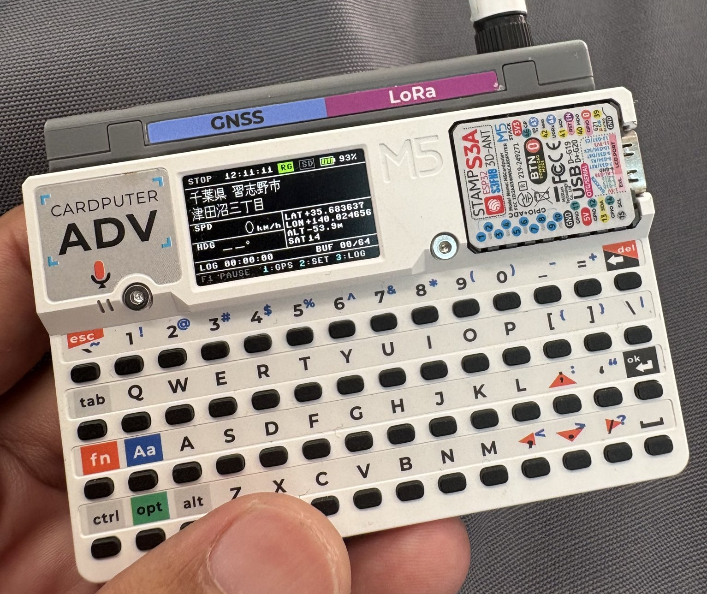

# Geoputer

[日本語](README.md)

Geoputer is an offline GPS logger that shows the name of your current location and nearby administrative boundaries. It records GPS fixes to a microSD card and lets you browse and replay logs on the device.

## Features

- Display place names and a map of administrative boundaries
- Record, browse, and replay GPS logs; export them as GPX, KML, or CSV
- Sound an alert when the current area changes
- Access files through USB storage mode or a Wi-Fi management page on a phone or PC

Place names and maps come from a Galuchat dataset on the microSD card. GPS logging also works without a selected dataset.

## Supported hardware

The current firmware targets the **M5Stack Cardputer ADV**. It uses the GNSS receiver on the **Cap LoRa-1262** for positioning and a FAT32 microSD card for logs and datasets. The cap's LoRa radio is not used. Support for an external GPS receiver is planned but is not yet available in the current firmware.

## Firmware images

Each release has two BIN files. **Use `-m5burner.bin` with M5Burner.** The `-standalone-0x10000.bin` file updates only the application at offset `0x10000` on a device that already has the matching bootloader and partition table. Uploading the standalone image to M5Burner prevents the device from booting. See `FLASHING.md` in the release for details.

## License and development

Geoputer's original material is released under the [GNU GPL version 3](LICENSE) (GPL-3.0-only). Copyright (C) 2026 nyatla. Geoputer was developed **by nyatla in collaboration with OpenAI Codex**. See the [credits](AUTHORS.md) for details. Third-party libraries, fonts, and map data retain their own licenses and attribution.

Design notes, build instructions, screen specifications, and test records are in the [developer documentation](doc/dev/README.md) (Japanese).
