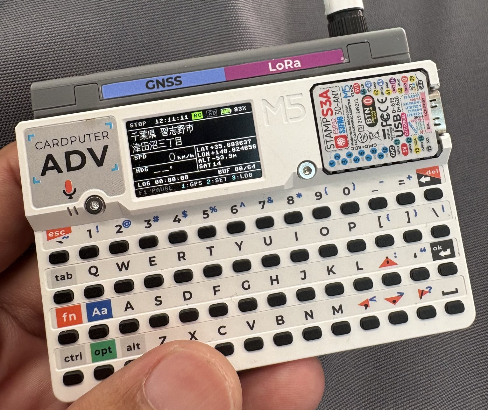

# Geoputer

[English](README.en.md)

Geoputer（ジオピューター）は、現在地の地名と区域の境界をオフラインで確認できるGPSロガーです。測位点をmicroSDカードへ記録し、端末上でログの閲覧や地図での再生ができます。

## 主な機能

- 現在地の地名と境界線地図の表示
- GPSログの記録、閲覧、再生、GPX・KML・CSVへの書き出し
- 区域が切り替わったときの通知音
- USBストレージモードと、スマートフォン・PCから使えるWi-Fi管理画面

地名と地図の表示には、microSDカードに置いたGaluchatのデータセットを使用します。GPSログはデータセットを選択しなくても記録できます。

## 対応機器

現行ファームウェアの対象は **M5Stack Cardputer ADV** です。GPSには **Cap LoRa-1262に搭載されたGNSS** を使用し、記録・データセットの保存にはFAT32のmicroSDカードを使用します。CapのLoRa無線機能は使用しません。外付けGPSは設計対象ですが、現行ファームウェアでは未対応です。

## ファームウェア

リリースには2種類のBINがあります。**M5Burnerには`-m5burner.bin`を指定**してください。`-standalone-0x10000.bin`は、起動ローダーとパーティション表が導入済みの端末へ、アプリ領域`0x10000`だけを更新するためのファイルです。M5Burnerにスタンドアロン版を指定すると起動できなくなります。詳しくはリリース内の`FLASHING.md`を参照してください。

## ライセンスと開発

Geoputerのオリジナル部分は[GNU GPLバージョン3](LICENSE)（GPL-3.0-only）で公開します。Copyright (C) 2026 nyatla。Geoputerは**nyatlaとOpenAI Codexの共同作業**で開発しました。詳細は[クレジット](AUTHORS.md)を参照してください。第三者のライブラリ・フォントとマップデータには、それぞれのライセンスと出典表示が適用されます。

設計、ビルド、画面仕様、検証記録は[開発者向けドキュメント](doc/dev/README.md)にまとめています。
