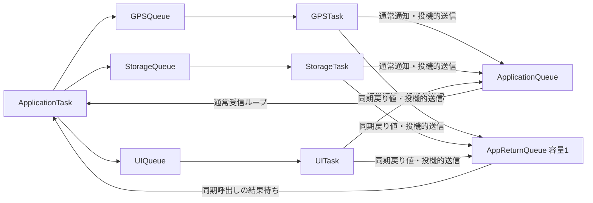

# Geoputer タスク構成設計

文書状態: Draft 0.33  
対象機: M5Stack Cardputer ADV（Mesh KitのGNSS使用 / 外付けGPS使用を選択可能）  

## 1. 文書の目的と適用範囲

本書は、Geoputerのタスク、受信キュー、メッセージ、状態と資源の所有者、待機方法、処理順序および障害時の通信を定義する。

実行構造は本書を基準とする。[システム構成設計](04_システム構成設計.md)は製品の機能、モード・状態の意味、データ形式および障害時の動作方針を定義する。タスク分割、キュー通信、実行主体、スケジューリングおよびタスク起動の連携は本書へ集約する。タスクの永久停止からの復旧・強制解除・再起動は本設計の対象外とする。

[画面・操作機能設計](画面・操作/02_画面・操作機能設計.md)に定義した操作を維持する。Live PlaceのF1は記録の一時停止、1/2/3はGPS記録・設定・ログ一覧を直接開き、GPS Loggerは開始・再開・停止、Escはキャンセル、Enterは決定、左右キーはSettingsの値編集、共通確認ダイアログの選択、ライセンス情報のソフトウェア単位ジャンプに使用する。LoRa機能は使用しない。

### 1.1 現在の実装範囲

App・GPS・Storage・UIの4タスク・5キューを実装している。StorageはNVS設定、FAT32のSD操作、Galuchat検索と矩形キャッシュに加え、GPSログの64件RAM受付・非同期SD保存・保存結果通知・失敗後の再試行に対応する。ログ追加はApp上で実行する`StorageTask::tryAppendLog`の直接受付APIとし、旧AppendLogメッセージは廃止する。

ログ一覧・概要・最大10件単位の読出し・測位点閲覧は実装済みであり、結果を固定長通知へ値コピーする。距離・最高速度の全件集計、領域ラスタ向けの結果バッファプールとその解放、GNSSの休止・復帰制御、長いGIS処理の分割は未実装であり、該当箇所は後続実装の契約として扱う。現行GPSは`StartGpsReception` / `GetGpsStatus`を使用して起動後のUART受信を継続し、記録操作だけを開始・停止する。保存の実装範囲と検証状況は[測位記録ファイル仕様11節](07_測位記録ファイル仕様.md#11-容量実装範囲検証状況)に従う。

## 2. タスクと通信経路

初期構成はApplication、GPS、Storage、UIの4タスクとする。Applicationは通常通知用と同期要求の戻り値専用の2キューを持ち、サブタスクはそれぞれ受信用の1キューを持つ。タスク間のキューは合計5つとする。

| 所有タスク | キュー | 内容 | 容量 |
|---|---|---|---|
| ApplicationTask | ApplicationQueue | GPSのサンプル・状態通知、Storageの保存・読出し結果通知、UIの内容更新通知 | 現行8メッセージ |
| ApplicationTask | AppReturnQueue | 同期要求に対する戻り値のみ | 1メッセージ |
| GPSTask | GPSQueue | 初期化・測位制御・現状取得要求 | 現行1メッセージ |
| StorageTask | StorageQueue | セッション・保存制御・検索・設定要求 | 現行1メッセージ |
| UITask | UIQueue | 画面指定・表示内容更新・操作内容取得の同期メッセージ | 現行1メッセージ |

メッセージのC++値型は用途別に分け、UI更新の最大サイズを全キューへ予約しない。共通封筒はkind・source・request_id・sequence・sent_at_msの16バイトとする。キューは同じ型の値だけをコピーし、画像や可変バッファのポインターを渡さない。

| キュー | 格納型 | ESP32での1件のサイズ |
|---|---|---:|
| ApplicationQueue | AppNotification | `sizeof(AppNotification)` |
| AppReturnQueue | ReturnMessage | `sizeof(ReturnMessage)` |
| GPSQueue | GpsRequest | 16バイト |
| StorageQueue | StorageRequest | 144バイト |
| UIQueue | UiRequest | `sizeof(UiRequest)` |

同期通信のSyncClientとTask基底は要求の型に応じたキューを使用し、全体で1件の結果待機と期限付きの再取得を維持する。サブタスクは未送信の戻り値をReturnMessageとして保持し、Storageの完了通知はAppNotificationとして保持する。キュー満杯時に処理を繰り返さず同じ結果を再投入する規則は変えない。

送信側は相手の受信キューへメッセージを入れる。送信用キューは作らない。サブタスクごと、要求ごとの戻り値キューも作らず、AppReturnQueueを共用する。

| 方向 | 使用する方式 | 宛先 |
|---|---|---|
| Application → サブタスク | タイムアウト付き同期的送信、または投機的送信 | GPSQueue / StorageQueue / UIQueue |
| サブタスク → Applicationの通常通知 | 投機的送信のみ | ApplicationQueue |
| サブタスク → Applicationの同期戻り値 | 投機的送信のみ | AppReturnQueue |

同期要求の発行元はApplicationだけとし、結果未取得の同期要求は全サブタスクを通して1件に限定する。結果取得のタイムアウト後もこの件数に含め、結果を受信するまで次の同期要求を発行しない。サブタスクは戻り値も通知も即時投入で送り、Applicationのキュー空きや処理を待たずに自分の処理へ戻る。サブタスク間の直接通信は行わない。



OS・ドライバー内部のUARTバッファやキー割り込み通知は、上記のタスク間キューとは区別する。

## 3. タスクの責務と所有者

### 3.1 ApplicationTask

ApplicationはArduinoのsetup / loopを実行するメインタスクで動作する。Application用のFreeRTOSタスクを別に起動せず、このメインタスクをApplicationTaskとして数える。

アプリケーション全体の判断と状態遷移を担当する。通知の受信、状態更新、タスク操作の要求を短時間で行う。SDアクセス、GIS検索および描画を直接実行せず、必要な処理を送信APIで要求する。同期要求ではAppReturnQueueから処理結果を期限付きで取得する。取得がタイムアウトしても1件の待機状態を保持し、同じ要求の結果取得を繰り返す。通常通知はApplicationQueueで処理する。同期要求ごとの継続処理や複数の待機状態を作らない。GIS検索は投機的送信による要求通知と結果通知で扱う。ログ閲覧は同期で要求だけを受け付け、実読出し結果を通知する。

- アプリの表示モード、表示する画面、確定した設定と業務状態を所有する。選択・ダイアログ操作・編集中の値はUIが管理する。
- ログの開始・一時停止・再開・停止、記録セッションと記録間隔を管理する。
- 確定GPSサンプルの有効性、セッション、測位時刻を確認し、記録対象を選ぶ。
- 各機能の測位要求を集約し、GNSSの目標状態をGPSへ指示する。
- GPS・Storageの同期結果・状態通知からアプリ状態を更新する。デバイスの実状態は報告された確認済み情報で判断し、操作の目標状態や受付成功だけで確定しない。
- 地名検索とラスタ取得の要求・結果の対応、キャンセル、画面遷移後の古い結果の破棄を判断する。
- GPS・Storageの通知をアプリ状態へ取り込み、表示内容をUIへ同期メッセージで渡す。
- UIの内容更新通知を受け、操作内容を同期取得して検証・適用する。

ログ状態の変更はApplicationだけが行う。Storageは保存の状態を報告し、Applicationが記録継続要求と組み合わせてSTORAGE_ERRORなどを判断する。

### 3.2 GPSTask

GNSS UART、NMEA解析、GNSSの実状態および測位サンプルを所有する。

- 選択したGPS接続プロファイルで初期化する。
- GPSQueueの同期メッセージに従ってGNSS PAUSE / ACTIVEを制御する。
- 初期化・測位状態変更・現状取得を同期メッセージとして処理し、成功または失敗の終端結果をAppReturnQueueへ返す。
- 測位サンプルと状態変化は通知としてApplicationQueueへ送る。
- 現状取得では確認できた実状態を返し、要求された目標状態を実状態として返さない。
- UARTを継続して処理し、同一測位時刻の情報を統合した確定サンプルを発行する。
- 座標、UTC日時、速度、進行方位、高度、衛星数、HDOP、各項目の有効性、受信状態などを計算し、ApplicationQueueへ送る。
- NMEA文ごとには通知せず、確定サンプルと状態変化を通知する。
- SD、UI、GISおよびアプリのログ状態には依存しない。

GPS側のLatestFixはGPSが更新する。ApplicationとUIはメッセージで受け取ったコピーを使用し、GPSの可変データを直接参照しない。GPSの同期メッセージと通知の契約は4.4節で定義する。

### 3.3 StorageTask

本体内蔵FlashのNVS設定領域、microSD上のファイル、未保存ログの64件固定長RAMバッファおよびGIS Readerを所有する。受信要求は初期化・状態取得、ログ保存、NVS設定保存、閲覧・GIS読込に分け、ログのRAM追加だけは排他付き共有リングへの直接受付APIとし、他の要求はStorageQueueで受信する。各要求の契約は4.5節で定義する。NVS用のタスクやキューを追加せず、4タスク・5キューの構成を維持する。

- App上のtryAppendLogが排他付きリングへレコードを取り込み、その場で受付結果を返す。SDへのまとめ書きは別の非同期処理として実行し、保存結果を通知する。
- 保存・flush・セッション終了の受付と実際のSD処理を分ける。読出し要求は通知として受け付け、読出し結果を通知する。
- GaluchatServiceを実行し、座標から地名・Region Code・領域ラスタを取得する。
- 保存件数、未保存件数、保存失敗、ログ欠落件数および処理結果をApplicationへ報告する。
- SD障害時も受け取ったレコードをRAM容量内で保持する。
- SettingsStoreでGeoputer用NVS名前空間`geoputer`の読込み・保存を行う。NVSとSDの利用可否を個別に管理し、SD未挿入・マウント失敗・取り外し後も設定を読み書きする。

ログの直接RAM受付、制御要求のキュー投入・同期受付、SDへの実保存を区別する。RAM受付やキュー投入成功だけを「保存成功」と表示しない。

### 3.4 UITask

画面指定と表示データを同期メッセージで受け取り、描画とユーザーインタラクションを自身のタスクループで実行する。SD・NVS・GPS・GISを直接操作しない。

- 同期メッセージで画面指定・表示内容を受け付け、保持できた結果を返す。実際の描画完了は待たせない。
- 選択移動、画面ショートカット、ダイアログ、設定編集、Escによる取消など、画面内の操作状態を所有する。
- ユーザー操作で内容が変わったらUiContentChangedを通知し、AppからのGetUiContentに内容を返す。
- 確定操作は未処理の1件だけを保持し、Appが処理を反映するまで次の確定操作で上書きしない。
- ログ開始・停止、GPS休止、設定適用などの業務判断は行わない。
- 非表示中もキーと無操作期限を監視し、復帰・消灯要求もUI内容の変更として通知する。
- 地名、Live Placeの速度・進行方位の主数値と方位の°は東雲16×16ドットとする。Settingsの主表示は日本語を東雲16×16、英語をAsciiFont8x16、タイトル・ライセンス本文・補助表示を8×8で描画する。

表示用のアプリデータはUIが受け取ったコピーであり、編集中の値や選択状態とは別に保持する。UIの同期メッセージと通知の契約は4.6節で定義する。

### 3.5 資源の所有関係

| 状態・資源 | 所有者 | 他タスクへの提供方法 |
|---|---|---|
| アプリの表示モード、画面指定、確定設定、ログ状態 | Application | SetUiScreen / UpdateUiContentの同期メッセージ |
| 画面ショートカット、選択、ダイアログ操作、編集途中の値、未処理の確定操作 | UI | UiContentChangedで通知し、GetUiContentで取得 |
| GNSS目標状態、測位要求元、セッション、検索要求 | Application | GPS・Storageへの同期メッセージ、Storageへの読出し要求通知 |
| GNSS実状態、UART、NMEA解析、LatestFix | GPS | 同期結果とサンプル・状態通知 |
| SD、NVS設定領域、GIS Reader、結果バッファプール | Storage | 同期結果と保存・読出し・状態通知。大きな結果だけ読取専用の参照を渡す |
| 64件のログRAMリング・受付状態 | StorageのLogWriter | Appは直接受付APIで追加し、Storageだけが保存対象を参照・解放する。すべての管理状態を短い排他区間で保護 |
| LCD、バックライト、キー入力、描画キャッシュ | UI | 画面指定・表示内容を保持した後、UIタスク内で非同期に更新 |
| 固定ピンとデバイス初期化手順 | Boardモジュール | 各所有タスクが呼び出す。Board自体は独立タスクにしない |

共有I2Cの排他はBoard層で提供する。タスク間で可変な設定・Fix・Reader・ファイルを直接共有しない。ログRAMリングだけは専用APIと排他規則を持つ共有領域とし、配列や可変状態の参照をAppへ公開しない。

## 4. メッセージ契約

### 4.1 共通情報

キューを使うタスク操作は同期メッセージと通知の2種類に分け、各メッセージの区分・完了点・結果の宛先を4.4〜4.6節で固定する。同じ操作の返却方式を呼出し時のフラグで切り替えない。同期メッセージの終端結果はAppReturnQueueへ、サブタスクからの通常通知はApplicationQueueへ送る。ログのRAM追加は通常の関数の戻り値で受付成否を返す例外とする。Storageの保存操作では直接受付結果または同期メッセージの受付結果と、非同期の実保存結果を返すため、この2つを代替の受信経路として扱わない。

メッセージには種別、送信元、単調増加時刻、送信元ごとの連番を含める。同期要求・同期結果と、結果通知を伴う要求にはrequest_idを付ける。要求単位で返す読出し・設定・媒体操作の通知には元のrequest_idを含める。現行のログ保存通知は複数の追加要求をまとめた保存状態であり、元のrequest_idを引き継がず、LogSnapshot自身のrevision・session_id・保存済み末尾sample_seqで識別する。検索関連には画面・検索世代を付ける。

受信時刻だけで複数送信元の実行順序を推測しない。別タスクからの通知は前後し得るため、処理完了の判定は対応するrequest_idと現在の操作状態で行う。同期結果取得のタイムアウトは要求を終了させず、同じ要求IDの結果を引き続き取得する。通知で要求した読出しの遅延結果は要求IDと表示・検索世代で識別し、後続の要求へ誤適用しない。古い検索世代の結果で表示を上書きしない。

キュー内では固定長メッセージを値としてコピーする。文字列は長さ制限を定義し、スタック上の一時変数へのポインターを送らない。

### 4.2 Applicationの受信内容

ApplicationQueueはサブタスクからの通知と読出し結果を受信する。AppReturnQueueは同期メッセージに対するSyncReturnだけを受信する。GPSは4.4節、Storageは4.5節、UIは4.6節で、それぞれ同期メッセージと通知を定義する。

結果未取得の同期要求がないIDLEではApplicationQueueの受信を待ち、各タスクの状態を常時ポーリングしない。App自身の期限処理がある場合は次の期限までを受信待機時間とする。WAITING_RESULTではreceiveSyncResultによる結果取得を繰り返し、その呼出しの間に通常通知を処理する。

SyncReturnには送信元タスク、request_id、メッセージ種別、処理成功・失敗と固定長の結果データを含める。通信層の投入エラーと業務処理の失敗を区別する。同期結果の取得に通常通知を代用しない。

### 4.3 大きな結果の所有と解放

本節は未実装の領域ラスタ向けの契約であり、現在のログ閲覧には適用しない。最大10件・320バイトの測位レコードはReadCompletedへ値コピーし、Appが保持するためReleaseResultを必要としない。

領域ラスタなどの大きな結果はStorageの固定長バッファプールに保持し、IDと世代をメッセージで渡す。書込中はStorageだけが所有し、受渡し後は読取専用とする。

AppはUpdateUiContentで結果をUIへ渡す。UIはタスク内の安全な区切りで旧表示の参照を止め、新しいデータを保持する。SetUiScreen / UpdateUiContentの同期結果には、UIが参照を終えたバッファID・世代を含める。Appはその結果取得後にStorageへReleaseResultを通知する。UIから解放要求を別の操作イベントとして送らない。

UIへ渡る前に不要となった結果、画面遷移後に届いた結果はAppが解放する。プールの確保・解放はStorageだけが実行し、読取参照中のバッファへ上書きしない。同期結果の取得タイムアウト時も同じ結果を取得し、解放情報を取り落とさない。

### 4.4 GPSのタスク操作

GPSのタスク操作は同期メッセージと通知の2種類に分ける。初期化・制御・現状取得はすべて同期メッセージとしてApplicationからGPSQueueへ送り、終端結果はAppReturnQueueへ返す。サンプル・状態変化の通知はGPSからApplicationQueueへ送る。

座標受信の先行実装では、Mesh Kitの固定接続でUART準備を行うStartGpsReceptionを同期要求として使用する。成功は受信準備の完了を表し、Fix取得やGNSSの休止確認を待たない。GetGpsStatusは、この段階では受信状態と座標のスナップショットを返す。GNSS実状態は確認せず、InitializeGpsのPAUSE確認やSetGnssStateの制御の代用にはしない。Appは起動直後から座標表示のために受信し、設定編集・Storage・ログ機能の導入まで記録へ採用しない。

#### 同期メッセージ

| メッセージ | 入力 | 終端結果 |
|---|---|---|
| StartGpsReception（座標受信の先行段階） | なし。Mesh Kitの標準UART接続を固定使用 | UART受信準備の成功・失敗、受信状態と座標 |
| InitializeGps | GPS接続プロファイル | 初期化の成功・失敗、初期化状況、適用したプロファイル、確認済みGNSS状態 |
| SetGnssState | 目標状態ACTIVE / PAUSE | 変更の成功・失敗、目標状態、確認済み実状態と確認可否 |
| GetGpsStatus | なし | 初期化状況、適用プロファイル、GNSS実状態と確認可否、UART受信状態、Fix有効性、直近エラー |

全メッセージに共通のrequest_idを付ける。終端結果はSyncReturnの送信元GPS、元の要求ID、メッセージ種別、処理結果と固定長の結果データとして返す。AppはsendSyncで投入してWAITING_RESULTへ移行し、receiveSyncResultで取得する。タイムアウト後も同じ要求の結果取得を繰り返す。

**InitializeGps**は選択した接続プロファイルでUARTとGNSSを初期化し、PAUSEで開始する。成功結果は初期化とPAUSEへの移行を確認した時点で返す。プロファイル不正、UART初期化失敗、GNSS制御失敗などは失敗結果として返し、結果を返さずに処理を終了しない。GPSログの開始・停止は行わない。

**SetGnssState**はGNSSの測位開始・休止を実行する。ACTIVEの成功は測位動作へ移行した時点で確定し、有効Fixの取得まで待たない。PAUSEの成功は実際の測位休止を確認した時点で確定する。すでに確認済みの同じ状態なら追加の変更を行わず成功結果を返す。未初期化や変更失敗は失敗結果とし、実状態が不明なら確認不能と明記する。

**GetGpsStatus**は読取専用とし、初期化、設定変更、測位開始・休止を実行しない。初期化前でも、その時点の初期化状況と確認できる情報を返す。要求された目標値や最後に送った制御値を、確認済みの実状態として返さない。観測不能な項目は不明として扱う。

GPSはAppの結果取得タイムアウトを理由に、処理や終端結果を放棄しない。処理失敗も必ず終端結果として返す。結果の送信は投機的送信で行い、投入失敗なら同じ結果を保持して再投入する。投入成功後に同じ終端結果を再送しない。

#### 通知

| 通知 | 発生条件 | 内容 |
|---|---|---|
| GpsSampleReady | 同一測位時刻のNMEA情報を統合したサンプルが確定したとき | GPSFix、sample_seq、測位・受信状態 |
| GpsStatusChanged | 初期化状況、GNSS状態、UART受信状態、Fix有効性またはエラー状態が変わったとき | 現在の状態、確認可否、直近エラー、状態更新時刻・世代 |

通知はApplicationQueueへ投機的送信する。結果取得を要求せず、Appからの返信を待たない。GpsSampleReadyはNMEA文ごとではなく確定サンプルごとに発行する。位置が無効な場合はGPSFixの有効フラグを使い、ゼロ座標を有効位置として扱わない。

GpsStatusChangedは自発的な状態変化の通知であり、同期メッセージの完了確認には使用しない。同期処理の完了は必ずAppReturnQueueから取得する。同期メッセージに伴う実状態の変化を通知することは可能だが、それで同期結果の返却を省略しない。

同期結果とGpsStatusChangedには共通の状態更新世代status_revisionと状態確認時刻を含める。GPSが状態を更新したときに世代を進め、Appは同期結果より古い通知で新しい実状態を上書きしない。GPSFixは測位時刻とsample_seqで識別し、状態通知の世代と混同しない。

通知の投入失敗はGPS側で検出する。未送信サンプルを固定容量内で保持し、容量を超えた場合は欠落数を計数する。通常の状態通知と同期の終端結果は別に保持し、通知の統合・省略によって終端結果を消去しない。

#### Applicationの操作との対応

| App側の操作 | GPSへの操作 |
|---|---|
| 起動時のGPS準備 | InitializeGpsの送信と結果取得 |
| ログ開始、現在位置を必要とする画面の表示 | 必要ならSetGnssState(ACTIVE)の送信と結果取得。その後に測位通知を受信 |
| ログ一時停止 | GPSに休止要求を送らず、ACTIVEを維持。Appで記録への採用だけを止める |
| ログ停止かつ測位要求なし | SetGnssState(PAUSE)の送信と結果取得 |
| 初期化・制御結果の取得タイムアウト | 同じ要求のreceiveSyncResultを再実行。新しい同期メッセージを送らない |
| 終端結果取得後に実状態を確認する必要がある | GetGpsStatusの送信と結果取得 |

結果未取得の要求がある間は、GetGpsStatusも含めて次の同期メッセージを送れない。通常通知は別キューで受け付け、結果取得呼出しから戻った後にAppが処理できる。

### 4.5 Storageのタスク操作

Storageの制御操作は同期メッセージと通知に分け、ログのRAM追加だけはApp上で実行する直接受付APIとする。一時停止・停止に関する同期操作は処理要求の受付までを完了点とし、実際のSD保存とNVS設定保存はStorageTaskが非同期に実行する。NVS設定・GISの読出しは要求と結果を通知で扱う。ログ一覧・概要・測位レコード読出しは同期メッセージで要求を保持した成否を返し、実読出しと結果通知を非同期に実行する。概要はヘッダーと端点2件から取得し、全件の距離・最高速度は集計しない。

同期要求と読出し要求通知はStorageQueueへ、同期結果はAppReturnQueueへ、保存・読出しの結果通知はApplicationQueueへ送る。Appは通常の通知処理とreceiveSyncResultを使い分け、読出し要求ごとの専用キュー・受信ループを作らない。

SDのVFS同時オープン枠は`Config.h`の`SdMaxOpenFiles = 3`とする。地図Readerの初期化は2本を同時に開く。ログの読書きは専用FILでFatFsへ直接アクセスし、VFSの枠とは別に管理する。

現在はInitializeStorage / GetStorageStatus / SaveSettings / OperateStorageに加え、OpenLogSession / FlushLog / CloseLogSessionを実装している。LoadSettings、CheckDataset、SearchPlaceは通知として要求・結果を扱う。GPS受信と記録中のログ採用は設定・SD操作画面・画面消灯中も継続する。ログセッションまたは未保存データを保持する間はSDの再マウント・取り外し・フォーマットを拒否する。データセットはDatasetOperationで番号01〜99と地名用Wordbookの言語を選択できる。GPS接続モードのみMesh Kit固定の読取専用項目とする。

SearchPlaceはNVSから復元した番号と言語に対応するGLC・Wordbookを検索する。ファイル指定と検証は[データセットメタデータ仕様](08_データセットメタデータ仕様.md)に従う。地図・辞書のReader操作とWordbookのUTF-8検証・整形はStorageだけが実行し、再マウント・取り外し・フォーマットの前にReaderを解放する。Wordbookを含む文字列はUTF-8だけを受け付け、文字コード変換は実行しない。

#### ログの直接受付APIと共有リング

`StorageTask::tryAppendLog(const LogCommand&, LogSnapshot&)`はAppタスク上で実行し、LogErrorと一貫した状態の値コピーを返す。StorageQueue・AppReturnQueueを使わず、別の同期要求の結果待ち中に通常通知を処理する場合も実行できる。SD処理・保存通知の返送を待たない。実機ではportMUXによる短いクリティカル区間、ホストではmutexを使用する。CRC計算・数値変換は排他区間の外で行い、区間内は状態・添字・32バイトコピーだけとする。

共有領域は`records[64][32]`と`sample_seqs[64]`の計2,304バイトと管理情報からなる。既存の64件分を置き換え、追加のレコード退避配列・二重バッファ・全件スタックコピーは作らない。32バイトの符号化用ローカル領域と従来の512バイトヘッダー領域は使用する。このリングは既存バッファの実装であり、タスク用のメッセージキューは5つを維持する。

Storageは先頭位置・保存対象件数を排他区間で固定し、ロックを解放して最大2つの連続区間を順にwriteし、f_syncする。保存中も空き領域への追加を認めるが、保存対象も未保存の64件へ含めて再利用しない。成功後は今回の対象だけを解放し、後から追加された点とその先頭受付時刻を残す。失敗時は対象件数・内容・元の保存位置を保持し、追加された後続点を同じ再試行へ勝手に混ぜない。保存中に新しいflush・終了要求を受けた場合も、それを旧バッチの成功で取り消さない。

検証結果は[ログ共有リング検証](検証/ログ共有リング検証.md)を参照する。LogSnapshotの参照を公開せず、受付・保存・制御の更新ごとに進むrevision付きの値コピーを返す。セッションの切替でもrevisionをリセットしない。Appは同revisionで新旧を判定し、旧Storage通知による件数・エラーの巻戻りを防ぐ。

#### 同期メッセージ

| メッセージ | 入力 | 同期操作の完了点・結果 |
|---|---|---|
| DatasetOperation | request_id、token、操作、番号、言語・変更方向 | 一覧・詳細・言語候補・適用要求を保持した成否を返す。SD読出し・検証・NVS保存は受付後に処理する |
| InitializeStorage | request_id | NVS設定領域の準備とSDマウントの結果を状態として個別に返す。GISデータ確認は後続のCheckDatasetで行う |
| GetStorageStatus | request_id | 保存状態のコピーを返す。ファイル読出しや設定変更は行わない |
| OpenLogSession | request_id、session_id、created_utc_ms | セッションIDの重複を検査し、RAM内の受付セッションを準備した成功・失敗を返す。物理ファイルは実保存時に作る |
| FlushLog | request_id、session_id、記録境界のsample_seq | 境界までの保存要求を受け付けた成功・失敗を返す。SD保存完了は待たない |
| CloseLogSession | request_id、session_id、記録境界のsample_seq | 新規追加の終了と残データの保存・終了要求を受け付けた成功・失敗を返す |
| SaveSettings | request_id、確定した設定のコピー | 設定のコピーとNVS保存要求を保持した受付成功・失敗を返す |
| OperateStorage | request_id、operation_id、操作種別、フォーマットの確認済みフラグ | 再マウント・安全な取り外し・FAT32フォーマットの要求を保持した受付成功・失敗を返す。SD実処理は待たない |

全メッセージの結果はSyncReturnとして返し、AppはreceiveSyncResultで必ず取得する。取得がタイムアウトしても同じ結果を待ち、要求を二重実行しない。

tryAppendLogの受付成功後はLogWriterがデータを保持し、Storageが保存する責任を持つ。受付失敗時はAppが元データを保持し、未受付と判断する。RAM容量不足、不正セッション、無効レコードなどを受付失敗として区別する。同一セッションの直前に受け付けたsample_seqの再要求は成功として二重追加せず、それより古い番号は不正要求として拒否する。

未保存ログのRAM容量はStorage全体で64件とし、終了済みセッションの未保存分も同じ上限に含める。32バイトの保存レコード本体は2048バイトとなり、session_id・sample_seq・保存進捗などの管理情報は別に必要となる。64件を受け付けた時点で、定期保存間隔を待たずに保存処理を起動し、65件目を保持するために未保存レコードを上書きしない。RAMへの取込み結果は実保存を待たず返す。

満杯のまま次のtryAppendLogを実行する場合はRAM容量不足の失敗結果を返し、そのレコードを受け付けない。Appが未受付レコードを保持し、空きができてから再要求する。保存成功を確認するまで64件の保持枠を解放せず、部分書込みやflush失敗でも未保存内容を維持する。再要求の受付失敗だけでは欠落件数を増やさず、App側でも保持できず実際に失った測位サンプルを欠落として数える。満杯を理由にRAMや同期結果用のキューを拡張しない。

FlushLog / CloseLogSessionを送る前に、Appは記録境界までのtryAppendLogの成功を確認する。Storageは受け付けた境界までを保存対象として保持する。同期受付の成功と、保存の成功を混同しない。

CloseLogSessionの受付時点で対象セッションの新規追加を終了し、open=false・closing=trueとする。ファイル保存と物理的なクローズは後で行い、成功はLogWritten、失敗はStorageErrorのLog種別で状態を通知する。成功時にopen=false・closing=falseであれば物理的な終了まで完了している。保存済みでもcloseが失敗した場合は保存件数を維持してclosing=trueとし、終了処理を再試行する。終了処理または未保存データが残る間は次のOpenLogSessionを拒否する。PAUSEDからの再開は既存セッションを継続する。

保存失敗後は5秒間隔で同じ未確定位置へ再試行する。Appは未受付点を1件保持し、1秒間隔でtryAppendLogを再実行する。未受付点を保持できている間は欠落として数えず、新たな記録対象点を保持できなかった場合だけ欠落件数を増やす。一時停止・停止は新規採用を止め、保持中の点が受付済みになるまでWAITとする。

保存先の命名、512バイトヘッダー、32バイト測位レコード、CRCと破損検出は[測位記録ファイル仕様](07_測位記録ファイル仕様.md)に従う。1セッションを1ファイルとし、日付変更では切り替えない。保存先の日時は最初の記録対象点から確定し、それまでは物理ファイルを作らない。日時付きの名前は`YYYYMMDD_HHMMSS_n.gps.dat`とし、同名ならnを増やして既存ファイルを上書きしない。session_idはファイル名とは独立した非ゼロの64bit値とし、既存ログのヘッダーと重複したIDで新規セッションを受け付けない。Storageは受付したsample_seqとファイル内レコード番号の対応を保持するが、sample_seqやrequest_id自体はファイルへ保存しない。書込み再試行では未確定範囲の同じオフセットへ同じ内容を書き、重複追記を防ぐ。

SaveSettingsは編集途中の値を参照せず、要求に含まれる設定のコピーを保存まで保持する。保存先はGeoputer用NVS名前空間`geoputer`とし、SettingsStoreがArduinoのPreferencesで書き込む。受付成功後のNVSへの永続化完了はSettingsWrittenで通知する。未保存の設定を次の変更で上書きして消失させず、保持容量がなければ受付を失敗させる。SDの利用可否を設定保存の受付条件にしない。

表示言語はSettingsの値コピーに含め、UIの確定操作をAppが取得・検証した後にSaveSettingsで保存する。Appの即時適用・NVS保存要求の受付・永続化完了を区別する。言語は日本語 / Englishで、旧NVS形式は言語を日本語として読み込む。翻訳はUI側のSettingsTextで行い、Storageは言語によって保存処理や通知種別を変更しない。

設定初期化は、データセットの組が変わらない場合はAppが初期値の設定コピーをSaveSettingsへ渡す。番号やWordbook言語の初期化が必要な場合はDatasetOperationの適用として検証・保存し、組が変わる場合だけ再起動する。Geoputerの設定だけを初期値に戻し、NVS全体、他ライブラリの名前空間、SDカードのデータを消去しない。

OperateStorageは処理中のSD操作、保持中のログセッション・未保存データがある場合に次の媒体操作を受け付けず、FAT32フォーマットはUIで確認した操作をAppが検証した場合だけ受け付ける。受付後はStorageが実処理を行い、StorageOperationCompletedまたはStorageErrorで元の要求ID・operation_idと結果を通知する。完了通知をキューへ投入できない場合は同じ結果を保持して再投入し、同じ操作を再実行しない。媒体操作前にはGISのReaderとキャッシュを解放する。

初期化ではGISデータをRAMへ全展開しない。GISデータがなくてもログ保存が可能なら、ログとGISの利用可否を別に返す。再初期化時に未保存データを無条件に破棄しない。

NVSとSDはそれぞれの準備結果を保持する。SDマウント失敗でもNVSが利用可能ならLoadSettings / SaveSettingsを処理し、NVS準備失敗でもSDのログ・GIS利用可否を個別に判断する。失敗を理由にNVS全体を自動消去したり、SDを自動フォーマットしたりしない。SDの再マウント・取り外し・明示的なFAT32フォーマットはNVS設定領域を変更しない。

#### 同期メッセージ：ログ閲覧・削除の要求受付

ListLogs / ReadLogSummary / ReadLogRecords / DeleteLogはStorageQueueへの同期メッセージとして要求を保持し、受付成功・失敗をAppReturnQueueへ返す。同期受付はSDの実読出しを待たず、結果はReadCompleted / ReadFailed（read_kind=LogBrowse）でApplicationQueueへ通知する。Storageが別のSD処理中なら要求の取出し・同期受付は遅れ得るが、その間もApp上のtryAppendLogは空き枠へ追加できる。

| 要求 | 入力 | 非同期の実処理 |
|---|---|---|
| ListLogs | request_id、token、表示世代、方向、基準ファイル名 | 最大6件のファイル名一覧を取得する |
| ReadLogSummary | request_id、token、対象ファイル名、表示世代 | セッションID・サイズ・スロット数・端点の日時・末尾断片を取得する |
| ReadLogRecords | request_id、token、対象ファイル名、session_id、表示世代、開始番号、要求件数（1〜10）、保存済み上限 | 指定位置から最大10件の測位レコードを読む |
| DeleteLog | request_id、token、表示世代、対象ファイル名、confirmed=true | 記録中・保存待ちの保持対象を保護し、確認済みの通常ログファイルを削除する |

DeleteLogは既存のログ閲覧用要求・結果の枠を使用する。LogReadKind::Deleteとして保持し、実処理後にread_kind=LogBrowseのReadCompleted / ReadFailedで対象名、token、表示世代、成否を返す。未確認の要求、パスとして不正な名前、通常ファイル以外、LogWriterの保持対象、ファイル消失、SDの削除失敗を区別する。実際のstat・unlinkだけをSDアクセスとして通知する。ログの記録受付は継続し、保持中の別ファイルの削除には閲覧用の保存済み境界までのflushを要求しない。SD操作そのものはStorageタスクが直列化する。

削除の確定後はUIが画面移動・自動消灯を抑止し、完了結果を待つ。CancelLogReadで確認済み削除を取り消さない。削除成功後のListLogsはFromAnchorで旧ページ先頭を含む側から最大6件を取得する。元の先頭が削除されていても次の対象から再開し、空の末尾ページではNewerで直前のページを取得する。削除成功と一覧再取得の失敗は別の結果として扱い、削除操作を再送しない。

#### データセット一覧・詳細・適用

DatasetOperationの同期結果は要求を保持した成否までとし、実処理はStorageが非同期に行う。ReadCompleted / ReadFailedのStorageReadKind::DatasetBrowserでDatasetViewを値コピーして返し、tokenをrevisionへ格納する。Appは待機中tokenと照合し、表示用のrevisionへ変換してUIへ渡す。読込み中の戻る・言語取消等による次の読出しは既存StorageQueueの1件枠へ投入し、新しいtokenで待つ。先行する古い結果は表示へ適用しない。専用キューやSDファイルへの参照は追加しない。

一覧は4件ずつ取得する。詳細・言語候補は使用中Readerを変更せず、候補用Readerを一時的に確保して検証し、解像度・外接矩形・チャンク数を返す。候補用Readerはタスクスタックへ置かず、検証終了時に解放する。INIと検証用ファイルのSD I/Oは既存のStorageObserverで通知する。

適用前にAppがSTOPPED、未保存データなし、保留中の採用点・ログ制御なしを確認する。Storageも保持中セッションがあれば拒否する。適用中はログの開始・再開を禁止する。Storageは検証後に番号と言語を含むNVSレコードを一括保存し、保存成功と再起動の要否を結果へ付ける。Appは同期結果の回収を終えた通常ループでのみ再起動する。検証・保存失敗では旧選択を維持し、同じ番号・言語への適用では不要な再起動を行わない。

#### 通知：AppからStorageへの要求

以下はsendSpeculativeでStorageQueueへ投入する。Queuedは要求の投入成功だけを意味し、読出し完了を意味しない。未投入の場合は結果通知を待たず、Appが再送または受付エラーを判断する。

現在の実装はLoadSettings / CheckDataset / SearchPlace / CancelLogReadとする。ReadRegionRaster / CancelRequest / ReleaseResultは領域ラスタ向けの後続契約であり、現行MessageKindには追加していない。

| 通知・要求 | 入力 | 処理 |
|---|---|---|
| LoadSettings | request_id | NVSから保存済み設定を読む |
| CheckDataset | request_id | 保存された番号と言語のINI・ファイル指定、Reader、ヘッダー・辞書形式・文字コードを確認する。GPS Fixを要求しない。全チャンクの索引確保・Origin列と地図本文の走査より前にチャンク数を確認し、1500を超える場合は実数と上限を伴う利用不可を返す |
| SearchPlace | request_id、検索世代、Fixスナップショット | Region Codeと地名階層を取得する |
| CancelLogRead | 取消対象のtoken | 受付済みのログ閲覧を区切りで中断する。保存・flush・記録追加は取り消さない |
| ReadRegionRaster | request_id、検索世代、Fixスナップショット、範囲・縮尺・寸法 | 指定範囲の領域ラスタを取得する |
| CancelRequest | 取消対象のrequest_id・世代 | 閲覧・検索要求を安全な区切りで中断する |
| ReleaseResult | 結果バッファID・世代 | 読取参照を終えた結果バッファを解放する |

LoadSettingsはGeoputer用NVS名前空間の設定を読み、形式バージョンと値域を検証する。設定なし・不正・読込障害を結果として区別し、Appが初期値適用を判断する。SD未挿入でも処理する。GetStorageStatusのRAM内状態取得、LoadSettingsのNVS読出し、ログ・GISのSD読出しを区別する。

読出し要求後、Appは読込中の画面を表示して通常のイベント処理へ戻る。結果が届いた時点で、その要求IDと表示・検索世代を照合し、現在の画面に対応するデータだけを反映する。画面遷移後の古い結果は表示せず、値コピーの結果は破棄する。将来のラスタ結果に参照バッファが付随する場合は解放する。

ファイル読出し先行版のSearchPlaceは、要求ID、画面世代、サンプル番号、Fixの値コピーを入力とする。Appは未完了の検索を1件だけ保持し、通常更新は新しいGPSサンプルに対して最短5秒間隔とする。画面遷移やFix喪失後も受付済み要求の結果を回収し、古い結果を表示へ適用しない。Settings表示中と画面消灯中は新しい検索を開始しない。

RG表示の正本はStorageが保持する矩形キャッシュの状態とし、RgCacheStateChangedで通知する。SD表示の正本はStorageの全SD実アクセスとし、SdAccessChangedで通知する。検索要求の投入やキャッシュヒットだけでアクセス通知を発行しない。キャッシュ状態とSD実アクセスの通知は、地名検索結果の完了通知とは独立して扱う。

Storageは結果をReadCompleted / ReadFailedで返す。固定長のStorageCompletionには読出し種別（Settings / Dataset / Place / LogBrowse）を持たせ、地名結果には検索時のFix、区域コード、書式展開済みの表示用UTF-8の2行と検索状態を値としてコピーする。StorageがWordbook言語に対応するdisplay_line1 / display_line2を展開し、Appは完成した2行を再結合せずUIへ渡す。未取得の下位住所を補わず、表示行をUTF-8境界で省略する。区域なしは正常に検索を終えた未該当結果とし、データの読込失敗と区別する。結果が通知キューへ投入されるまで同じ結果を保持し、次の要求を受信しない。先行版の地名結果は固定長メッセージ内に収まり、大きな結果のバッファプールは使用しない。

区域コードの点検索はStorage内のPlaceLookupがCachedMapReaderを通して実行する。キャッシュの形状・値域・再構成範囲は[システム構成設計](04_システム構成設計.md)の6.1節に従う。画像とその有効状態はStorageだけが所有し、App・UIへ画像ポインターを渡さない。SDKの矩形読出しで同じバッファを書き換える間は無効とし、成功後にだけ公開する。画面遷移後も同じReaderなら再利用でき、SD操作前のReader閉鎖で解放する。CheckDatasetではReader準備までを行い、64KiB画像は最初のSearchPlaceで確保する。地図Readerはチャンク索引を保持し、矩形取得では交差するチャンクだけを開く。上限超過またはメモリ不足は利用不可として保持し、GPS更新による再検索で再読出しせず、明示的なReader閉鎖・SD再マウント後に再確認する。従来の逐次探索へ切り替えない。結果にはDatasetInfoの状態・チャンク数・上限を値コピーし、Appは検索可否へ反映してUIへ渡す。UIは起動チェック後に警告を表示し、Esc / Del / Enterで閉じるまで保持する。

PlaceLookupはWordBookCacheも所有し、区域コードから書式展開済みのUTF-8地名2行を得る処理を16件固定のLRUで包む。保持内容と有効期間は[システム構成設計6.2節](04_システム構成設計.md#62-wordbookの地名キャッシュ)に従う。地名キャッシュのヒットはRAM内で処理し、ミス時だけSDKの辞書読出し・UTF-8検証・整形を行う。結果の要求・Fixは毎回今回の要求から設定し、App・UIへ渡す値コピーの形式とキュー数は変更しない。キャッシュ内の可変バッファや利用順を他タスクへ共有しない。

記録中ログの概要は先行分の保存後に保存済み範囲を固定し、その範囲を結果に含める。Appは同じ上限を測位レコード要求へ指定し、詳細の再読込まで更新しない。未保存RAMレコードを含めず、開いているファイルはLogWriterと同じハンドルで読む。ファイル内の現在位置は各SD操作の開始時に明示する。CancelLogReadは読出しだけを中断する。

Appの未完了読出しは1件とし、同期通信のrequest_idとは別のtokenと画面世代を要求へ付ける。結果が同期受付結果より先に届いても照合できるよう送信前にtokenを保持する。画面遷移時は取消通知を再試行し、元の結果を回収するまで次の要求を送らない。取消が間に合わない結果も、token・画面世代と遷移状態で排除する。取消要求自体は同期結果を持たず、元要求のReadFailed（Cancelled）または既に完成した結果を回収する。

ReadLogRecordsは1要求につき1回のReadCompletedで最大10件を返す。結果にはrequest_id、token、表示世代、対象ログ・session_id、開始レコード番号、実件数、保存済み上限、EOFを含め、次の番号は開始番号＋実件数から求める。先行する保存を完了した後の概要取得時に保存済み上限を固定し、継続要求には同じ上限を指定する。末尾の残件数が10件未満なら残件数だけ返し、開始位置が保存済み上限と一致した場合は0件・EOFとする。上限より後ろの指定、1〜10以外の要求件数、CRC不一致などはReadFailedとし、破損レコードを詰めて番号を変えない。

レコード本体は保存形式の32バイト×最大10件、最大320バイトを固定長通知へ値コピーする。Appは1バッチを保持し、UIには現在表示する1点のGpsFixだけを渡す。プール・バッファID・ReleaseResultは使用しない。自動的な連続送信は行わず、次のバッチはAppが要求する。通知投入後の結果は受信側が所有し、Appの表示キャッシュ保持中もStorageはSD保存を実行できる。一覧も最大6件・各48バイトの名前を値コピーする。

#### SD読出しと書込みの排他

App上のRAM追加はSD読出し・書込み中も空き枠があれば実行できる。Storageが定期保存・満杯時保存を含めたSD操作を直列化する。ログ読出し要求に先行する受付済みの未保存レコードは先に書込み・flushし、保存成功を確認してから読出しを開始する。保存に失敗した場合は未保存データを保持し、ログ読出しもReadFailedで返す。

書込みとflushの実行中はログ・GISの読出しを開始せず、読出しの実行中は書込みを開始しない。最大10件の測位点読出し、またはディレクトリ10項目の走査が終わった区切りで、待機中の保存・制御要求を優先する。SDを操作する実行主体はStorageTaskだけとし、この排他のために別タスク・別キュー・他タスクと共有するファイルロックを追加しない。

#### 通知：StorageからAppへの結果

| 通知 | 発生条件 | 内容 |
|---|---|---|
| LogWritten | 定期書込、受付済みflushまたはセッション終了が成功 | read_kind=Log、StorageSnapshot（revision、session_id、accepted / saved、末尾sample_seq、buffered、open / closing、error、last_saved_ms） |
| SettingsWritten | 受付済み設定のNVS永続化が完了 | 元のrequest_id、保存結果 |
| StorageOperationCompleted | 受付済みの再マウント・取り外し・FAT32フォーマットが完了 | 元のrequest_id、operation_id、操作種別、NVS・SDの状態スナップショット |
| RgCacheStateChanged | 矩形キャッシュの準備状態が変化 | cache_revision、dataset_generation、状態（Unprepared / Rebuilding / Ready） |
| SdAccessChanged | ログ・GIS・媒体操作を含むSD実アクセスの開始／終了 | revision、access_id、active。現在は処理種別や要求・セッションIDを付与しない |
| ReadCompleted | 設定・ログ・GIS読出しが完了 | request_id、要求種別、世代、結果データまたは読取専用バッファID |
| ReadFailed | 設定・ログ・GIS読出しに失敗 | request_id、要求種別、世代、失敗理由 |
| StorageError | 受付後の保存・デバイス処理で障害を検出 | Log種別ではStorageSnapshotとlog_result。設定・媒体操作では元の要求ID・operation_idと状態 |

すべてApplicationQueueへ投機的送信する。通知を送るためにAppの返信を待たない。直接受付または同期メッセージの受付成功後にSD書込が失敗した場合も、未保存データをRAM容量内で保持し、StorageErrorと保存状態を通知する。受付結果を遡って保存成功へ変更しない。

NVS設定保存の失敗も元のrequest_idに対応するStorageErrorで通知し、保存完了を表示しない。SDの状態やログ保存の成功で、NVS設定保存の失敗を上書きしない。

現行のログ保存通知はread_kind=Logとし、StorageSnapshotのrevisionと、LogSnapshot自身のrevision、session_id、受付・保存進捗をAppへ渡す。元の同期要求IDは引き継がない。終了専用通知と汎用の状態変更通知は設けず、LogWritten / StorageError / 同期戻り値で同じ状態を共有する。通知が同期結果の取得前にApplicationQueueへ届く場合もあるため、AppはStorageのrevisionで古い媒体状態を除外し、ログ状態にはLogSnapshot自身のrevisionを用いる。古いStorage通知でAppの直接受付後の件数を上書きしない。要求IDを持つ読出し・設定・媒体操作の結果は、それぞれ元の要求と照合する。

ReadCompletedの大きなデータの所有・解放は4.3節のバッファ規則に従う。読込失敗を空一覧や空地名として正常表示せず、元の要求に対応したエラーを表示する。

#### RGキャッシュ状態とSD実アクセスの通知

Storageはキャッシュの実状態を次の3状態で管理する。

| 状態 | 条件 | RGの表示 |
|---|---|---|
| Unprepared | 初回読出し前、無効化後、再構築失敗、Reader閉鎖・画像解放後 | 黒地に暗灰の枠・文字 |
| Rebuilding | 初回または範囲外の要求に対し、矩形の再読出し・構築を実行中 | 黄地・黒文字 |
| Ready | 読出しを完了した有効な矩形画像を保持 | 緑地・黒文字。検索していない間も維持 |

キャッシュヒットではReadyを維持し、ヒットごとの点灯・消灯通知を出さない。辞書検索の終了とキャッシュ準備完了は別の状態であり、矩形を構築できた時点でReadyを確定する。GPS Fix喪失や画面離脱だけではキャッシュを無効化しない。SD操作等でReaderを閉じた場合はUnpreparedにし、古い緑表示を残さない。新規検索が不要な画面でRGを表示しても、その表示のためだけに画像を確保・再構築しない。

状態が変わるとcache_revisionを進め、RgCacheStateChangedをApplicationQueueへ投機的に送る。通知にはReader・データセットの再オープンを識別するdataset_generationを含める。最新状態を保持して投入できるまで再試行し、表示通知待ちのために実処理を止めない。未投入の中間状態は最新状態へ統合できる。Appはキャッシュ世代・状態世代を照合し、古いReady通知で解放済みキャッシュを有効表示に戻さない。

SDの実アクセスは、ログファイルの作成・ヘッダー・測位レコード・flush・一覧・集計に加えて、Galuchatの地図とWordBook、データセット確認、SDのマウント・ファイル管理・明示的な媒体操作を対象にする。StorageがSD APIまたはSDKのファイルReader経由で実際にI/Oを実行する区間を計測し、SdAccessChangedで開始・終了を通知する。RAM上の区域コード検索、UTF-8検証・整形、記録受付、結果バッファ参照、NVS保存、ファーム内ライセンス表示は含めない。検索処理全体をSDアクセス中とせず、ファイルI/Oの区間とRAM処理を区別する。

ログ書込みとそれに続くflushは1アクセス単位、測位レコードの読出し・集計は最大10件の処理単位とする。GISはSDKのファイルReaderの下にあるI/O経路で観測する。ファイルシステムやドライバー内のキャッシュまで除いたSPIバスの電気的な動作を保証して示す表示ではない。Storage内でまとまった媒体操作が内部Readerを呼ぶ場合は外側のアクセス区間へまとめ、内側の終了通知で外側のactiveを解除しない。

Storageはアクセス単位ごとにaccess_id、状態変化ごとにaccess_revisionを進める。active=falseは成功・失敗にかかわらずそのI/O区間を終えたことを表す。通知キューが満杯なら最新状態を保持して再投入し、開始・終了を最新状態へ統合できる。SdAccessChangedとRgCacheStateChangedの最新スナップショットはGetStorageStatusの保存状態にも含める。表示通知やApp・UIの応答を待つために実保存・読出しを遅らせない。処理結果のLogWritten / ReadCompleted / ReadFailed / StorageErrorは別に保持・通知する。

Appは古い世代を適用せず、Storageの最新キャッシュ状態とSDアクセス状態を集約する。これらは画面の検索要求IDに属する地名結果ではないため、画面遷移だけで破棄しない。先行する同期要求の終端結果を回収してからUpdateUiContentでUIへ渡す。UIはRGを継続した状態表示、SDを青のアクセス表示として描画する。

RGには150msの点灯延長を適用せず、最新のUnprepared / Rebuilding / Readyを表示する。短い再構築で中間のRebuildingが表示更新へ統合された場合は、Readyをそのまま緑で表示してよい。SDは新しいaccess_idを受けたときに最低150ms点灯し、長いI/Oではactive=falseまで点灯を維持する。開始・終了が1回のUI更新へ統合されても短い点灯を行う。結果バッファを参照している時間だけでSDを点灯し続けない。

RGが緑でSDが青なら、準備済みキャッシュを保持しながら辞書やログ等へアクセスしていることを示す。RGが黄でSDが青なら、矩形の再構築中にカードを読んでいることを示す。RGが暗灰でSDが青となるデータセット確認等も正常に表現する。SD青は保存成功を意味せず、失敗の内容は赤帯へ保持する。表示専用タスク・キューを追加せず、StorageのSD読出し・書込みの直列化を維持する。

#### エラーのApp・UIへの伝達

RAM満杯、不正セッション、無効点など、tryAppendLogの受付失敗は通常の関数の戻り値で返す。キュー経由の制御要求を受け付けられない場合はSyncReturnの失敗結果でAppへ返す。戻り値には処理種別、失敗理由と、その時点の未保存件数・バッファ容量などの判明している状態を含め、Appが受付失敗の原因を識別できるようにする。同期要求の結果取得タイムアウトは業務処理の失敗と区別する。

RAMへの受付後に発生するSD書込み・flush失敗は、先に返した受付成功の戻り値を変更せず、StorageErrorでAppへ通知する。Appは戻り値と通知の両方から、対象媒体、処理種別、request_id・session_id、失敗理由、未保存件数、バッファ使用数・容量、欠落件数を表示状態へ集約する。欠落していない受付失敗を欠落件数へ加算しない。

Appは同期要求の終端結果を回収した後、UpdateUiContentでエラーを含む状態のコピーをUIへ同期送信する。通常通知で保存エラーを受けた場合も、結果未取得の同期操作があれば先にその結果を取得してからUI更新を送る。UIは自身のループで描画し、StorageがUIへ直接通知したり描画したりしない。

Live PlaceのSD状態とGPS Loggerの状態欄に、書込み・flush失敗はSD ERROR、RAM満杯による受付失敗はBUFFER FULLとして表示する。GPS Loggerには未保存件数、バッファ使用数/64、欠落件数を併記する。エラーはトーストだけで消さず保持し、Appが対応する処理・媒体の回復を確認した状態をUIへ送るまで表示する。新しいGPS Fixや無関係の処理成功だけでは消去しない。STOPPEDやPAUSEDへ移行しても残っている保存エラーと未保存件数は保持する。

#### 一時停止・保存状態

一時停止の同期操作はAppが記録の新規採用を止め、境界までの受付済みレコードについてFlushLogの受付結果を取得するまでとする。受付結果を取得したらPAUSEDを確定し、未保存件数と保存要求の受付成否を表示する。実際の保存はStorageが非同期に行い、LogWritten / StorageErrorの通知で表示を更新する。GPSはACTIVEを維持する。

保存状態は、NVS設定領域の利用可否・設定保存進捗・直近エラー、SDマウント可否・カード容量・総容量・空き容量・ファイルシステム、GIS利用可否、受付中session_id、RAM取込件数、SD保存件数、未保存件数、バッファ容量、欠落件数、最後の保存時刻とエラー、矩形キャッシュ状態・世代、SD実アクセス状態・世代を含める。NVSとSDの状態を別々に返す。RAM取込とSD保存にはそれぞれ最後に処理したsample_seqを付ける。sample_seqはログ間隔の選別で飛び得るため、番号の差から件数を計算しない。

同期受付の結果未取得では次の同期操作を始めない。受付成功後の保存・読出し通知が届かない場合の対応は、Storage固有の方針として後で定義する。

### 4.6 UIのタスク操作

UIのタスク操作は同期メッセージと通知に分ける。Appは画面指定、表示データの受渡し、操作内容取得を同期で行い、UIはその受付後に描画・ユーザー操作を非同期に進める。

#### 同期メッセージ

| メッセージ | 入力 | 終端結果 |
|---|---|---|
| SetUiScreen | 画面ID、画面世代、表示モード、画面の初期内容、処理済みaction_idと処理結果 | 画面指定・初期内容の保持成功または失敗 |
| UpdateUiContent | 対象画面世代、表示データ、表示データrevision、処理済みaction_idと処理結果 | データ保持・操作反映の成功または失敗 |
| GetUiContent | なし | 表示中画面・世代、選択・編集状態、内容revision、未処理確定操作、最終入力時刻 |

終端結果はAppReturnQueueへ投機的送信する。共通の同期契約に従い、Appは結果を必ず取得し、タイムアウト後も同じ要求の結果を待つ。

**SetUiScreen**は表示する画面と初期内容を保持し、描画対象として登録した時点で完了する。LCDの描画完了やユーザー操作を待たない。Appがトップレベルの画面を指定し、UIはその画面内のダイアログ・選択を管理する。異なる画面への遷移はUIが候補を確定操作として保持し、Appの画面指定で実行する。

**UpdateUiContent**はGPS・Storageの状態、地名、ログ情報、確定した設定、バックライト・無操作期限などの表示用コピーを保持する。GPS・StorageはUIへ直接送らず、Appが一度集約してからこの同期メッセージで渡す。選択項目や編集中の値は通常の表示更新で初期化しない。古い画面世代・表示revisionの更新は適用しない。

Settings内の入口・子画面、選択項目、編集状態とライセンス本文のスクロール位置はUIが所有する。入口の動作設定・ストレージ操作・初期化・ライセンス情報は2階層で表示する。設定保存・初期化・SD操作の確定内容は既存の未処理確定操作としてAppが同期取得し、対象を検証してStorageへ渡す。ライセンス表示用の読取専用データはファームウェア内に保持し、表示のためにSDやNVSへアクセスしない。

**GetUiContent**は取得時点のUI内容をコピーして返す。Appに処理を依頼する確定操作があれば、その種類、action_id、対象項目・値、元の画面世代を含める。読み取りだけで未処理操作を消去しない。UiContentChangedに操作内容そのものを載せず、同期取得した値に基づいてAppが判断する。

GetUiContentの結果が保持・返却された後も、UIはキー入力と描画を継続する。取得後に別の変更があれば内容revisionを進め、再び通知できるようにする。同期結果のコピーを後続入力で書き換えない。

#### 通知

UIからAppへの通常通知はUiContentChangedとする。内容revision、画面世代を含め、ApplicationQueueへ投機的送信する。選択・編集、確定操作、復帰・無操作要求など、UI側の内容が変化したことだけを知らせる。Appは通知後、同期要求が結果未取得なら先にその結果を取得し、GetUiContentで現在の内容を読む。

AppからSetUiScreen / UpdateUiContentを受け取ったことや、LCDを描画したことを理由にUiContentChangedを送らない。Appの表示更新がUIからの更新通知を呼び、再びAppが表示更新する循環を作らない。

通知の投入失敗時は内容の変更を保持し、タスクループで投機的に再通知する。未取得の選択・編集値は最新へ統合できる。GetUiContentの結果を返した後に内容revisionが進んだ場合は、新しい変更通知を送る。古い変更通知を受信した場合も、Appは古い操作データを実行せず、現在内容を取得する。

#### 未処理の確定操作

開始・停止・一時停止・画面遷移・設定確定など、実行の意味を持つ操作は固定の1件分の領域へ保持する。次の確定操作で上書きせず、操作待ちを表示して確定入力を抑制する。復帰要求・無操作要求もこの領域で扱う。すでに確定操作を保持している場合は、新しい無操作要求などで上書きしない。

UIはGetUiContentで同じaction_idの操作を返し続ける。Appは操作IDと画面世代を検証し、同じ操作を二重実行しない。Appが検証・実行または拒否した後、SetUiScreen / UpdateUiContentの処理済みaction_idと結果でUIへ反映する。UIは一致するIDだけを解消して次の確定操作を許可する。画面指定を含む処理の同期結果も、Appは必ず取得する。

選択移動・編集取消・確認ダイアログの表示はUIタスク内で処理する。業務上の操作を確定するEnterなどを受けた時点で未処理操作を保持する。確定済み操作をEscで別の確定操作へ置き換えない。未確定の編集・ダイアログは通常のEscで取消できる。

無操作要求は最終入力時刻を含める。Appが取得時点の入力時刻を検証し、古くなった消灯要求なら拒否して処理済みにする。非表示中の最初のキーは復帰操作として保持し、通常操作へ転用しない。AppのLive Place・表示モード指定が反映されるまで追加の確定操作を抑制する。

#### 描画と操作のタスクループ

UIはUIQueueの同期メッセージ受付、キー入力、無操作期限、差分描画を同じタスクループで進める。受付と描画を分け、長い描画中も区切りでメッセージと入力を処理する。

Appがデータ保持の同期結果を取得したことは、画面への描画完了を意味しない。GPSや保存状態の表示用更新は最新の保持データを描画し、中間フレームを省略できる。未処理の確定操作は表示更新と独立して保持し、省略しない。

UIはLive Place用の表示時計を持つ。Appから渡された最初の有効FixのUTC時刻を初期値とし、以降はUIループの単調増加時刻で進める。日付境界と32bit時刻の周回を処理し、日本時間のHH:MM:SSを8×8のASCIIで描画する。未取得時は--:--:--を表示する。時計はGPSロスト・Settings表示・消灯を経ても保持し、再起動後は未確定へ戻る。初回以降のGPS受信では再設定しない。秒の変化による再描画はLive Placeの表示中だけで行い、Appへ操作変更通知を送らない。GPSログで用いるUTCは各GPSサンプルの値を使用する。

Live Placeの再検索中は表示済みの地名と対応するFixを保持し、現在の要求ID・画面世代・有効Fixに一致する結果だけで一緒に切り替える。キャッシュ状態のRGとカード実アクセスのSDは、この地名結果の適用可否とは独立して更新する。RGは準備済みで緑、再構築中で黄、未準備で暗灰とし、ヒットごとの点滅やGPS喪失による強制消灯を行わない。SDは地図・辞書・ログを含む実アクセスで青く点灯し、短い処理は最低150ms表示する。Fix喪失時は旧地名・座標を消し、地名欄を既存のWAIT GPS FIXへ置き換えるが、保有するキャッシュや実行中のSD I/Oの状態を偽って変更しない。SD表示の期限満了はUI内の再描画だけを発生させ、操作変更通知を送らない。

採用するヘッダーは記録状態→時刻→RG→SD→電池アイコン・残量率の順とする。GPS:FIXと正常時SD OKは上段に常設せず、住所は都道府県・市区町村と町名以降の2行にまとめる。本文左は速度SPDとGPS進行方位HDGの大きな数値、右はLAT・LON・海抜高度ALT・使用衛星数SATとする。HDOPはメイン表示から外すが、GPS通知とログ記録の項目を削除しない。SD・GPSの問題は赤地・白文字の帯で表示し、業務上の記録状態とは分けて管理する。配置の正本は[Live Place画面レイアウト仕様](画面・操作/live-place/レイアウト仕様.md)とする。

画面サイズ240×135 px、地名・GPS測位待ち・Live Placeの速度と進行方位の主数値は東雲16×16ドット、Settingsの項目と値・確認文・カード情報は日本語を16×16、英語を8×16とし、Settings画面群のタイトルとライセンス本文はASCIIの8×8ドット、補助表示とその他は8×8ドット、Live PlaceのF1 PAUSEと1:GPS / 2:SET / 3:LOG、Enter決定 / Esc取消、Settingsの値編集・共通確認ダイアログ・ライセンス情報のソフトウェア単位ジャンプでの左右キーという画面仕様を維持する。

## 5. 通信APIと同期要求の寿命

### 5.1 APIと完了点

タスク操作の区分は同期メッセージと通知とする。通知は投機的送信で投入する。同期メッセージはタイムアウト付きの投入と結果取得を分離し、タスクに対する同期関数として成功または失敗の終端結果を必ず取得する。同期結果の返送自体はサブタスクからの投機的送信で行う。

| API | 動作 | 戻り値 |
|---|---|---|
| sendSpeculative(destination, message) | 即時投入を1回試み、空き・処理結果を待たない | Queued / QueueFull / DestinationUnavailable |
| sendSync(destination, request, enqueue_timeout) | 同期要求を期限内に投入し、成功時に結果待機状態へ移行する | AwaitingResult / QueueTimeout / DestinationUnavailable / SyncPendingError |
| receiveSyncResult(timeout) | 未取得の同期要求の結果をAppReturnQueueから期限付きで取得する | Returned(result) / ResultTimeout / NoPendingSyncError / ProtocolError |

sendSpeculativeのQueuedはキュー投入成功だけを意味する。サブタスクからの通常通知と同期結果の投入は、どちらも投機的送信を使用する。

sendSyncとreceiveSyncResultを呼ぶのはApplicationだけとする。未投入のQueueTimeout / DestinationUnavailableでは待機状態を作らない。投入成功時は相手タスク、要求種別、request_idを固定の1件分の管理領域へ保持し、状態をWAITING_RESULTとする。

sendSyncはAppが用意した変更可能な要求を参照で受け、source・request_id・sequence・sent_at_msをその要求へ設定する。引数の値渡しでUIデータ全体のコピーを作らない。キュー投入時に要求全体をキュー所有領域へ値コピーするため、投入完了後に呼出し元の要求領域を再利用できる。結果照合に必要な情報はSyncClientが独立して保持する。画面更新要求はペイロードの各フィールドへ直接代入し、UiDataを含む集約初期化の一時オブジェクトを作らない。UI操作の取得用要求と同期結果はreadUiSnapshot内で解放し、返された小さなUiSnapshotだけを操作処理へ渡す。これにより、取得と画面切替の大きなローカル要求を同時にスタックへ保持しない。

receiveSyncResultのReturnedは、その要求の処理結果を取得したことを示す。resultが業務処理の失敗でも結果取得は完了し、状態をIDLEへ戻す。ResultTimeoutは今回の取得呼出しの待機時間が尽きたことだけを示し、要求を終了・取消・再実行せず、WAITING_RESULTを維持する。

sendSyncの投入期限とreceiveSyncResultの取得期限は別の呼出しの期限とする。各呼出しは自身の期限で戻り、待機を繰り返す場合はreceiveSyncResultに新しい待機時間を指定する。サブタスクの業務処理にはAppの取得期限による取消を適用しない。

### 5.2 状態遷移と呼出し制限

| 現在状態 | 操作・結果 | 次状態 |
|---|---|---|
| IDLE | sendSyncの投入成功 | WAITING_RESULT |
| IDLE | sendSyncの投入失敗 | IDLE |
| IDLE | receiveSyncResult | NoPendingSyncError。IDLEを維持 |
| WAITING_RESULT | receiveSyncResultの結果取得 | IDLE |
| WAITING_RESULT | receiveSyncResultのタイムアウト | WAITING_RESULT |
| WAITING_RESULT | sendSync | SyncPendingError。投入せず、WAITING_RESULTを維持 |
| WAITING_RESULT | 結果のID・送信元・種別が不一致 | ProtocolError。未取得の要求を完了扱いにせず、WAITING_RESULTを維持 |

```text
IDLE → sendSync投入成功 → WAITING_RESULT
                             │
                             ├ receiveSyncResult → タイムアウト → WAITING_RESULT
                             │                                      │
                             │                           同じ要求の結果を再取得
                             │                                      │
                             └ receiveSyncResult → 成功／失敗の結果 → IDLE
```

結果未取得の同期要求を放置して次の同期要求を発行しない。タイムアウト後に同じ処理を再送するのではなく、同じ結果の取得を繰り返す。待機状態がない結果取得はエラーとし、AppReturnQueueを読み取らない。

### 5.3 戻り値キューとサブタスクの完了義務

AppReturnQueueは容量1とし、同期結果だけを入れる。通常の状態通知、保存結果通知および読出し結果通知はApplicationQueueへ送る。同期結果は要求ID・送信元・要求種別を照合する。

サブタスクは、受け付けた同期要求をAppの待機タイムアウトを理由に放棄しない。各メッセージで定義した完了点まで処理し、成功または失敗の終端結果を必ず1つ返す。GPSの初期化・制御は実処理の結果、Storageの書込・flush・終了・設定保存は受付結果、UIの画面指定・表示更新は保持結果を返す。受付・保持後のSD保存・NVS設定保存や描画はこの終端結果の取得対象に含めない。

結果は処理終了時にAppReturnQueueへ投機的送信する。投入成功後は同じ結果を重複送信しない。投入失敗を結果の破棄として扱わず、サブタスクは完了結果を保持し、通常処理を止めずに投機的送信で再投入する。結果自体は再作成・処理再実行しない。

正常な契約では、未取得の要求が1件、終端結果も1件、Appが結果を取得するまで次の要求を送らないため、旧結果と新結果が容量1のキューを奪い合うことはない。満杯や不一致の結果が発生した場合は通信契約違反として検出し、上書き・無条件のキュー掃除・待機状態の解除で隠さない。

結果を取得するまで要求IDを変更・再利用せず、待機状態を消去しない。要求ごとの専用キューや継続処理の一覧は作らず、1件の待機情報とAppReturnQueueだけで管理する。

### 5.4 通常通知とタスク別の使い分け

| 内容 | 要求方式 | 結果の受信先 |
|---|---|---|
| GPSの測位・状態通知、Storageの状態通知、UIの内容更新通知 | 投機的送信のみ | ApplicationQueue |
| UI画面指定・表示内容更新・操作内容取得 | 受付・コピーまでの同期メッセージ | AppReturnQueue。描画・入力はUIタスク内で継続 |
| tryAppendLog | App上で共有リングへ追加する通常の関数 | 受付成否は関数の戻り値、LogSnapshotは値コピー。実保存結果はApplicationQueue |
| 初期化、GNSS制御、現状取得 | 同期メッセージ | AppReturnQueue |
| SaveSettings | データ保持・NVS保存受付までの同期メッセージ | 受付結果はAppReturnQueue、NVSへの実保存結果はApplicationQueue |
| FlushLog / CloseLogSession | 境界までの記録受付後に同期メッセージ | 受付結果はAppReturnQueue、実保存・終了結果はApplicationQueue |
| 設定・GISの読出し | 投機的通知による要求 | ApplicationQueue |
| ログ一覧・概要・測位レコード読出し | 要求保持までの同期メッセージ | 受付結果はAppReturnQueue、実読出し結果はApplicationQueue |

receiveSyncResultで待機中はApplicationQueueを処理しない。通常通知は同期待ちと独立したキューへ保持される。結果取得がタイムアウトして関数から戻った場合、AppはWAITING_RESULTを維持したまま通常通知を処理できるが、新しい同期要求は発行できず、再びreceiveSyncResultを呼ぶ必要がある。

結果未取得の間は、相手タスクにかかわらず新しい同期操作を実行しない。UiContentChangedやGPS・Storageの通知を処理しても、GetUiContent、UpdateUiContentなどの送信は先の結果取得後に行う。tryAppendLogは同期メッセージを発行しないため、同期待機中の通知処理でも実行できる。確定操作を保持中のUIは自身で操作待ちを表示し、Appは同期操作の結果取得後に表示内容を更新する。通常通知から別の同期要求を再帰的に開始しない。

長いGIS処理は通知で要求するため、それ自体はAppを同期待機状態にしない。UIのキー入力とGPSのUART受信は各タスクで継続する。ただし、その間にAppが別の同期要求の結果を待つ場合は、同じ呼出し制限に従う。

GPSのUART受信、Storageの保存処理、UIの入力監視は各タスクで継続する。結果未取得状態が長引く場合の通常通知保持量は別途見積もる。Appがタイムアウトのたびに結果取得だけを続けて通常通知を処理しない場合、通常キューが溢れる問題は解消しない。

停止・一時停止時は記録境界までのtryAppendLogの成功を確認した後、保存要求の受付結果を必ず取得する。取得タイムアウトで受付操作を終了せず、同じ結果取得を続ける。実保存の結果は通常通知で受け取る。

### 5.5 タスク固有の結果処理

GPSは4.4節、Storageは4.5節、UIは4.6節で同期メッセージと通知を定義する。共通の同期待機状態を維持する規則に従い、結果未取得の変更要求を現状取得へ切り替えない。

Storage・UIも同期要求の結果取得義務に従う。失敗結果の取得後の再実行・処理障害への対応と、投機的通知の未達への対応は各タスクの契約で定義する。

## 6. 実行順序と長い処理

GPS UART処理を最優先し、Applicationのイベント処理はその下で短時間に保つ。Storageの記録保存・制御要求をGIS検索・ログ集計より優先する。UIはキー入力と状態表示を継続する。

Storageは受信メッセージの受付処理と、実際のSD/GIS処理を分ける。ログレコード読出しとログ集計は最大10件を処理単位とする。長い検索も区切れる範囲で小さい単位に分け、その区切りで直接受付された点の保存・flush・停止要求を処理する。64件の未保存バッファが満杯になった場合は定期保存間隔を待たず書き出し、実際のSD読出し・書込みは4.5節の規則で直列化する。同じStorageTask内で実行するため、SDとGIS Readerを別タスクが同時操作することはない。

SDKの同期呼出しを途中で区切れない場合、StorageQueueの同期メッセージ・通知の受付とSD保存がその間遅れる。AppがStorageの制御要求の結果待ちに入ると、取得タイムアウト後も次のGPS・Storage・UI同期操作を開始できない。GPSのUART受信とUIの入力・描画は継続でき、Appは結果取得呼出しの間に通常通知を処理し、その中でtryAppendLogによるRAM追加も実行できる。ただしUI操作の取得・表示更新とSDへの実保存は遅れ得る。

アプリ側Adapterで読込単位を区切れるか、最大占有時間を測定し、各キューと受付前・受付後のログ保持容量が吸収できることを確認する。確認できるまでは検索中の保存期限・UI操作の反映時間・Esc後の解放時間を保証しない。

タスクの数値優先度、コア割当およびスタック容量は実機で確定する。高優先度タスクが待機せずCPUを占有する構成にはしない。

UIのキー走査・要求受付・通知・描画を行うループは、各反復の終了後に相対時間で10ms待機する。描画で10msを超過しても、絶対周期へ追いつくための休止なしの反復は行わない。IDLEタスクの実行機会を確保し、監視タイマーを無効化・延長しない。時計とキーリピートの判定には実際の経過時刻を使用する。

## 7. 代表的な処理の流れ

以下の同期操作はすべて、投入後に同じ要求の終端結果を取得するまでを1操作とする。結果取得がタイムアウトした場合は通常通知を処理する区切りを設けつつ再取得し、次の同期操作へ進まない。UIの確定操作の処理完了と、有効Fix待ち・SD保存・NVS設定保存・描画の完了は別に扱う。

### 7.1 ログ開始と記録

1. UIがGPS Loggerの開始操作を保持してUiContentChangedを通知する。AppはGetUiContentで操作を取得し、action_id・画面世代・開始可否を検証する。
2. Applicationが新しいsession_idを発行し、STARTINGとしてUpdateUiContentで開始処理中の表示内容を渡す。この時点では確定操作を処理済みにしない。
3. ApplicationがOpenLogSessionでStorageの受付セッションを準備し、必要ならSetGnssState(ACTIVE)を送る。同期操作は1件ずつ結果を取得する。
4. 開始処理の結果を判断し、UpdateUiContentで状態・処理済みaction_id・処理結果をUIへ渡す。準備成功時はSTARTINGで有効Fixを待つ。初期化・受付・GNSS制御の失敗は開始成功として扱わず、対応する状態とエラーを反映する。有効Fixの取得までUIの確定操作を保持させない。
5. GPSが確定サンプルを通知する。Appは確認済みのGNSS実状態と開始後の新しい有効Fixを確認し、SD障害の有無に従ってRECORDING / STORAGE_ERRORを判断する。
6. Applicationが記録間隔と重複を確認し、session_id付きLogCommandをtryAppendLogへ渡し、App上で共有リングへの受付成否を得る。
7. Storageが受付済みデータを定期的にSDへ保存し、LogWritten / StorageErrorをApplicationへ通知する。Appが保存状態を集約してUpdateUiContentでUIへ渡し、UIが後で描画する。

初期値は1 Hz記録、10秒flushとする。ログ開始時点より古い測位サンプルを新しいセッションに混ぜない。

### 7.2 一時停止・再開・停止

1. Live PlaceのF1でUIが確認ダイアログを開く。EscならUI内で取り消す。
2. EnterでUIが一時停止の確定操作を保持してUiContentChangedを通知する。AppがGetUiContentで取得・検証する。
3. Appが確定操作を取得・検証した時点で新しい記録の選別・追加を止める。すでに採用したレコードの末尾sample_seqを境界として保持する。
4. 境界までのtryAppendLogの成功を確認し、その後にFlushLogを同期送信する。未受付レコードがある間はflushを先に送らない。
5. 保存要求の受付結果を取得してPAUSEDへ移行する。実保存を待たず、未保存件数と保存要求の受付成否を表示する。SD保存の成功・失敗は後で通知を受けて更新する。
6. GPSはACTIVEを維持する。PAUSED中のサンプルは表示に使用し、記録へ追加しない。
7. GPS LoggerでUIが確定した再開操作をAppが同期取得した場合は、新しい有効Fixから同じセッションの記録を再開する。
8. GPS LoggerでUIが確定した停止操作をAppが同期取得した場合は、同じ境界順序でCloseLogSessionの受付結果を取得し、STOPPEDと未保存状態を区別する。実保存・ファイル終了はStorageが処理して通知する。測位要求がなければSetGnssState(PAUSE)を同期要求する。
9. 各操作の結果が確定したら、AppはUpdateUiContentで表示内容・処理済みaction_id・処理結果をUIへ渡す。実保存完了や再開後の有効Fixを待たずに確定操作を解消し、後続の状態変化は別の表示更新で反映する。

停止時に保存できなかったレコードは元のsession_idと保存先を保持し、新しいセッション開始で消去・混在させない。未保存データの保存・復旧と、新しいセッションの記録要求を区別する。

停止・一時停止要求は繰り返し同じ境界で実行しない。未投入の保存要求は同じrequest_idとsession_idで再送し、投入済みの同期要求は結果取得タイムアウト後も同じrequest_idでreceiveSyncResultを繰り返す。tryAppendLogはsample_seqで重複追加を防ぐ。

開始処理の結果待ち中はUIが開始操作を保持し、別の停止操作で上書きしない。開始操作が解消されて有効Fix待ちのSTARTINGになった後は、GPS Loggerで停止を確定できる。Appは結果未取得の同期操作があれば先にその結果を取得してから停止操作を取得・処理する。停止処理後に届いた古いサンプルや状態通知を理由に、終了したセッションの記録を再開しない。

### 7.3 表示・非表示

1. 非表示中の最初のキーでUIが復帰操作を保持し、UiContentChangedを通知する。
2. AppがGetUiContentで復帰操作を取得し、SetUiScreenでVIEW_MODEとLive Place、処理済みaction_idを指定する。
3. UIが受付結果を返し、タスク内でバックライトと画面を更新する。Appは必要ならGPSへACTIVEを同期要求する。
4. UIは無操作期限で消灯要求を保持してUiContentChangedを通知する。
5. AppがGetUiContentで要求と最終入力時刻を検証し、UpdateUiContentでBACKGROUND_MODEと処理済みaction_idを指定する。

画面モードはAppが判断し、UIは指定を保持した後に実表示を更新する。画面消灯はログ状態を変更せず、RECORDING中は測位・記録、PAUSED中は測位を継続する。

### 7.4 GIS検索・画面遷移

Applicationが検索時のFixをコピーし、SearchPlaceまたはReadRegionRasterを通知としてStorageへ投機的送信する。投入成功時はUpdateUiContentでUIへ検索中の表示内容を渡す。Live Placeの通常更新では地名・対応座標を保持する。キャッシュの再構築開始でRGを黄にし、有効画像を構築できたら緑へ戻す。ヒット時はRGを緑に維持し、SDは地図・辞書の実I/O区間で点灯する。完了結果で地名と座標を同時に差し替える。未投入の場合は結果通知を待たず、再送または受付エラーを判断する。結果通知は同じrequest_idと検索世代の要求にだけ反映し、UpdateUiContentでUIへ渡す。

Escによる離脱や画面遷移はUIが確定操作として保持する。Appは先の同期結果取得後にGetUiContentで操作を取得し、要求を無効化してCancelRequestを通知する。SetUiScreenで遷移先と処理済みaction_idをUIへ渡す。Storageの検索終了・取消完了は待たないが、Appが別の同期結果待ち中なら離脱の反映もその結果取得後になる。遅延結果は表示へ反映せず、付随するバッファを解放する。GPS Loggerでは新規GIS検索を要求しない。

## 8. 起動とモジュール配置

### 8.1 起動時の連携

#### GNSS制御導入前のBoot実装

AppはUIの準備後にBootを指定し、画面、タスクとキュー、NVS設定、SD、GPS UART、Galuchatデータの6項目を値コピーでUIへ渡す。GPSはMesh Kit固定のStartGpsReceptionでUART受信を開始し、有効Fixは待たない。InitializeStorageの結果からSD状態を更新し、LoadSettingsを通知で要求してNVS設定の読込み結果を反映する。

SDがFAT32でマウントできた場合はCheckDatasetを通知で要求し、ReadCompleted / ReadFailedのStorageReadKind::Datasetで読出し準備の結果を反映する。StorageはPlaceLookupのReader準備だけを行い、座標検索・全データのRAM展開を行わない。SDが利用できない場合はGaluchat未確認をNO SDとして表示する。未投入の要求だけ再試行し、投入済み要求の結果は同じIDで待つ。

選択した番号ディレクトリ・INI・GLC・言語セクション・Wordbookが見つからない場合、またはSD未挿入等で選択先を発見できない場合は、Appがfatal_datasetを設定する。UIはエラー画面を表示してEnter等の遷移操作と自動消灯を禁止し、Appも期限によるLive Placeへの遷移とログ開始を禁止する。保存された選択値を別候補へ自動変更しない。

それ以外は、すべての項目が成功・警告・失敗のいずれかになった時点でBootを完了とする。通常2秒、問題がある場合5秒表示し、期限到来または完了後のEnter操作をAppが処理してLive Placeへ遷移する。期限待ちも通常通知の受信待機を使い、GPS通知を処理する。UIはBoot表示中にSleepや未完了の画面遷移を要求しない。GNSS PAUSEと起動完了後のBACKGROUND_MODEは、GNSS制御の導入後に実装する。

#### GNSS制御導入後の起動手順

1. main / Boardが基本ピン・バス・排他機構を準備する。初期化手順はハードウェア詳細設計に従う。
2. 通常通知用ApplicationQueue、容量1のAppReturnQueue、各サブタスクの受信キュー3つを確保し、各タスクを開始する。
3. UIがBoardのLCD・キーボード初期化を実行する。AppがSetUiScreenでBootを指定し、受付の成功・失敗を同期結果で取得する。
4. ApplicationがInitializeStorageの同期結果からNVS設定領域とSDの準備結果を個別に取得する。NVSが利用可能ならSDマウント失敗でもLoadSettingsを投機的通知で要求し、ReadCompleted / ReadFailedでNVSの保存済み設定または初期値を確定する。NVS自体が利用不可なら初期値を使用し、設定復元エラーを保持する。
5. Applicationが確定したGPS接続プロファイル（保存済み設定または初期値）でInitializeGpsを同期要求し、AppReturnQueueで初期化とPAUSEへの移行の成功・失敗を取得する。
6. Appが各初期化結果と非致命的エラーを集約し、GPSログSTOPPED、BACKGROUND_MODE、GNSS目標状態PAUSEを確定してUpdateUiContentでUIへ渡す。GNSS実状態はGPSの結果で確認できた値だけを反映し、初期化失敗で確認不能なら不明・エラーとして表示する。

初期化結果が揃うまでログ開始を許可しない。SD障害などは機能別の結果として扱い、初期化失敗を理由に無関係なタスクまで停止させない。

### 8.2 モジュールと実行タスク

| モジュール | 実行タスク | 責務 |
|---|---|---|
| Application | Application（メインタスク） | 全体状態、タスク操作の判断、通知・同期結果の処理 |
| GPSManager | GPS | GNSS制御、UART、NMEA、確定サンプル |
| LogWriter | Storage（受付APIはAppから呼出し） | 記録バッファ、ファイル、flush、保存状態 |
| SettingsStore | Storage | PreferencesによるGeoputer用NVS設定の読込・保存。SD状態から独立 |
| GaluchatService | Storage | Readerと地名・ラスタ取得 |
| PowerManager | Application / UI | Applicationがモードを判断し、UIがキー監視・バックライトを実操作する |
| UiModel / UiRenderer | UI | 選択・編集・ダイアログ操作、内容更新通知、同期受付後の非同期描画 |
| Board / SharedBus | 資源を所有する各タスク | ピンとデバイス初期化、バス排他。別の受信キューを作らない |

UiModelは画面内の選択・編集を担当し、トップレベルの画面指定と業務判断はAppが行う。LogWriterはアプリのログ状態を変更しない。モジュール名とタスク名を区別する。上記以外のタスクを追加する場合は本書の通信経路・所有者・キューを更新する。

### 8.3 ソース配置案

```text
application/
  main.cpp
  Application.h / Application.cpp
  Settings.h / Settings.cpp
  TaskMessages.h
  utils/
    Task.h
    Queue.h
    SyncClient.h
  task/
    ui/
      UiTask.h / UiTask.cpp
      UiModel.h / UiModel.cpp
      UiRenderer.h / UiRenderer.cpp
      PixelFont.h / PixelFont.cpp
      UiTypes.h
      LicenseText.h / LicenseText.cpp
      SettingsLayout.h
    gps/
      GpsTask.h / GpsTask.cpp
      GpsReceiver.h / GpsReceiver.cpp
      NmeaParser.h / NmeaParser.cpp
      GpsTypes.h
    storage/
      StorageTask.h / StorageTask.cpp
      StorageTypes.h
      log/LogWriter.h / LogWriter.cpp
      log/LogFormat.h / LogFile.h / LogTypes.h
      StorageActivity.h
      SettingsStore.h / SettingsStore.cpp
  board/
    Board.cpp
    SharedBus.cpp
    board_config.h
  galuchat/
    GaluchatService.cpp
  power/
    PowerManager.cpp
```

PlatformIOのソースルートはapplicationとする。Applicationはmain.cppのsetup / loopから実行し、サブタスクのクラスはtask以下に配置する。utilsのTaskは受信キュー1つを所有するタスク基底クラス、Queueは固定容量のキューと投機的送信、SyncClientはAppの同期要求1件の管理を担当する。TaskMessagesはメッセージの値型とIDを定義する。

キューはApplicationが通常通知用と結果用を所有し、各サブタスクが自分の受信キューを所有する。Phase 0はApplication・UIの2タスクと3キュー、GPS座標受信の先行実装は3タスクと4キュー、NVS・SD基本操作の実装は4タスクと5キューとする。GPSの座標受信に加え、StorageTask・StorageTypes・SettingsStore・SettingsはNVS・SD基本操作、LicenseTextはファームウェア内のライセンス本文の実装とする。LogWriterはtask/storage/log、GaluchatのReader・キャッシュはtask/storage/galuchatに実装する。BoardとPowerの独立層は後続フェーズの配置案とする。

## 9. 受け入れ条件と実機で確定する値

- Applicationは通常通知用と戻り値用の2キューを持ち、GPS・Storage・UIは各1キューを持つ。
- AppReturnQueueの容量は1であり、タイムアウト後も含めて未取得の同期要求は1件だけとする。
- 同期要求はApplicationからサブタスクだけとし、サブタスクからの通知・戻り値は投機的送信だけで行う。
- AppはIDLEで通常通知を待ち、同期待機中は結果取得呼出しの間に通常通知を処理する。タスクの状態を常時ポーリングしない。
- receiveSyncResultはAppReturnQueueだけを受信し、同時に届いた通常通知はApplicationQueueへ保持される。
- 戻り値の要求ID・送信元・要求種別を照合する。結果未取得で次の同期要求を開始せず、待機なしの結果取得もエラーにする。
- 結果取得のタイムアウトは関数だけを終了させ、WAITING_RESULTと要求IDを維持する。再取得で同じ要求の結果を受け取る。
- サブタスクは成功・失敗いずれかの終端結果を必ず保持・返却し、Appの取得タイムアウトによる処理放棄・結果破棄・重複返却をしない。
- キュー投入、Storageの同期RAM取込・保存要求受付、非同期SD保存・NVS設定保存を区別する。
- SD未挿入・マウント失敗・取り外し後もNVSから設定を読込み・保存でき、SDフォーマット後も設定を保持できる。
- 設定初期化はGeoputerの設定だけを対象とし、NVS全体・他ライブラリの設定・SDデータを消去しない。
- 設定・GISの読出しは通知で要求し、ログ読出しは同期で要求を受け付ける。完了結果をAppが集約して同期メッセージでUIへ渡す。
- UIの同期完了は指定・データ保持・操作コピーまでとし、実描画を待たない。
- UiContentChanged後に操作内容を同期取得し、未処理の確定操作を1件保持して二重実行・上書きを防ぐ。
- Appの表示データ更新と再描画を原因とするUiContentChangedを発行しない。
- GPSの変更結果が未取得なら同じ結果を再取得する。GetGpsStatusは先の同期結果取得後に発行する。
- GIS検索は通知で要求する。ログ一覧・概要・測位レコード読出しは同期の要求受付と非同期の完了通知を分ける。別の同期操作の結果待ち中はUI更新等の同期メッセージが制限されるが、通知処理中のtryAppendLogによるRAM追加は実行できる。
- Storageの長い処理の区切りで同期メッセージを受け付け、GPSのUART受信・UIの入力と、Appの通常通知処理・同期結果取得を進められる。
- キュー満杯、遅延戻り値、サンプル欠落、保存障害を検出できる。
- 記録境界までの追加要求がflush・closeより後ろへ並ばず、終了後の未保存データが次のセッションへ混在しない。
- ログ開始操作を処理済みにするために有効Fixを待たず、STARTING中の停止を次の確定操作として受け付けられる。
- 起動時STOPPED、GPS初期化成功時のGNSS PAUSE、一時停止中GNSS ACTIVE、画面消灯中の記録継続を確認できる。初期化失敗時にGNSS目標状態を確認済み実状態として扱わない。
- 復帰キーを通常操作へ転用しない。
- 各キューの最大使用数・滞留時間、同期呼出しの待機時間、スタック使用量、UART欠落数、GIS占有時間を記録する。

未保存ログの64件は実装済みの固定容量で、満杯時の拒否と保存後の再受付を単体試験で確認している。ログ読出しの最大10件も実装済みであり、末尾・EOF・範囲外・破損位置・保存済み上限を単体試験で確認している。現行のキュー容量は2節のとおりであり、AppReturnQueue以外は負荷計測に応じて調整する。GPS通知保持・領域ラスタ等のその他のバッファ容量、タスク優先度、コア割当、スタック容量、再取得間隔、同期要求の投入期限・結果取得1回の待機時間およびGIS処理単位についても、未測定値を達成済みの性能として扱わない。

[GPS・Application通信検証](検証/GPS・Application通信検証.md)はDraft 0.7の旧同期方式に対する検証記録であり、結果未取得状態を維持する現行方式の検証結果ではない。シミュレーションは中止済みとし、本書の根拠や実機の性能保証と混同しない。

現行実装はRgCacheStateChangedとSdAccessChangedを使用し、画面世代に依存しないRG/SDの最新状態をAppへ通知する。追加キューは設けない。LogWriterはtask/storage/log以下に実装し、排他付き64件リングへの直接受付・非同期保存・保存結果通知・再試行に対応する。ログ一覧・概要・測位点閲覧も実装済みである。距離・最高速度の全件集計とGNSS休止制御、長いGISの分割は未実装であり、上記の受け入れ条件全体の完了とは扱わない。

## 10. 関連文書

- [Geoputer 測位記録ファイル仕様](07_測位記録ファイル仕様.md)
- [Geoputer コンセプト・利用体験概要設計](01_コンセプト・利用体験概要設計.md)
- [Geoputer 画面・操作機能設計](画面・操作/02_画面・操作機能設計.md)
- [Geoputer ハードウェア詳細設計](03_ハードウェア詳細設計.md)
- [Geoputer システム構成設計](04_システム構成設計.md)
- [Geoputer 開発計画](05_開発計画.md)

## USBストレージ起動

[起動モード・USBストレージ仕様](09_起動モード・USBストレージ仕様.md)の永続フラグをタスク起動前に判定する。通常起動は既存の4タスク・5キューとし、USB起動ではGPSタスクとその受信キューを生成しない。App・UI・Storageと4キューだけを使い、USBドライバのシステムタスクはアプリケーションタスクの数とは区別する。

USB起動のStorageは、PC公開状態ではSDをファイルシステムとしてマウントせず、生セクタをUSB公開する。USBコールバックは同じミューテックスを通じてSDを読み書きし、Appへ同期要求を送らない。準備・取り外し・I/O異常の変化をStorageがAppへ投機的に通知する。

[ログエクスポート機能](10_ログエクスポート仕様.md)では、USBモード内に端末操作状態を加える。StorageがUSB公開を止め、進行中のI/O終了を確認してからFatFsをマウントし、対象ログの一覧・形式別変換・`/export/`への出力を担当する。PCと端末でSDを同時にファイル操作しない。完了時はファイル閉鎖・同期・アンマウント後に再公開する。GPSタスクや専用変換タスク、専用キューは追加しない。

変換要求はAppからStorageへの同期受付とし、処理の全完了までAppを待機させない。進捗・完了・失敗はStorageからAppへの投機的通知、画面内容の反映はAppからUIへの同期要求とする。通知が混雑してもStorageが最新進捗と最終結果を保持する。UI操作の通知とAppによる内容の同期取得は既存方式を維持する。同期メッセージ`UsbExportOperation`はBegin（端末所有へ移行）、Start（形式と対象名で変換開始）、Publish（選択の終了・再公開）を受け付ける。進捗・結果・USB状態は既存の`UsbStorageChanged`へ集約する。Storageは1回最大10点ずつ変換し、2048バイトの出力バッファと200ms目安の進捗通知を使う。変換器のファイルオブジェクトはStorageのメンバーへ置く。

モード切替は確認済みのOperateStorageとして受け付け、フラグ保存と切替準備の結果を既存の完了通知で返す。Appは同期受付成功を再起動の条件にせず、成功の完了通知を受けてから再起動する。保存失敗時は現在モードを維持する。USB終了は実行中のI/O完了とSD同期を待ち、フラグ保存に成功してから媒体を非公開にする。PC公開中でも明示確認による終了を受け付ける。排他取得後は新規転送を止め、同期またはフラグ保存に失敗した場合は転送受付を戻して再試行可能とする。端末内でFatFsのファイルを保持している間の終了は引き続き拒否する。GPSロガーの停止・RAMバッファ・セッション終了の検証はUI・App・Storageで重ねて行う。
