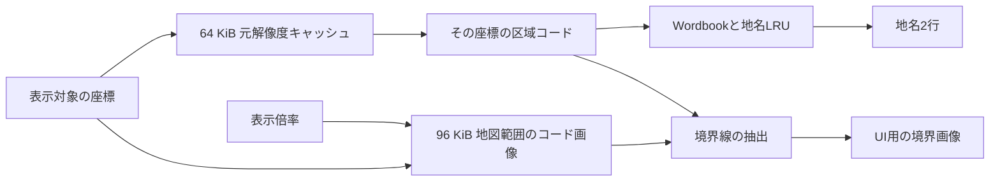

# Storage固定画像領域と作業領域の設計

対象: Cardputer ADV、32bit区域コード、地名判定用128×128、地図用上限96 KiB。固定画像化と、UIの4 KiBを索引・GLC・Wordbook Readerへ順に貸す方式は実装済み。地図用96 KiBは索引生成・突合検証の作業領域と排他共用する。起動確認も同じ96 KiBを一時利用する。USBへの転用は後続候補とする。

## 1. 二つの画像の役割

両方に格納する値は区域コードの32bit整数である。地名の文字列や、描画済みの白い境界線を格納する領域ではない。利用する目的と格子を分ける。

| 領域 | 答える対象 | 内容と使い方 |
|---|---|---|
| 地名判定用64 KiB | 現在の座標はどの区域か | 元解像度の128×128のコード。座標に対応する1点を読み、Wordbookで地名へ変換する |
| 地図用96 KiB | 画面内のどこに境界があり、どの区域を強調するか | 地図範囲のコード。隣接コードの違いから境界線を作り、現在区域のコードで強調する |

地名判定キャッシュは、座標が格子を移るたびに使う。キャッシュ内ならSDを読まず、範囲外なら座標を中心に128×128を再読出しする。元解像度を維持し、地図の表示倍率によって地名判定の精度を変えない。

地図用は1/1・1/2・1/4の表示に合わせて取得する。1/2では元格子の2点おき、1/4では4点おきに採取し、間引いたコード画像から境界を抽出する。間引いた画素の間にある小区域は地図では消える場合があるため、地図の画素をそのまま精密な地名判定へ使わない。

地図用96 KiBは上限であり、今回の習志野付近の有効な画像は240×83×4＝79,680 B。表示する境界画像は別に約6 KiB/枚の2bit画像で、UIが固定front/back各1枚を所有する。

この図はデータの利用関係を表す。タスク間の要求・完了通知は従来どおりAppを経由し、StorageとUIを直接通信させる方式へ変えていない。

## 2. 所有権と静的予約

StorageTaskがStorageCodeImagesを直接内包し、CodeCacheBuffer 65,536 Bと、地図／索引保守用98,304 BのStorageMapMemoryを所有する。データ領域の合計163,840 Bを起動から終了まで予約する。メイン画面、設定、USBモードでも解放しない。StorageMapMemoryは役割を表す管理フィールドを別に持ち、CodeImageBufferとDatasetIndexWorkspaceをunionで排他配置する。

CachedMapReaderとPlaceLookupは地名判定配列を参照する。MapSessionは地図配列を参照する。両者はヒープから配列を確保せず、Reader・セッションの破棄でも予約領域を解放しない。地図配列と索引作業領域の型の寿命はStorageIndexLeaseが切り替える。容量超過時に動的確保へ切り替える処理も持たない。

通常地図用とログ地図用のMapSessionは独立したメタデータを持ち、同じ地図配列1枚を排他的に使用する。StorageScreenResources::selectMapは、上書きに先立って他方の内容を無効にする。地図用の配列を各Sessionへ1枚ずつ置く方式ではない。

画像固定化時点の静的データRAMは95,512→259,360 B（+163,848 B）。163,840 Bが画像本体で、残りは借用参照と型の整列による差である。静的予約量をヒープ使用量へ再加算しない。[実機検証](検証/区域コード画像の固定領域化.md)で空き量と連続領域を確認する。

## 3. 内容の有効性と再利用

予約済みのメモリと、読込み済みの有効な内容を分けて管理する。起動直後は両画像とも未読込みで、固定配列が存在していても測位・データセットの不足を成功扱いしない。

地名キャッシュは格子範囲とvalidを照合し、読出し失敗中の途中画像を使わない。MapCacheStats.bytesは読出しに使用した論理画像の量であり、全体の静的予約量を表すカウンターではない。

地図の読出し開始時に以前の内容を無効にし、完了時だけ有効にする。MapSession.bytesは有効な格子の使用量を示し、予約容量96 KiBと区別する。MapSessionの移動はメタデータを移し、固定配列の所有権は移さない。

ReleaseMap/CancelMapはジョブとUI back画像への書込み権を返す。CloseMapSessionはUI側の利用を終えるが、固定領域と有効な地図はStorageに残す。索引の適用・再生成・検証で同じ領域を借りる場合は、通常地図とログ地図の両方を無効化する。新しい画面からの要求がSession種別・データセット世代・緯度経度・倍率で一致すれば、SDを読まず新しい画面世代で境界画像を作る。現在の緯度経度のキーはリクエスト値の完全一致であり、画面をまたいだ範囲内追従へ拡張したものではない。

表示中の区域強調だけを変える明示的なreuse要求では、従来どおり画面世代も照合する。SDの再設定、データセットの変更、地図配列を別のSessionで使う場合は内容を無効にする。画面側のカーソル追従範囲と地名判定の頻度は変えない。

## 借用領域の型と寿命

UI backの用途別配置は、地図読出しのMapReadWorkspace、地名検索のPlaceReadWorkspace、データセット表示のDatasetReadLayoutで定義する。データセット結果は既存6,060 Bの先頭にDatasetView 472 Bを構築する。UIが貸出し、Storageの書込み完了後にUIの画面専用領域へコピーして返す。Appは要求・進捗・完了の制御情報だけを保持する。前者はReader用4,096 Bのみ、後者は先頭にPlaceResult、その後ろにReader用4,096 Bとトークン番号用の固定512 Bを配置する。返却領域へ直接書き、別の地名2行の出力領域は作らない。一時パスは地図・地名・ログ・索引・エクスポート共通のTemporaryPathをファイル操作中だけスタック上に置く。容量は終端込み256 B（最大255 BのUTF-8バイト列）とし、切り詰めず超過エラーにする。UI backからパス領域は借りない。型のメンバー配置で区切り、利用側にキャスト・オフセット計算を置かない。共通のBorrowedLayoutが容量・アラインメントの確認とplacement new・型付き参照・破棄を担当する。

同じ領域を用途ごとに排他利用するが、未アクティブなunionメンバーを読み出す方式ではない。既存の整列済みbyte配列をストレージとして、使用する型の寿命を明示的に開始・終了する。MapBuildJobはReaderとFILが閉じた後に読出し用の型を破棄してから境界画像を初期化する。UIは地名検索開始時に結果を含む型を構築し、Storage終了とAppの回収を待ってCommit／Discard時に破棄する。画面切替・消灯では未返却の型を破棄しない。

読出し用配列は初期化時にゼロクリアせず、地名検索の結果だけを初期化する。画像の大きさ、貸出しID、Reader/FILの排他、タスク間の所有権移譲は維持する。[型付きレイアウトの整理と性能比較](検証/借用メモリの型付きレイアウト整理.md)を参照する。

## 4. 地図索引参照の一時キャッシュ

GLC読出しでは、読出し要求全体に必要なグループ参照を最大15件のスタック配列へ集める。1チャンクごとに収集・読出しを交互に行う方式ではない。索引を最後まで走査して閉じた後、GLCを1回開いて全参照先をファイル順に読む。索引ReaderとGLC本体Readerの寿命は重ならない。

各参照はグループ情報16 Bと、そのチャンクの原点・幅・高さ・ブロックサイズ20 Bを持ち、1件36 B、配列本体540 Bとなる。件数と関数の管理領域は別である。件数はConfig.hのMapReadGroupCacheEntriesで定義する。索引のない小チャンクも同じ配列に収容し、チャンク境界はLimitedReaderで制限する。

座標格子が揃った非重複の256×256ブロックでは、通常の1/4表示で最大5列×3行＝15ブロックを想定する。ただし一般のreadRect呼出し、格子のずれ、チャンクの重なりまで15件を保証する形式上の制約は設けない。実際に15件を超えた場合だけ、既処理参照を飛ばして索引を再走査する。配列の拡張やヒープへの代替確保は行わない。15件以内ならチャンク数にかかわらず索引は1回だけ開く。

参照はファイル順のまま展開し、チャンク重複時の「最初の非ゼロを採用」を維持する。全参照を1個のGLC Readerで処理するため、チャンクごとのGLC Open/Closeも発生しない。読出し範囲は先頭参照から末尾参照の終端までに制限する。

これは1回の読出し内のキャッシュであり、読出し終了後には残さない。索引収集の関数フレームはGLC展開へ持ち越さず、参照配列を含む読出しの関数フレームは後段の境界抽出へ持ち越さない。展開中には配列と展開処理のスタックが重なるため、コンパイラのフレーム量と実機の高水位を確認する。

索引とGLCの読出しバッファはともに4 KiBとし、UI back内のReader領域4 KiBを順に借用する。地名検索では先頭が返却領域のため、Readerの位置をPlaceReadWorkspaceの型から取得する。地図生成ではMapBuildJob::readBuffer、地名検索ではBeginPlaceSearchで得た作業領域を検索１回の引数として渡す。索引Readerを閉じてからGLC Readerを作るため同時に同じ領域を使わない。GLC用16 KiBの動的バッファは確保しない。

StorageWorkAreaはvariantの外に固定FIL２枠を持つ。地図生成とログ閲覧は第１枠、地名検索は第２枠を使い、索引・GLC・WordbookのReaderを順に閉じて同じ枠と4KiBを再利用する。ログ記録用FILは共有しない。FILまたはUIバッファの貸出し中はloaded・release・作業領域切替を拒否する。

地図・地名共通のFileReadSource::withRangeはReaderを局所変数として構築し、処理終了・例外のどちらでも破棄する。DiskIndexedMapReaderとDiskIndexedWordBookReaderはファイル情報を借用し、共有所有しない。アプリ内のFactory互換アダプタは廃止する。SDK本体の汎用APIは変更しない。本番の地図・Wordbook・索引と候補確認はFactory経由でReaderを生成しない。GI01のLimitedReaderもデコーダーの値メンバーとし、通常の地図生成ではReader本体・FIL・一時パスの動的確保を行わない。

選択済みWordbookのcheckWordBookは、GW00の任意メタデータの長さを検証して読み飛ばし、値を返さない。メタデータ長に比例する文字列の動的確保と、Readerの解放後まで残る返却文字列は持たない。実際に読む地名はUTF-8として検証する。候補確認も同じWordBookHeaderReaderを使い、SDK Reader内部のメタデータ保持・Factory・shared_ptr・動的Reader生成を使わない。起動・再確認のReader用4 KiBはStorageIndexLeaseで96 KiBから借り、GLC・索引・Wordbookの確認へ順に渡す。貸出し先を永続情報に保存しない。地図やFILが使用中なら内容を壊さずWaitingを返し、Appが後で再要求する。

データセットの詳細・言語候補・適用前確認はStorageIndexLeaseで96 KiBを借りる。候補一覧はINIだけを読むため借りない。inspectMapは2本のSourceと4 KiB×2本を使用し、全GLCの範囲・解像度・チャンク数を確認する。両Sourceの終了後、inspectWordBookは1本のSourceをスタックへ構築し、同じ作業バッファを借りる。WordBookHeaderReaderは84 Bのヘッダー値だけを返し、候補には保存索引を要求しない。checkWordBookは同じReaderの値を保存索引と照合し、元ファイルの識別情報も確認する。任意メタデータが96 KiBを超えていても、内容に比例する作業領域を確保しない。保持地図は借用開始時に無効化し、返却後に配列を再結合する。地名判定用64 KiBは保持する。

SelectedDatasetはStorageTaskが固定メンバーとして所有し、PlaceLookupと地図読出しへ参照を貸す。AppはSelectedDatasetの本体や参照を持たない。選択言語は終端込み32バイト、地名書式は各行終端込み128バイトの固定配列とし、選択情報そのものは動的文字列を保持しない。StorageではPlaceLookupより先に構築し、PlaceLookupとそのファイル記述の破棄後まで保持する。画面の有無と無関係に寿命を維持し、UIへ渡すのは完了後の既存スナップショットとする。設定の選択番号と、各128バイトの地図名・選択言語の辞書名からパスを生成する。セッションへディレクトリやGLC・索引・Wordbookのフルパスを重複保持しない。名前の文字コード・上限・不正値の扱いは[メタデータ仕様2節](08_データセットメタデータ仕様.md#2-配置とデータセットの単位)を正本とする。

INI解析のDatasetMetadataは552 Bの固定結果とし、ファイル名・言語・書式・件数・位置を保持する。タイトル・説明はUIの既存返却先へ直接書く。16件の言語ID本体512 Bと件数、256 Bの行、セクション・既定言語は解析関数内の局所スタックとする。初期化ではnoinlineのreadSelectionを経由し、解析関数と一時結果のフレームを戻してから索引・GLC・Wordbook Readerの確認を行う。UIやStorageに解析専用の常設配列を追加しない。言語切替のためにINIを解析し直さず、同じ2走査内で前後を選択する。索引生成ではWordbook処理の引数を言語・辞書名へ絞り、大きなDatasetMetadataの複製を後段のReaderへ持ち越さない。

FileReadSourceは固定ルート、整数番号、固定名領域への参照を保持し、open/statの呼出し中だけ256バイトのTemporaryPathへ構成する。読出し時にINIや索引の初期化検証を繰り返さず、検証済みヘッダーとファイル長を再利用する。切替時は旧Reader・ファイル情報・キャッシュを閉じてから保持領域を更新する。要求とデータセットの世代が異なる場合は開始しない。

地図読出しに関する初期の所有方式と計測値は[選択中データセット情報の統合](検証/選択中データセット情報の統合.md)に、256バイトのパス領域と借用レイアウトは[一時パスの固定長化](検証/一時パスの固定長化とスタック配置.md)に記録する。これらは各変更時点の検証記録である。

地名検索ではGLCの読出し完了後に同じ4 KiBをWordbookの索引・実データへ順に貸す。通常経路はreadPlaceLinesByCodeを使い、TIの階層番号を得てから1階層ずつTT・TMを解決する。トークン番号と並べ替え順序は各128件のuint16_t配列、合計512 BをUIから借用する。16bit制限はトークン番号だけに適用し、TIの構成要素番号はuint32_tを維持する。1階層のトークン数が128を超えた場合は容量エラーとして返し、ヒープへ退避しない。

階層番号32件128 Bは検索関数のスタック、TMの幅・出力位置128件256 Bは1階層を解決する関数のスタックに置く。TMの参照先は従来と同じ最大32件のPagePlanを局所保持し、超えた分は再走査する。ページ計画を収集するReaderは本文のReaderより先に閉じ、同じFILと4 KiBを共用する。大きな作業域のスタック化やタスクのスタック拡張は行わない。

PlaceResultの各行は385 Bとする。ASCII128文字と非ASCII64文字が混在する場合をUTF-8最大4バイトで見込み、終端込み128 + 64 * 4 + 1とする。実際の出力は既存の画面幅232ピクセルでUTF-8境界を保って省略する。階層順、書式指定時は書式順に返却先へ追加し、その行が満杯になった後の構成要素は検索しない。他方の行に必要な構成要素は続けて処理する。TMは必要なトークンを番号順に読み、局所の位置配列を使って返却先へ直接配置するため、断片文字列や完成前のvector<string>を保持しない。LRUと通常表示用スナップショットは画面幅で省略した各64 Bの2行を保持し、各行を個別にコピーする。

Galuchatには呼出し側の配列へ書くreadCodeSetFromRootIntoとreadTokenIdsFromPageIntoを追加する。既存のvectorを返すAPIと従来経路は維持する。通常の検索はReader/FIL・一時パス・トークン配列・文字列のC++動的確保を行わない。初期準備と索引保守も、既存作業領域を借用する正常経路ではC++ヒープ確保を行わない。異常時の例外生成と標準IO・ドライバ等の内部確保は別に扱う。

GLC・索引・Wordbookは検索スコープだけの借用参照を使い、例外・未検出・LRUヒットの早期returnでもUI領域への参照を持ち越さない。借用指定がない呼出しは拒否し、代替領域を確保しない。地名のPlaceResultは借用領域の先頭に置き、作業域と重ねない。

[GLC4 KiB借用の検証](検証/GLC4KiB共通借用領域の検証.md)に変更・検証結果を記録する。

[全要求キャッシュの検証と性能比較](検証/地図索引の全要求キャッシュ.md)に結果を記録する。以前の[チャンク単位版の記録](検証/地図索引参照の15件キャッシュ.md)は履歴として区別する。

## ログのパスと局所スタック

LogWriterとLogReaderはルート・フルパスをstd::stringで保持しない。固定ルートはROM、記録対象名は既存のLogSnapshot::name、閲覧対象名は要求内のnameとする。LogDirectoryはルートへの非所有参照と、各ファイル操作だけのTemporaryPathを使う。現在の本体ルートはconfig::LogDirectoryへ集約する。

パスを構成するopen・stat・削除等はnoinlineの小関数へ分け、256バイトのパス領域を呼出し側のヘッダー・統計処理へ持ち越さない。LogReader::readHeader、LogWriter::writeHeader、セッション重複確認のヘッダー読出しもnoinlineとし、各512バイトをその処理中だけスタックに置く。FatFsネイティブパスへの変換中には正規パスと変換先が短時間重なるため、個別の配列容量だけでなく実ビルドのフレームと呼出し関係も確認する。ファイルのclose失敗時は要求・対象名・ハンドルの再試行条件を維持する。標準IO内部の確保は今回の対象外とする。

## 索引生成・検証との排他共用

StorageMapMemoryの地図配列98,304 Bと、DatasetIndexWorkspaceをunionで共用する。作業領域は4,096 Bのバッファ2本、int32のx/yを各1,500件保持する12,000 Bの座標配列、全言語の辞書情報表2,756 Bからなり、合計22,948 Bとする。処理中に座標配列をスタックへ置かない。データ容量が地図予約を超えた場合はコンパイル時に拒否する。

設定からの適用・再生成・突合検証はStorageIndexLeaseを開始し、DatasetIndexWorkをDatasetIndexへ渡す。未完了の地図ジョブ、未返却の地図結果、FIL使用中、未完了ログ読出し、すでに索引保守中の場合は開始しない。拒否時は保持地図を変更せずBusyを返す。開始時は両MapSessionの内容を無効化してpixels参照を外し、地図型の寿命を終了してから索引作業領域を構築する。

DatasetIndexWorkは2本のBorrowedReadBufferを操作全体で管理する。SourceとOutputは空き領域を排他的に借り、同時に生存する2つのReader／Outputへ同じ範囲を渡さない。生成では元データと出力、比較検証では元データと比較対象の索引を並行して保持する。ヘッダー照合・CRC・既存索引の適用も同じセッションを通し、Sourceの終了・例外で借用を返す。固定FILは従来の2枠を使う。チャンク座標はセッションの固定配列へ直接読み込む。

生成・検証・適用が成功または失敗して戻った後、Source／OutputとFILの借用が終了したことを確認してセッションを破棄し、地図型を再構築する。両MapSessionを新しい型の配列へ結び直すが、validはfalseのままとする。次の地図表示は元データから再生成し、保守前の画像を誤って再利用しない。地名判定用64 KiBとUIの表示用front画像はこの領域と別に保持する。

全言語の辞書情報はIndexBookTableへ最大16件を格納する。1件は言語ID32 B、辞書名128 B、元ファイルの長さ・FAT時刻・ヘッダーCRC各4 Bの計172 B。表は16件2,752 Bと件数・整列分4 Bで2,756 Bとなる。BookSourcesは操作全体で表を借り、成功・例外の両方で返す。二重貸出しは拒否し、占有状態をDatasetIndexWork::inUseへ含める。適用から全再生成へ移る場合は、先行する表を返してから再取得する。少数言語への再利用時は件数をリセットし、以前の行を参照しない。

進捗の言語名は局所char[32]、GLCH・GW00・GI01・LAYO等の識別子は局所char[4]で照合する。辞書情報表をスタックへ置かず、INI解析の局所言語一覧は辞書列挙関数が戻った時点で破棄する。表はWordbook生成・検証・公開の間も固定作業領域にあり、TI00の再帰スタックへ2,756 Bを追加しない。

INI解析を含め、既存作業領域を渡すアプリの索引適用・再生成・検証は正常経路でC++ヒープ確保を行わない。標準IO・NVS等の内部確保と、破損・I/O失敗・不正な再入等の例外生成は別に扱う。作業領域・固定FILを渡さない呼出しは拒否し、内部で代替領域を確保しない。索引形式、処理順序、公開とロールバックの仕様は変更しない。

## 5. 次に検討する借用先

GLCとWordbookのバッファはUIからの借用へ、索引保守・起動確認はStorageの96 KiBへ移行済みである。以下はUSB等の後続候補とする。固定化によって、大きな連続領域のアドレスと上限が決まった。作業領域へ貸す条件は、読出し・書込みが排他的であることに加え、有効な保持画像を壊さないこととする。使用していない画面の領域でも、有効な画像を保持していれば自由な領域ではない。

### 画像の末尾余白

Wordbookは既存UI領域の4 KiBを順に借用するため、画像末尾の余白を利用する必要はない。地図画像の余白は緯度・格子比率等で変わり、240×83では18,624 B、赤道付近の240×101では1,344 Bとなる。今後ほかのReaderへ貸す場合は、使用範囲と借用先の寿命を確認し、有効な画像を壊さない条件を別途定義する。

### 画像が無効な間に全体を貸す候補

| 候補 | 利用できる状態 | 対応の範囲 |
|---|---|---|
| USBエクスポート | GPSロガーと排他的なUSB起動中 | 配列領域は使われない。まず変換用のバイトバッファが候補。LogExporter全体を載せるには型・アラインメント・構築破棄順の設計も必要 |

今のStorageCodeImagesはPlaceLookupとMapSessionより先に構築される。USBのExporterオブジェクト等へ貸す場合は、その借用先より先に領域を構築し、最後に破棄するようメンバーの宣言順も整理する。

### 今回は対象としないもの

地名キャッシュ64 KiBは、地図表示中も次の区域判定に使う有効な内容を持つ。単にStorageの処理が直列という理由で通常の作業バッファへ貸すと、内容の破壊と再読出し増加につながる。無効化・復元・I/O増加を含む別の検討が必要である。

Wordbookの通常検索は上記の固定領域と局所スタックへ移行済み。アプリ内のvector/stringを返す旧APIは廃止し、UIから借用した返却領域へ直接出力する。SDK本体の汎用APIは維持する。

ログの10件返送バッファ、64件リング、統計の集計器、Wordbookの16件LRUは既に固定領域にある。別領域へ移すだけでは残存ヒープの削減にならない。

これらの借用は今回の実装に含めない。実測を見て、性能と有効画像の保持に影響しない候補から選ぶ。
