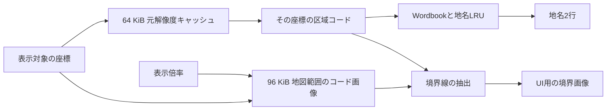

# Storage固定画像領域と作業領域の設計

対象: Cardputer ADV、32bit区域コード、地名判定用128×128、地図用上限96 KiB。固定画像化と、UIの4 KiBを索引・GLC・Wordbook Readerへ順に貸す方式は実装済み。Storage画像配列を別用途の作業領域へ貸す後半の案は検討段階とする。

## 1. 二つの画像の役割

両方に格納する値は区域コードの32bit整数である。地名の文字列や、描画済みの白い境界線を格納する領域ではない。利用する目的と格子を分ける。

| 領域 | 答える対象 | 内容と使い方 |
|---|---|---|
| 地名判定用64 KiB | 現在の座標はどの区域か | 元解像度の128×128のコード。座標に対応する1点を読み、Wordbookで地名へ変換する |
| 地図用96 KiB | 画面内のどこに境界があり、どの区域を強調するか | 地図範囲のコード。隣接コードの違いから境界線を作り、現在区域のコードで強調する |

地名判定キャッシュは、座標が格子を移るたびに使う。キャッシュ内ならSDを読まず、範囲外なら座標を中心に128×128を再読出しする。元解像度を維持し、地図の表示倍率によって地名判定の精度を変えない。

地図用は1/1・1/2・1/4の表示に合わせて取得する。1/2では元格子の2点おき、1/4では4点おきに採取し、間引いたコード画像から境界を抽出する。間引いた画素の間にある小区域は地図では消える場合があるため、地図の画素をそのまま精密な地名判定へ使わない。

地図用96 KiBは上限であり、今回の習志野付近の有効な画像は240×83×4＝79,680 B。表示する境界画像は別に約6 KiB/枚の2bit画像で、UIが固定front/back各1枚を所有する。

この図はデータの利用関係を表す。タスク間の要求・完了通知は従来どおりAppを経由し、StorageとUIを直接通信させる方式へ変えていない。

## 2. 所有権と静的予約

StorageTaskがStorageCodeImagesを直接内包し、CodeCacheBuffer 65,536 BとCodeImageBuffer 98,304 Bを所有する。合計163,840 Bを起動から終了まで予約する。メイン画面、設定、USBモードでも解放しない。

CachedMapReaderとPlaceLookupは地名判定配列を参照する。MapSessionは地図配列を参照する。両者は配列をnew/deleteせず、Reader・セッションの破棄でも配列を解放しない。容量超過時に動的確保へ切り替える処理も持たない。

通常地図用とログ地図用のMapSessionは独立したメタデータを持ち、同じ地図配列1枚を排他的に使用する。StorageScreenResources::selectMapは、上書きに先立って他方の内容を無効にする。地図用の配列を各Sessionへ1枚ずつ置く方式ではない。

静的データRAMは95,512→259,360 B（+163,848 B）。163,840 Bが画像本体で、残りは借用参照と型の整列による差である。静的予約量をヒープ使用量へ再加算しない。[実機検証](検証/区域コード画像の固定領域化.md)で空き量と連続領域を確認する。

## 3. 内容の有効性と再利用

予約済みのメモリと、読込み済みの有効な内容を分けて管理する。起動直後は両画像とも未読込みで、固定配列が存在していても測位・データセットの不足を成功扱いしない。

地名キャッシュは格子範囲とvalidを照合し、読出し失敗中の途中画像を使わない。MapCacheStats.bytesは読出しに使用した論理画像の量であり、全体の静的予約量を表すカウンターではない。

地図の読出し開始時に以前の内容を無効にし、完了時だけ有効にする。MapSession.bytesは有効な格子の使用量を示し、予約容量96 KiBと区別する。MapSessionの移動はメタデータを移し、固定配列の所有権は移さない。

ReleaseMap/CancelMapはジョブとUI back画像への書込み権を返す。CloseMapSessionはUI側の利用を終えるが、固定領域と有効な地図はStorageに残す。新しい画面からの要求がSession種別・データセット世代・緯度経度・倍率で一致すれば、SDを読まず新しい画面世代で境界画像を作る。現在の緯度経度のキーはリクエスト値の完全一致であり、画面をまたいだ範囲内追従へ拡張したものではない。

表示中の区域強調だけを変える明示的なreuse要求では、従来どおり画面世代も照合する。SDの再設定、データセットの変更、地図配列を別のSessionで使う場合は内容を無効にする。画面側のカーソル追従範囲と地名判定の頻度は変えない。

## 借用領域の型と寿命

UI backの用途別配置は、地図読出しのMapReadWorkspaceと地名検索のPlaceReadWorkspaceで定義する。前者はReader用4,096 Bとパス用512 B、後者はReader用4,096 Bと整列済みPlaceResultである。型のメンバー配置で区切り、利用側にキャスト・オフセット計算を置かない。共通のBorrowedLayoutが容量・アラインメントの確認とplacement new・型付き参照・破棄を担当する。

同じ領域を用途ごとに排他利用するが、未アクティブなunionメンバーを読み出す方式ではない。既存の整列済みbyte配列をストレージとして、使用する型の寿命を明示的に開始・終了する。MapBuildJobはReaderとFILが閉じた後に読出し用の型を破棄してから境界画像を初期化する。UIは地名検索開始時に結果を含む型を構築し、Storage終了とAppの回収を待ってCommit／Discard時に破棄する。画面切替・消灯では未返却の型を破棄しない。

読出し用配列は初期化時にゼロクリアせず、地名検索の結果だけを初期化する。画像の大きさ、貸出しID、Reader/FILの排他、タスク間の所有権移譲は維持する。[型付きレイアウトの整理と性能比較](検証/借用メモリの型付きレイアウト整理.md)を参照する。

## 4. 地図索引参照の一時キャッシュ

GLC読出しでは、読出し要求全体に必要なグループ参照を最大15件のスタック配列へ集める。1チャンクごとに収集・読出しを交互に行う方式ではない。索引を最後まで走査して閉じた後、GLCを1回開いて全参照先をファイル順に読む。索引ReaderとGLC本体Readerの寿命は重ならない。

各参照はグループ情報16 Bと、そのチャンクの原点・幅・高さ・ブロックサイズ20 Bを持ち、1件36 B、配列本体540 Bとなる。件数と関数の管理領域は別である。件数はConfig.hのMapReadGroupCacheEntriesで定義する。索引のない小チャンクも同じ配列に収容し、チャンク境界はLimitedReaderで制限する。

座標格子が揃った非重複の256×256ブロックでは、通常の1/4表示で最大5列×3行＝15ブロックを想定する。ただし一般のreadRect呼出し、格子のずれ、チャンクの重なりまで15件を保証する形式上の制約は設けない。実際に15件を超えた場合だけ、既処理参照を飛ばして索引を再走査する。配列の拡張やヒープへの代替確保は行わない。15件以内ならチャンク数にかかわらず索引は1回だけ開く。

参照はファイル順のまま展開し、チャンク重複時の「最初の非ゼロを採用」を維持する。全参照を1個のGLC Readerで処理するため、チャンクごとのGLC Open/Closeも発生しない。読出し範囲は先頭参照から末尾参照の終端までに制限する。

これは1回の読出し内のキャッシュであり、読出し終了後には残さない。索引収集の関数フレームはGLC展開へ持ち越さず、参照配列を含む読出しの関数フレームは後段の境界抽出へ持ち越さない。展開中には配列と展開処理のスタックが重なるため、コンパイラのフレーム量と実機の高水位を確認する。

索引とGLCの読出しバッファはともに4 KiBとし、UI backの先頭4 KiBを順に借用する。地図生成ではMapBuildJob::readBuffer、地名検索ではBeginPlaceSearchで得た作業領域を両Factoryへ指定する。索引Readerを閉じてからGLC Readerを作るため同時に同じ領域を使わない。GLC用16 KiBの動的バッファは確保しない。

Storageからの地図生成では、MapBuildJobに含めたReadFileSlotのFILを事前確認・索引・GLCで順に借りる。FILはStorageWorkAreaの地図／ログ排他領域に置き、別の常駐配列を増設しない。MapBuildJobがLogReader以下の大きさであることをstatic_assertで確認する。ログ記録用FILは共有しない。FILまたはUIバッファが貸出し中のloaded・release・作業領域切替を拒否する。

地図専用のObservedFileReaderFactory::withRangeはReaderを局所変数として構築し、ByteReader参照を渡した処理が終了してから破棄する。DiskIndexedMapReaderのファイル用経路がこれを使い、既存のSDK Factory経路は維持する。初期化時にGLC・索引の整合性を確認し、選択中情報として保持する。この地図生成経路ではReader本体とFILの動的確保を行わない。索引用・GLC用のFactoryも局所変数として構築し、DiskIndexedMapReaderはその参照を借りる。SDK内部のGI01 LimitedReaderはデコーダの値メンバーとして保持し、チャンク・群ごとの動的確保を行わない。FactoryのパスはStorageのSelectedDatasetから借りる。INI解析とパスの構築は初期化時だけ行い、通常の地図生成では繰り返さない。地図生成のFatFsパス変換は、UI backの先頭4 KiBに続く512 Bを借りて直接書き込む。地図読出し中はReader領域と重ならず、Reader終了後に全体を境界画像として使う。2026-10-28のESP32ビルドではReadFileSlotが4,140 B、FIL込みMapBuildJobが4,264 B、LogReaderが4,800 Bで、StorageWorkAreaは従来どおり4,816 Bとなった。通常版の静的RAMは259,376→259,384 B（+8 B）。借用ReaderテストでReader/FILの確保0と例外時の返却、実データの3縮尺で画像一致、Storage作業領域の切替を確認した。

Factory・SDK内部Readerの保持方式と残るパス・メタデータ・標準IOの確保は、[地図生成の残存ヒープ調査](検証/地図生成の残存ヒープ調査.md)を参照する。

StorageTaskはSelectedDatasetをメンバーとして保持し、PlaceLookupが初期化したGLC・索引・Wordbookのパス、選択言語、地名書式、検証済みヘッダー、状態・世代を地図生成と共有する。地図生成はreadDatasetMetadata・loadMapを呼ばず、初期化済みのmap_indexで索引・GLCを読む。Readerの4 KiBと固定FILは、この2種類のファイルへ順に貸す。実際のstat・open・範囲内の読出し失敗は引き続き地図エラーとして返す。選択情報と要求の世代が異なる場合は読出しを始めない。起動・設定画面の確認、索引生成・検証のOutputは従来の経路を維持する。

共有情報の寿命と再初期化条件は[選択中データセット情報の統合](検証/選択中データセット情報の統合.md)を参照する。

地名検索ではGLCの読出し完了後に同じ4 KiBをWordbookの索引・実データへ順に貸す。DiskIndexedWordBookReaderはTI・TT・TMの段階ごとに索引Readerを閉じてから実データを読む。TTとTMの各関数は、必要な参照先を最大32件のローカル配列に保持する。1件24 B、配列768 B、ESP32では管理情報込み776 Bとする。TTの関数から戻ってからTMへ進むため、両配列や地図展開用スタックが重なることはなく、検索間の保持も行わない。32件を超える参照先は再走査で取得する。参照先配列とWordbook展開処理のスタックは重なるため、高水位で余裕を確認する。TT/TMの処理関数にはnoinlineを指定し、コンパイラが両配列を呼出し側のフレームへ取り込んで予約しないようにする。

GLC・索引・WordbookのFactoryへの借用設定は検索のスコープ終了時に解除し、例外・未検出・LRUヒットの早期returnでもUI領域への参照を持ち越さない。借用指定がない呼出しは同容量を自己所有する。地名のPlaceResultは従来どおり先頭4 KiBより後ろに置く。

[GLC4 KiB借用の検証](検証/GLC4KiB共通借用領域の検証.md)に変更・検証結果を記録する。

[全要求キャッシュの検証と性能比較](検証/地図索引の全要求キャッシュ.md)に結果を記録する。以前の[チャンク単位版の記録](検証/地図索引参照の15件キャッシュ.md)は履歴として区別する。

## 5. 次に検討する借用先

GLCとWordbookのバッファはUIからの借用へ移行済みであり、以下は索引保守等の候補である。固定化によって、大きな連続領域のアドレスと上限が決まった。作業領域へ貸す条件は、読出し・書込みが排他的であることに加え、有効な保持画像を壊さないこととする。使用していない画面の領域でも、有効な画像を保持していれば自由な領域ではない。

### 画像の末尾余白

Wordbookは既存UI領域の4 KiBを順に借用するため、画像末尾の余白を利用する必要はない。地図画像の余白は緯度・格子比率等で変わり、240×83では18,624 B、赤道付近の240×101では1,344 Bとなる。今後ほかのReaderへ貸す場合は、使用範囲と借用先の寿命を確認し、有効な画像を壊さない条件を別途定義する。

### 画像が無効な間に全体を貸す候補

| 候補 | 利用できる状態 | 対応の範囲 |
|---|---|---|
| 起動時のデータセット確認 | 地図がまだ無効な間 | メタデータ・索引のReaderバッファを借用。画像の取得前に返却する |
| 索引再生成・検証 | 地図内容を無効にしてよい設定操作中 | DatasetIndexのSource/Outputバッファを借用対応へ変更する。複数の入力・出力は別の範囲に置く |
| USBエクスポート | GPSロガーと排他的なUSB起動中 | 配列領域は使われない。まず変換用のバイトバッファが候補。LogExporter全体を載せるには型・アラインメント・構築破棄順の設計も必要 |

今のStorageCodeImagesはPlaceLookupとMapSessionより先に構築される。USBのExporterオブジェクト等へ貸す場合は、その借用先より先に領域を構築し、最後に破棄するようメンバーの宣言順も整理する。

### 今回は対象としないもの

地名キャッシュ64 KiBは、地図表示中も次の区域判定に使う有効な内容を持つ。単にStorageの処理が直列という理由で通常の作業バッファへ貸すと、内容の破壊と再読出し増加につながる。無効化・復元・I/O増加を含む別の検討が必要である。

Wordbook検索の数値配列・断片文字列も一時ヒープを使うが、入れ子のvector/stringの寿命・上限・アラインメントを扱う必要がある。初めはバイトバッファの借用を優先し、コンテナのアロケータ変更や別の非trivialオブジェクトの配置は後続の設計で扱う。

ログの10件返送バッファ、64件リング、統計の集計器、Wordbookの16件LRUは既に固定領域にある。別領域へ移すだけでは残存ヒープの削減にならない。

これらの借用は今回の実装に含めない。実測を見て、性能と有効画像の保持に影響しない候補から選ぶ。
