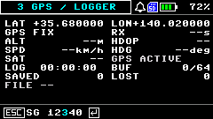
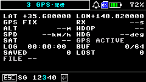
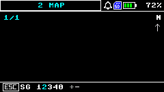
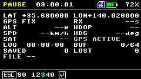

# トップ画面名のヘッダー重畳とアイコン間隔

2026-11-01。区域コードアラート・共通ヘッダー実装後の表示調整。

## 変更

- ベルはx=152〜163、SDはx=166〜177、電池本体はx=180から。隣り合うアイコンの間を2ドットに揃える。SD位置はUSB・Wi-Fiでも共通とする。
- 名前の一時表示は1〜4のトップ画面への実際の切替時だけ。設定（0）、画面選択メニュー、ログの子画面、設定サブメニュー、起動チェックでは出さない。
- 黒地・白枠の名前表示をヘッダー左側x=0〜147、y=0〜15へ1秒重ねる。名前は8×8で表示し、本文・フッターや右側のアイコンには触れない。期限後は記録状態・現在時刻へ戻す。
- 新しい画像バッファ・動的確保は追加しない。画面名の取得と遷移検出から、不要になったサブメニュー・ログモードの参照を取り除く。

## 検証

- 共通ヘッダー・フッターの描画試験439ケース成功。日英・4/16ビット、全画面のSD・電池、ベルの白/黄/非表示、ダイアログを確認。
- トップ4画面×日英×4/16ビットの16ケースで、表示中と期限後の本文・フッター・右側アイコンをピクセル比較し、一致を確認。
- ログ地名の継続表示8ケース、設定画面の日英各24シーン、ライセンス本文の一致を確認。
- 画面名の1秒期限、Tick折返し、同画面での非延長、表示中のショートカット、対象外画面での非表示を確認。
- ESP32-S3向けのステージビルド成功。固定RAMは279,116 Bで変更前と同じ。Flashは1,810,677 B（最終リポジトリビルド値は後記）。

## 描画例（240×135）

## 最終ビルド・実機確認

ネイティブ全体試験は成功。元のPlatformIO設定でもビルド成功（334.37秒）。固定RAMは279,116 Bで増減なし、Flashは1,810,629 Bで直前の1,811,361 Bより732 B減少した。

`firmware.bin` SHA-256: `84b9b99f6f23a7e5b090f6fb01b1989579885f33cbf877fdaeec81961e8a4b64`。

MAC `70:AF:09:DF:46:D0`のCardputerへアプリ領域0x10000だけを書込み、esptoolのハッシュ照合に成功。NVS・SD・パーティションの消去は行わなかった。通常のGPSモードで30秒間の起動を監視し、SD/FAT32・GPS UART・データセット02の読込み、GPS FIX、時刻補正、地名表示まで確認。アラートONの保存設定も復元された。観測中のパニック・再起動ループはない。

起動後の診断は空きヒープ46,444 B、最小45,924 B、最大連続領域34,804 B、Appスタック残量3,412 B。ヒープは実行状態で変化するため、制御条件を揃えた前版との比較値ではない。

書込みログは`.pio/header-overlay-flash.log`、起動ログは`.pio/header-overlay-boot.log`。各画面の見え方は上記の実装描画試験で確認し、実機での全画面の目視操作は今回未実施。
