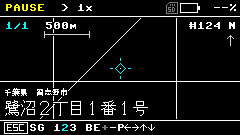
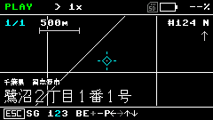

# ログ地図の再生専用ヘッダー

2026-11-01。ログ閲覧の地図画面を対象とする。

## 変更

ヘッダー左側は、PLAY/PAUSE（x=4）、方向 >/<（x=60）、再生倍率（x=76）とし、上端y=4のASCII 8×8で表示する。再生中は緑、一時停止中は黄色、方向・倍率は白。1/4x〜4xの5段階と既存の再生操作を維持する。

現在のGPSログ記録状態・現在時刻に代えて再生状況を表示し、保存点の時刻も非表示とする。地図内y=40の再生状態・方向・倍率・保存時刻の行を廃止し、元の境界画像が見えるようにする。地図の縮尺、距離目盛り、点番号、方位、地名、エラー表示は維持する。右側のベル・SD・電池は他画面と同じ配置を使う。

ログ地図を実時刻ヘッダーの対象から外し、時計の秒更新だけでは再描画しない。時計そのものは進め、LIVE等へ戻ると現在時刻を表示する。追加の画像バッファ・ヒープ確保はない。

## 検証

- 描画439ケース成功。再生／停止、方向、全5段階の倍率、日英、4/16ビットでヘッダー全画素を照合し、時刻や現在の記録状態が混在しないことを確認。
- ログ地図7シーン×日英の14シーン成功。境界画像を与え、廃止した情報行の位置が元の境界画素と一致することを確認。エラー表示の縁取りは対象から除外する。
- ログ地名継続8ケース、トップ画面名16ケースに成功。
- 未定義動作検出付きのホスト試験で、ライブ時計、ログ地図の毎秒再描画抑止、画面名・設定操作を確認。

プレビュー補助ツールはGPS画面専用に整理し、アプリ分離前のUSBデータ参照を除去した。USBの共通ヘッダー描画は既存の`tests/run_status_icons.py`で検証する。`render_log_browser.py --mode log-map --mode log-map-play`のように対象シーンだけを指定できる。

## ビルド・実機確認

元のPlatformIO設定でビルド成功（332.86秒）。固定RAMは279,116 Bで増減なし、Flashは1,810,489 Bで直前の1,810,541 Bより52 B減少した。

ファームウェアSHA-256: `b98c776b12ddab01b071ceed8be9e4706852d3a908a390bbf42836fbc25a20e2`。

MAC `70:AF:09:DF:46:D0`のCardputerへアプリ領域0x10000だけを書込み、ハッシュ照合に成功。NVS・SD・パーティションの消去は行っていない。30秒間の通常起動で、GPSモード、SD/FAT32、データセット02・アラートON設定の復元、GPS FIX、時刻補正、地名表示を確認。観測中にパニックや再起動ループはなかった。

書込みログは`.pio/log-replay-header-flash.log`、起動ログは`.pio/log-replay-header-boot.log`。ログ地図そのもののレイアウトは上記の実装描画試験で確認し、実機でのログ再生操作の目視確認は今回未実施。プレビューの区域境界は検証用のパターンを使用する。

