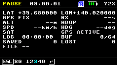
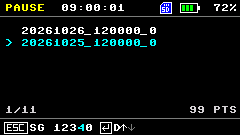
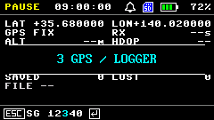
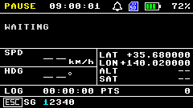

# 区域コードアラートと共通ヘッダーの検証

実施日: 2026-11-01。比較元: `c7c45f9`。

## 変更内容

- アラート設定は既存のStorage固定スナップショットで保持する。GPS更新ごとのWordbook階層検索を廃止し、GLCの最も細かい区域コードで判定する。同じセル・同じ区域判定方式は直前の9点判定結果を再利用する。
- 地名検索用の128×128区域コードキャッシュを共用する。キャッシュ範囲外の補充、通常の地名検索、ログ保存は引き続きSDアクセスを伴う。区域変更だけに全SDアクセスを制限する仕様ではない。
- 監視階層設定を廃止する。設定はデータセット単位のまま。`_alert.dat`は64バイト・version 3とし、旧version 1/2は有効・判定方式・音・通知時間を引き継いで移行する。旧階層指定は引き継がない。
- 設定ルートは「動作設定、システム設定、アラート、ストレージ操作、バージョン情報、ライセンス」の順。
- LIVE/MAP/GPS/LOGGER/LOGSのヘッダーを状態・現在時刻・ベル・SD・電池に統一する。履歴地図の再生情報は本文に置く。
- 実際の画面・表示モード変更時に画面名を1秒表示する。既存フレームに直接重ね、操作を妨げず、新しいフレームバッファを確保しない。
- ベルはアラート設定有効時に白、実通知の鳴動中に黄。GPS未測位でも設定有効なら白。通知音のプレビューは黄にしない。

## 確認結果

| 確認 | 結果 |
| --- | --- |
| ネイティブ全体試験 | 成功。画面遷移、設定編集、モード別資源、音声、省電力、USB等の既存試験を含む |
| ロガーApp試験 | 成功。区域コード判定と通知音操作を含む |
| 実N03ファイルを使う借用バッファ試験 | 成功。3方式の判定、同一セル10回の再要求・キャッシュ内の隣接セルでSD読出し0回 |
| 同じセルの再要求 | 区域コード画像への再問い合わせも0回 |
| 描画試験 | 439ケース成功。日英・4/16ビット、ヘッダー、ベル、モーダル、画面名、ログ地名の継続表示 |
| 設定画面描画 | 日英各24シーン成功。ライセンス本文フレーム一致 |
| 画面名期限 | 1,000msで消去。GPS更新がなくても再描画し、同一画面の更新で期限を延長しない。Tick折返し・連続遷移・キー操作も確認 |
| ファームウェアビルド | ESP32-S3/Cardputer ADV向け成功。元のPlatformIO設定でもビルド成功（216.85秒）。下表はリポジトリビルド値 |

## メモリとFlash

ESP32-S3のELFによる比較。ホスト側の`sizeof`とは区別する。

| 項目 | 比較元 | 変更後 | 差分 |
| --- | ---: | ---: | ---: |
| 固定RAM（data+bss） | 279,220 B | 279,116 B | −104 B |
| ApplicationRuntime | 216,832 B | 216,728 B | −104 B |
| GpsApplication | 216,824 B | 216,720 B | −104 B |
| GpsUiTask | 32,104 B | 32,112 B | +8 B |
| GpsStorageTask | 174,328 B | 174,344 B | +16 B |
| Flash | 1,810,065 B | 1,811,361 B | +1,296 B |

階層配列の削除と、セル判定結果・画面名期限の小さな固定状態追加を合わせた結果。新しい画像バッファ、動的確保は追加していない。Flash差分にはビルド情報の影響も含む。

リポジトリビルドの`firmware.bin` SHA-256: `308b6646b57652487f01a13282985d29742fb0f621e8741d14cb2dbe02b0731a`。

## 実機書込みと起動確認

2026-11-01に上記SHA-256のファームウェアを、MAC `70:AF:09:DF:46:D0`のCardputerへ書き込んだ。対象はアプリ領域`0x10000`のみ。esptoolのハッシュ照合に成功し、NVS・パーティション・SDの消去は実施していない。

保存済みのGPSモードで30秒間の通常起動を確認した。NVS読込み、SD/FAT32、GPS UART、データセット02の読込みに成功。GPS FIX・現在時刻補正・地名表示まで進み、観測中の再起動・パニックはなかった。アラート設定はOFFで復元された。

| 実機診断 | 起動後の値 |
| --- | ---: |
| 空きヒープ | 46,652 B |
| 最小空きヒープ | 45,780 B |
| 最大連続領域 | 36,852 B |
| Appスタック残量 | 3,460 B |

書込みログは`.pio/alert-ui-flash.log`、起動ログは`.pio/alert-ui-boot.log`。消費電力、実際の越境通知音、各画面の目視操作は今回未計測。

## 描画例

画像は実装のホスト描画結果（240×135ピクセル）。

