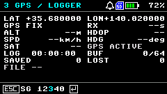

# 画面名の英字表示と枠の廃止

2026-11-01。ヘッダー内の1秒表示から囲み枠を取り除く調整。

UI言語によらず、トップ画面の名前を`1 LIVE`、`2 MAP`、`3 GPS / LOGGER`、`4 LOGS`の英字に統一した。表示位置は状態表示と同じx=4、y=4。ASCII 8×8・シアンの文字だけを、状態と時刻の表示領域に重ねる。右側のアイコン、本文、フッターは隠さない。

対象は引き続き1〜4のトップ画面への実際の切替時だけで、1秒後に状態・時刻へ戻る。非モーダル、同画面の更新では延長しない、ダイアログ優先の条件と、ベル・SD・電池間隔2ドットは維持する。追加の画像バッファ・動的確保はない。

## 確認

- 描画439ケースとログ地名継続8ケースに成功。
- トップ4画面×日英×4/16ビットの16ケースで、ヘッダーが枠なしASCII文字だけであることをピクセル照合。本文・フッター・右側アイコンは期限前後で同一。
- 設定編集・画面名期限・キー操作・対象外画面・日本語UIでも同じ英字名の条件を、未定義動作検出付きのホスト試験で確認。

## ビルド・実機確認

元のPlatformIO設定でビルド成功（363.19秒）。固定RAMは279,116 Bで増減なし、Flashは1,810,541 Bで直前の1,810,629 Bより88 B減少。

ファームウェアSHA-256: `ce8acf264e334e384daec4f2f9a1aa196ad67ed25b1e4639a27b4cec502a7dc0`。

MAC `70:AF:09:DF:46:D0`のCardputerへアプリ領域0x10000だけを書き込み、ハッシュ照合に成功。NVS・SD・パーティションの消去は行わなかった。30秒間の通常起動で、保存済みGPSモード、SD/FAT32、データセット02・アラートON設定の復元、GPS FIX、時刻補正、地名表示を確認。観測中にパニックや再起動ループはなかった。

書込みログは`.pio/plain-header-flash.log`、起動ログは`.pio/plain-header-boot.log`。ヘッダーのピクセル配置は上記の実装描画試験で確認し、実機の全画面を目視する操作は今回未実施。

