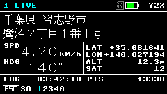

# Geoputer Live Place画面

文書状態: 採用仕様 1.5（使用不能時の自動解除と診断通知に対応）

対象画面: 240×135 px、横向き  
入力: Cardputer ADV 56キーキーボード  

[共通仕様・画面一覧](../02_画面・操作機能設計.md)／[画面レイアウト・表示状態の詳細](レイアウト仕様.md)

## 1. 目的

復帰時のメイン画面として、地名、GPS情報、記録状態、SD実アクセス、電池残量を確認する。GPSログを開始していなくても現在地を確認できる。GPSログの操作はGPS Loggerと共通Gで行い、GはGPS画面と共通の開始・一時停止・再開・停止操作を開く。

## 2. 採用レイアウト

[4倍表示](live-place-refined-pause-preview.png)／[N03データ](live-place-refined-n03-preview.png)／[SD保存失敗](live-place-refined-sd-error-preview.png)／[GPS受信断](live-place-refined-gps-error-preview.png)

最上段は記録状態→時刻→SDカードアイコン→電池アイコン・残量率の順とする。SDは12×12の固定パターンとし、RGは表示しない。住所は東雲16×16ドットの2行とし、1行目に都道府県・市区町村、2行目に町名以降を表示する。

住所の下は縦線で左右に分ける。左はSPD（速度）とHDG（進行方位）を上下に配置し、主数値を東雲16×16ドットで表示する。ラベルと速度単位km/hはASCII 8×8とする。右はLAT（緯度）、LON（経度）、ALT（海抜高度）、SAT（使用衛星数）をASCII 8×8で縦に並べる。HDGはGPSの進行方位であり、端末本体の向きではない。HDOPはメイン画面へ表示しないが、取得・記録項目には残す。

その下にLOG経過時間とPTS記録ポイント数（現在のログで受け付けた総件数。SD保存待ち分を含む）、最下段に⎋SG 12340を置く。全項目の配置・サイズ・単位・未取得表記は[レイアウト仕様](レイアウト仕様.md)を正本とする。

GPS:FIXと正常時SD OKは上段へ常設しない。GPS・SDに問題がある場合は、本文下部を赤地・白文字の原因表示へ切り替える。メイン画面のERROR表示と、Appが持つ実際の記録・停止・一時停止状態は区別する。

住所の表示例は習志野市庁舎の所在地（千葉県習志野市鷺沼2丁目1番1号）とする。実際の地名はデータセットの粒度に従い、確認済みのN03では1行目を「千葉県 習志野市」、2行目を空欄とする。番地を逆ジオコーディングで取得できたと誤表示しない。時刻・座標・件数等の例示値は配置確認用であり、GNSS実測値や実機の現在値ではない。

## 3. SD実アクセス

全画面共通のSDカードアイコンを共通ヘッダー内(x=166、y=2)へ12×12ドットで配置する。非アクセス時は暗灰、実アクセス中は青とし、短いアクセスも最低150ms表示する。形は角を斜めに切ったカードと3本の端子で、文字・囲み枠を付けない。確認ダイアログやUSBの取り外し待ちでもアイコンを暗くしない。RGの表示は廃止する。

ログ・地図・Wordbook・媒体操作・USBの実I/Oで点灯する。RAM参照・記録受付・NVS保存だけでは点灯しない。詳細は[共通仕様](../共通ステータスアイコン.md)に従う。

## 4. 検索と表示更新

dataset.iniのWordbook言語セクションにdisplay_line1 / display_line2を置き、%0〜%9と%%で内容・順序・固定文字を指定できる。この2つは表示上の折返しとは独立した論理行とする。書式省略時は従来の行政名／町名の配置を使う。未取得の番地を表示例から補わない。設定で選択した番号ディレクトリのGLCとWordbook言語を使用する。データセットが使用可能で、有効Fixがある場合に限り、新しいGPSサンプルがデータセットの別の格子へ移ったら、5秒を待たず地名検索を要求する。同じ格子内の移動では検索を省き、座標だけを更新する。地図画面も同じコード面キャッシュと地名LRUを利用する。使用不可の場合はGPS更新・Fix再取得・画面復帰でも検索を投入しない。

Live Placeの地名欄はx=4〜235、y=20〜57を使用する。選択中のWordbook言語が`ja`の場合は、2つの論理行をy=20・40に東雲16×16で表示する。半角スペースだけは8ドット幅とし、各行が232ドットを超えたらUTF-8の文字境界を保って末尾を`...`で省略する。

ASCIIだけで構成された日本語以外の地名は、通常は2つの論理行をy=20・40に8×16で表示する。どちらか一方でも232ドット（ASCII 29文字）を超えた場合は、地名欄全体を8×8へ切り替える。各論理行を独立して2表示行まで折り返し、1行目をy=20・30、2行目をy=40・50に配置する。各表示行の上限は232ドットとし、折返しは半角スペースを優先する。折返し位置の区切りスペースは表示せず、29文字を超える単語は文字境界で分割する。2表示行に収まらない部分は各論理行の2表示行目の末尾を`...`にして省略する。片方の論理行の余白をもう片方へ貸さない。日本語以外でも非ASCII文字を含む地名は、8×16のASCIIと16ドット幅の非ASCII文字で2論理行に表示し、超過分を省略する。地図画面にはこの折返しを適用しない。

Storageは書式展開後の2論理行を各96バイト以内で地名キャッシュへ保持し、Appは書式を再展開しない。Live PlaceはASCII長文を8×8へ折り返し、地図画面は同じ論理行から表示幅に応じて省略する。

正常な再検索中は既存の地名と、その検索に使用したFixを保持する。異常が確定した場合は保持を終えて未選択へ移し、原因を一時通知する。結果確定後に地名・座標を一緒に差し替え、検索途中に届いたGPS位置で対象を変更しない。初回など結果がない場合だけSEARCHING...を表示する。

Fix喪失時は旧地名・座標を消し、データセットが使用可能なら地名欄をWAIT GPS FIXの東雲16×16ドットにする。未選択なら地名欄の未選択表示を維持する。座標・失効したGPS詳細は--にする。赤帯に受信断等の原因を表示する。実行中のSD I/OがあればSDカードアイコンは青を維持する。遅延した地名結果を新しい検索結果として適用しない。

## 5. エラー

使用中データセットが利用不能と判明した場合、StorageがNVSとRAM上の選択を未選択へ更新する。地名欄は「データセット／未選択」とし、`DS01 MISSING -> NONE`など、解除番号・原因・未選択への遷移をASCII 8×8の赤帯へ5秒間通知する。消灯中・他画面で発生した通知はLive Placeに戻ってから表示時間を数える。番号と原因はその起動中の設定→動作設定→データセットでも確認できる。

解除のNVS保存失敗は通常画面に`DATASET CLEAR SAVE FAILED`を表示し、設定画面にも未保存を示す。RAM上の未選択は維持する。保存失敗時は旧選択がNVSに残る可能性を診断情報へ記録し、後続の設定保存が成功するまで保持する。GPS・ログ・SDの個別エラーの表示とデータ保護は継続し、データセットの自動解除だけでGPS記録を停止しない。

未選択後は画面復帰・Fix再取得・再マウントで元の選択を自動復活させない。必要ならキャッシュ再生成・検証を行い、データセットを改めて選択する。GPS未測位、範囲外・区域コード0は自動解除理由にしない。詳細は[メタデータ仕様8.3〜8.4節](../../08_データセットメタデータ仕様.md#83-起動時の復元とエラー)に従う。

## 6. 操作

| キー | 動作 |
|---|---|
| Esc（Fn不要） | 画面選択MENUを開く。LIVEのDelは無効 |
| 1 / 2 / 3 / 4 / 0 | メイン / 地図 / GPS・記録 / ログ一覧 / 設定へ直接移動 |
| S | 消灯する。復帰後も元の画面を維持する |
| G | GPS画面と共通の記録操作を開く |
| 左右または`,` / `/` | 共通操作内の項目選択 |
| Enter | 共通操作内の選択を確定 |
| Esc / Del | 共通操作を取り消す |

記録中・開始待ちは一時停止、一時停止中は再開、停止中は開始を初期選択とする。取消項目は設けず、Esc / Delで戻る。表示しただけでは記録状態を変更せず、確定済みの操作をUIが保持してAppへ通知する。Appは一時停止時に新しい記録採用を止め、境界までのFlushLogの受付結果を得てPAUSEDを確定する。SDへの実保存は非同期とし、GPS受信・測位は継続する。停止はファイルを閉じるが、GPS受信は継続する。

数字の画面ショートカットは各トップ画面で使用でき、下位階層・値編集中・ダイアログ中は画面を切り替えない。物理キーを保持したままFnを変更しても、新しい押下として扱わない。消灯中の最初のキーは復帰だけに使用し、次の押下から通常操作を受け付ける。

## 7. 実装状況

住所2行・左右GPSパネル・大きな速度と進行方位・高度表示を採用仕様1.3に合わせて実装した。Storageで書式展開・文字幅判定した2行をキャッシュし、Appはそのまま表示へ渡す。SPD / HDGのラベルを各パネル左上に置き、左右と上下を均等に分割し、SPDとHDGの間の横線は画面左端から中央の縦線までとし、右のGPS詳細パネルには引かない。速度の単位はkm/h固定とし、1km/h未満は0、1〜10km/h未満は小数2桁、10〜100km/h未満は小数1桁、100km/h以上は整数とする。数字16ドット・小数点の送り8ドットで数字3桁までを収め、単位は同じ位置へ固定する。SDカードアイコン、電池、赤帯、GPS Loggerの記録操作は同じ状態を使う。EscでMENUを開き、1/2/3/4/0で各トップ画面へ直接移動する。GPSの休止処理は撤回し、記録停止後も連続受信する。詳細値・進行方位・電池表示は固定した右端へ揃え、ラベルと単位の位置を維持する。

地名欄へ原因を2行表示する旧画像は採用仕様1.4当時の資料であり、現行の自動解除後の画面を示さない。現行は未選択表示と解除通知を使用する。

画像は`python3 tools/render_live_place_layout.py`で実装の描画コードから再生成する。旧レイアウトの画像は新レイアウトで置換した。レイアウトのホスト検証と実機確認の結果は[メインレイアウト1.3検証](../../検証/メインレイアウト1.3検証.md)、2026-10-16の操作ガイド・キー変更は[キーバインド変更検証](../../検証/キーバインド変更検証.md)を参照する。画像は例示入力からの描画であり、接続中の実機の現在値を示すキャプチャではない。

Gの問い合わせは[共通確認ダイアログ](../共通確認ダイアログ.md)のGPS操作を使用する。[日本語の表示例](../gps-logger/log-browser-logger-confirm-preview.png) / [English](../gps-logger/log-browser-en-logger-confirm-preview.png)。旧Pキーと個別の一時停止確認は使用しない。

エラー表示中もEscのMENUと0の設定を使用できる。通常画面からの設定表示ではGPS・記録を自動停止しない。自動GPS・地名検索を起動しないメンテナンスは、起動時のEsc保持またはBoot画面のEscから入る。

キーの分類・並び順・ESC・Enterマークと暗黙のDelは[共通キー操作](../共通キー操作.md)に従う。
