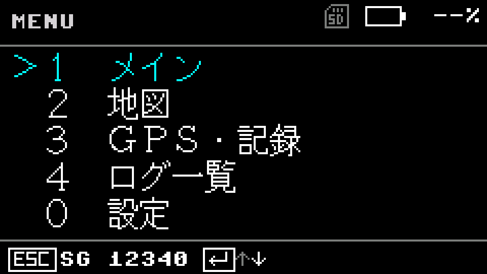

# MENU画面

LIVEのEscで開く画面選択入口。1 メイン、2 地図、3 GPS・記録、4 ログ一覧、0 設定の5項目を並べる。上下で選択しEnterで移動する。数字キーは選択行に関係なく対応先へ直接移動する。Esc / Delはメインへ戻る。MENU自体は記録・GPS状態を変更しない。

タイトル・フッターの通常文字はASCII 8×8、項目は日本語が東雲16×16、英語がASCII 8×16とする。240×135の実画面へ整数座標で描画する。最下段は⎋SG 12340にEnterマークと上下矢印を続ける。Enterによる選択は改行キー風マークで示し、先頭・末尾では移動できない方向をグレーにする。

[English](en-menu-preview.png)

キーの分類・並び順・ESC・Enterマークと暗黙のDelは[共通キー操作](../共通キー操作.md)に従う。
