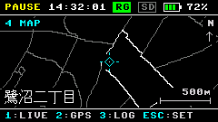

現行実装は[地図画面仕様](README.md)を参照。本書は初期の画像案として残す。

# 境界線による地図画面案

提案日: 2026-10-24。240×135ピクセル、表示・操作案。ファームウェアへの画面追加・4キーの割当はまだ行っていない。

[4倍プレビュー](place-view-boundary-proposal-preview.png)

## 表示

上段の記録状態・時刻・RG・SD・電池はLive Placeと共通にする。地図は北を上とし、現在地を地図領域の中央へ固定する。区域内部は黒のまま、異なる区域コードが接する箇所を1ピクセルの線で表示する。現在地の区域は白、周辺の境界は灰色、現在地マーカーは水色と中心の白点にする。

地図領域はx=0〜239、y=18〜118、中央は(120,68)。左下に現在区域の地名を東雲16×16で表示し、右上に北、右下に500mのスケールを置く。その他の表示は既存のASCII 8×8とし、アンチエイリアスを使用しない。

## 画面切替

通常モードの各トップ画面から4で開く想定とする。この画面の1はLive Place、2はGPS Logger、3はLogs、EscはSettingsへ直接移動する。4を再度押しても同じ画面を維持する。画像の最下段は移動先の1 / 2 / 3 / Escを表示する。下位階層・確認中の切替は既存の共通仕様に従う。

## 画像の生成

`python3 tools/render_boundary_map_proposal.py`で生成する。estatの実データから35.681641, 140.027194付近を取得し、区域コード66087の鷺沼二丁目を中心にしている。地名と境界は同じ区域コードから取得する。水平・垂直の距離が概ね等しくなるよう緯度に応じてサンプリングし、境界と文字は整数ピクセルへ描く。

ホスト上の案の生成であり、端末上の必要メモリ・縮尺・更新周期を確定するものではない。既存READMEの疑似色による塗分け案とは別の提案として保持し、採用後に仕様を統合する。

## モジュール設計

画像処理と保持形式の分離、Storage／App／UIの責務と通信は[地図表示モジュール設計](../../12_地図表示モジュール設計.md)に従う。地図生成はタスク追加ではなく、独立した画像モジュールを既存Storageジョブから呼ぶ設計とする。
