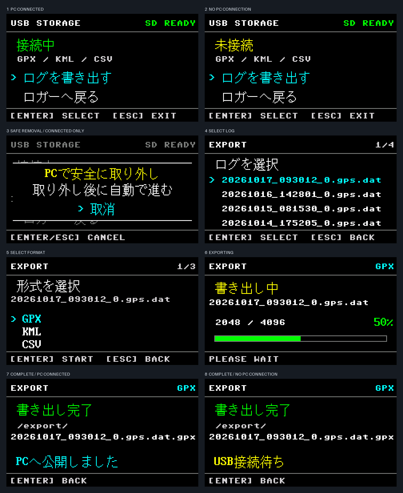

# USBストレージとログエクスポートの画面

本書は、USBモード内で保存済みGPSログをGPX・KML・CSVへ書き出すための画面である。動作の基本契約は[ログエクスポート仕様](../../../10_ログエクスポート仕様.md)に従う。画像は実装のUiModel・UiRenderer・UsbRendererから生成する。GPSロガーへの復帰とログ書き出しをUSBモードの入口に並べ、変換のために通常モードへ再起動する操作は設けない。

## 入口

USBモードへ入ると、状態と2項目のメニューを表示する。状態はPC接続中・未接続・取り外し済みを区別する。SDの準備状態はヘッダーに表示する。

メニューは「ログを書き出す」と「ロガーへ戻る」とする。上下キーまたは`;` / `.`で選び、Enterで進む。Esc / Delはロガーへ戻る確認を開く。ロガーへの復帰は既存の共通2択確認を使い、左が取消、右が終了、左右で選択、Enterで確定する。PC公開中でも終了を選べる。PCの保存完了後に確定し、実行中転送とSD同期を終えてからUSB公開を止めて再起動する。

## PC公開と端末操作の切替

「ログを書き出す」を選んだとき、PCへSDを公開している場合は中央に取り外し案内を表示する。案内は上下だけの白線、黒地、暗くした背景という既存のウインドウ表現を使う。PCでの安全な取り外しを待ち、その完了を確認できたらUSB公開を停止してログ選択へ進む。待機中のEnter・Esc / Delは取消となり、USBメニューへ戻る。ここでは実行と取消を選ばせる質問を追加せず、待機を取り消す操作だけを置く。

未接続・安全な取り外し済みの場合は案内を省略し、USB公開を停止してログ選択へ直接進む。単にアクセスランプが消えている状態は安全な取り外し済みとは扱わない。

ログ選択・変換中はSDを端末が所有する。途中でケーブルが接続されても、PCへSDを公開しない。完了後は端末側のファイルを閉じ、ファイルシステムをアンマウントしてから再公開する。PC未接続ならUSB接続待ちとなる。

## ログ選択と変換

ログ選択には元のファイル名を4件ずつ表示する。上下キーまたは`;` / `.`で選び、Enterで対象を決定すると形式選択へ進む。Esc / DelではSDをPCへ再公開できる状態へ戻してUSBメニューを表示する。USBモードでは記録タスクを起動しないため、この一覧に記録中のログは含めない。

形式選択にはGPX・KML・CSVを並べ、選択対象の元ログ名を表示する。上下で形式を選び、Enterで書き出しを開始する。Esc / Delでログ選択へ戻る。タイトルは以降の処理・完了画面も含めて`EXPORT`とし、GPXへ固定しない。GeoJSONは将来の追加候補であり、初期の一覧には含めない。

書き出し中は対象ファイル名、選択形式、処理済み件数／総件数、進捗率、進捗バーを表示する。変換はStorageが少量ずつ読み進め、UIは進捗通知を表示する。全データをRAMへ展開しない。処理中は別の書き出しとモード終了を受け付けず、完了または失敗の画面へ進む。

出力先はSD直下の`/export/`、出力名は元ファイル名全体へ形式の拡張子を追加する。画像の例では`/export/20261017_093012_0.gps.dat.gpx`となる。元の`.gps.dat`は残す。画像のファイル名と件数は配置確認用の例である。同名出力は上書きせずエラーとし、破損レコードや不完全な末尾を検出した場合も変換を中断する。元のバイナリログは変更しない。長い出力名は8×8の複数行表示で確認できるようにし、追加した拡張子を切り捨てない。

完了画面は出力先と「PCへ公開しました」または「USB接続待ち」を示す。Enter・Esc / DelでUSBメニューへ戻る。失敗時は成功を表示せず、原因を示して再操作できる状態へ戻す。出力後の再公開失敗は「出力済み・公開失敗」と表示し、生成の失敗と区別する。

## 画像

[英語の画面一覧](usb-export-en-overview.png)

| 状態 | 日本語プレビュー | English preview |
|---|---|---|
| PC接続中の入口 | [表示](usb-export-ja-connected-preview.png) | [View](usb-export-en-connected-preview.png) |
| 未接続の入口 | [表示](usb-export-ja-disconnected-preview.png) | [View](usb-export-en-disconnected-preview.png) |
| 接続中だけ表示する取り外し待機 | [表示](usb-export-ja-eject-preview.png) | [View](usb-export-en-eject-preview.png) |
| ログ選択 | [表示](usb-export-ja-files-preview.png) | [View](usb-export-en-files-preview.png) |
| 出力形式選択 | [表示](usb-export-ja-format-preview.png) | [View](usb-export-en-format-preview.png) |
| 書き出し中 | [表示](usb-export-ja-progress-preview.png) | [View](usb-export-en-progress-preview.png) |
| 完了・PC未接続 | [表示](usb-export-ja-complete-preview.png) | [View](usb-export-en-complete-preview.png) |
| 完了・PC接続中 | [表示](usb-export-ja-complete-connected-preview.png) | [View](usb-export-en-complete-connected-preview.png) |
| 破損レコード | [表示](usb-export-ja-error-preview.png) | [View](usb-export-en-error-preview.png) |
| 出力済み・再公開失敗 | [表示](usb-export-ja-publish-error-preview.png) | [View](usb-export-en-publish-error-preview.png) |
| SDなし | [表示](usb-export-ja-no-sd-preview.png) | [View](usb-export-en-no-sd-preview.png) |
| 安全に取り外し済み | [表示](usb-export-ja-ejected-preview.png) | [View](usb-export-en-ejected-preview.png) |

画像は240×135ドットで描き、個別プレビューのみ最近傍法で4倍にしている。一覧では各画面を最近傍法で3倍にし、画面外に状態番号を付ける。タイトル・補助・ファイル名は既存のASCII 8×8、日本語本文は東雲16×16、ASCII本文は既存の8×16を使用する。英語版も同じ寸法・キー操作とする。

`python3 tools/render_usb_export_proposal.py`で再生成する。ファームウェアのUiModel・UiRenderer・UsbRenderer・PixelFont・UiCanvasを使い、本文の画面内収容と4bpp／16bppの画素一致を検証する。最大長の元名・出力名、空一覧、読込中、最大件数、失敗表示も描画検証に含める。
