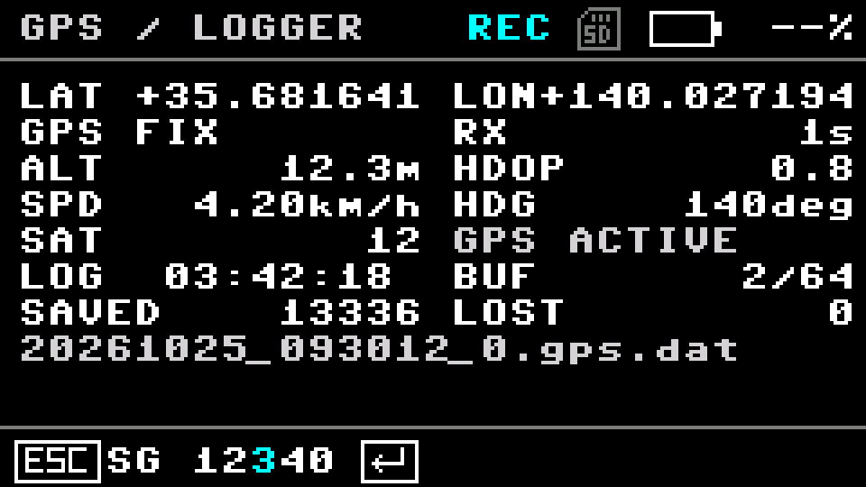

# ReverseGeoputer GPS・記録画面

文書状態: Draft 0.14（GPS休止処理を撤回し、連続受信へ復帰）
対象画面: 240×135 px、横向き

[共通仕様・画面一覧](../02_画面・操作機能設計.md)

## 1. 目的と入口

GPS・ロギングの現在状態を詳細に確認し、状態を変更する画面とする。トップ画面の3またはEsc→MENUの「3 GPS・記録」から開く。GPS詳細は本画面へ集約するが、メインの速度・方位・座標等も維持する。本画面では逆ジオコーディングを実行しない。

## 2. 表示

ヘッダーはLIVE・地図と共通の高さ17 px（区切り線y=16）とし、タイトル・記録状態の文字上端をy=4に揃える。タイトルと数値・補助表示はASCII 8×8、操作ダイアログは日本語を東雲16×16、英語をASCII 8×16とする。

| 位置 | 内容 |
|---|---|
| ヘッダー | GPS / LOGGER、記録状態STOP / WAIT / REC / PAUSE、終了処理中はSAVING |
| 上部 | GPS受信状態、LAT、LON、ALT、SAT、HDOP、SPD、HDG |
| 中部 | 最終有効NMEA受信からの経過秒、GPS受信動作（GPS ACTIVE / GPS ERROR） |
| 下部 | 一時停止を除く記録時間、BUF使用数/64、SD保存済み件数、欠落件数 |
| 下部の補助欄 | 実ファイル名（最大47バイト、29文字ごとに2行）。最初の保存まではFILE --。保存エラーと通知を優先する |
| 最下段のキー一覧 | ⎋SG 12340 ↵。Enterは枠付き改行キー風マークで示し、ENTER / G: CONTROLの説明行は設けない |

座標・速度・高度・方位は有効Fixがある場合だけ表示する。衛星数とHDOPは有効な受信項目なら未測位でも表示する。LAT/LONはy=23の1行に並べ、左右それぞれ116pxの欄を使う。ラベルはx=4 / 124、数値右端はx=116 / 236とし、符号付き小数6桁で表示する。各行の項目名・単位と数値欄の右端は固定し、未取得の「--」、桁数・符号の変化で隣の項目を動かさない。欄に収まらない数値はOVRとする。

## 3. 共通の状態変更操作

EnterまたはGで中央に上下線付きの操作ダイアログを開く。各画面のGも同じ処理へ接続し、現在画面は変更しない。取消は選択肢に含めず、Esc / Delだけで操作を送らずに閉じる。左右で隣へ移動してEnterで確定する。上下や数字は操作しない。一時停止できるときは一時停止を初期選択とし、Enterだけで実行できる。

| 現在状態 | 左から並ぶ選択肢 | 初期選択 |
|---|---|---|
| 記録停止（GPS受信は継続） | 開始 | 開始 |
| 開始待ち・記録中 | 停止 / 一時停止 | 一時停止 |
| 一時停止中 | 停止 / 再開 | 再開 |

SD利用不能時の開始、セッション終了処理中の操作など、既知の利用不能項目はグレーアウトする。無効な項目はEnterでも実行できず、すべて無効でもEsc / Delで閉じられる。実行時にもAppとStorageが条件を検証する。状態が変わった場合は開いている旧状態のダイアログを閉じ、古い操作を実行しない。

開始はGPS受信の準備を確認し、新規ログセッションを用意する。受信済みの古いFixは採用せず、次の新しい有効Fixを待つ。一時停止は新しいログ受付を止めてflushを要求し、セッション・GPS受信を維持する。再開は同じセッションを次の新しい有効Fixから継続する。

停止は新しいログ受付を止め、Appが保持する未受付レコードを既存の再試行手順で受け渡し、Storageへ保存・終了を要求する。受付成功後に記録状態をSTOPPEDとする。実保存・ファイル閉鎖はStorageが非同期に完了し、SAVINGと未保存件数で区別する。保存失敗でも受理済みデータを捨てない。GPS受信と有効Fixは維持し、地名・地図の現在位置を更新できる。

## 4. GPSの連続受信

GPSは起動時に受信を開始し、記録停止・一時停止中も連続受信する。時間指定待機コマンドの繰返し、復帰期限待ち、停止中のUARTデータ破棄は使用しない。GPSのみを停止する選択肢と、STANDBY REQUEST / SLEEP UNCONFIRMED / WAKING表示は撤去する。

画面消灯は表示のみを休止し、GPS受信と記録状態を変更しない。GPSのハードウェア休止は今回の実装対象から外す。LoRaの起動時休止は別系統であり維持する。

## 5. 現行実装と保存状態

UIは確定操作を保持してAppへ内容更新を通知し、Appが同期取得して既存のログ制御へ渡す。GPSはStartGpsReception / GetGpsStatusを同期要求として扱い、Fixと状態変化を通知する。StartGpsReceptionは受信準備済みなら状態を初期化せず成功を返す。通知のrevisionとsample_seqは単調な系列を維持し、古い通知を再適用しない。

RAMへの追加受付とSD実保存は別とする。受付・開始・flush・終了要求のエラーをAppがUIへ伝え、非同期の実保存エラーも保持して表示する。保存済み件数は書込み・sync成功分に限る。ログ状態とエラーは独立し、SD青ランプだけを保存成功の根拠にしない。

[English](log-browser-en-logger-preview.png)

キーの分類・並び順・ESC・Enterマークと暗黙のDelは[共通キー操作](../共通キー操作.md)に従う。
