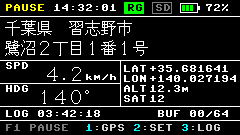

# Geoputer Live Place画面

文書状態: 採用仕様 1.3（実装反映済み）  
対象画面: 240×135 px、横向き  
入力: Cardputer ADV 56キーキーボード  

[共通仕様・画面一覧](../02_画面・操作機能設計.md)／[画面レイアウト・表示状態の詳細](レイアウト仕様.md)

## 1. 目的

復帰時のメイン画面として、地名、GPS情報、記録状態、キャッシュ状態、SD実アクセス、電池残量を確認する。GPSログを開始していなくても現在地を確認できる。GPSログの開始・再開・停止はGPS Loggerで行い、Live PlaceのF1は一時停止だけに使用する。

## 2. 採用レイアウト

[4倍表示](live-place-refined-pause-preview.png)／[N03データ](live-place-refined-n03-preview.png)／[SD保存失敗](live-place-refined-sd-error-preview.png)／[GPS受信断](live-place-refined-gps-error-preview.png)

最上段は記録状態→時刻→RG→SD→電池アイコン・残量率の順とする。RG・SDは四角で囲った8×8 ASCIIの2文字とする。住所は東雲16×16ドットの2行とし、1行目に都道府県・市区町村、2行目に町名以降を表示する。

住所の下は縦線で左右に分ける。左はSPD（速度）とHDG（進行方位）を上下に配置し、主数値を東雲16×16ドットで表示する。ラベルと速度単位km/hはASCII 8×8とする。右はLAT（緯度）、LON（経度）、ALT（海抜高度）、SAT（使用衛星数）をASCII 8×8で縦に並べる。HDGはGPSの進行方位であり、端末本体の向きではない。HDOPはメイン画面へ表示しないが、取得・記録項目には残す。

その下にLOG経過時間とBUF使用数/64、最下段にF1 PAUSE  1:GPS 2:SET 3:LOGを置く。全項目の配置・サイズ・単位・未取得表記は[レイアウト仕様](レイアウト仕様.md)を正本とする。

GPS:FIXと正常時SD OKは上段へ常設しない。GPS・SDに問題がある場合は、本文下部を赤地・白文字の原因表示へ切り替える。メイン画面のERROR表示と、Appが持つ実際の記録・停止・一時停止状態は区別する。

住所の表示例は習志野市庁舎の所在地（千葉県習志野市鷺沼2丁目1番1号）とする。実際の地名はデータセットの粒度に従い、確認済みのN03では1行目を「千葉県 習志野市」、2行目を空欄とする。番地を逆ジオコーディングで取得できたと誤表示しない。時刻・座標・件数等の例示値は配置確認用であり、GNSS実測値や実機の現在値ではない。

## 3. RGとSDの分担

| 表示 | 暗灰 | 緑 | 黄 | 青 |
|---|---|---|---|---|
| RG | キャッシュ未準備・無効 | 有効な矩形を保持。検索のない間も維持 | キャッシュ再構築中 | 使用しない |
| SD | SD実アクセスなし | 使用しない | 使用しない | ログ・地図・WordBook・媒体操作を含む実アクセス中 |

RGはキャッシュヒットの点滅ではない。GPS喪失や画面切替だけで有効な矩形キャッシュの緑表示を消さない。SDは短いI/Oだけ最低150ms表示し、RAM参照・記録受付・NVS保存では点灯しない。矩形がヒットして地名キャッシュがミスした場合は辞書を読むため、RG緑・SD青は正常な組合せである。矩形と地名がともにヒットした検索ではSDアクセスを発生させず、別のログ保存等がなければSDは待機表示のままとする。RGは地名キャッシュのヒット・ミスを表示しない。

状態の正本はStorageとし、RgCacheStateChanged / SdAccessChangedをAppが集約してUIへ渡す。RGの状態とSDの点灯を保存成功・失敗の表示に代用しない。

## 4. 検索と表示更新

画面の住所は最大2行・各14文字とする。1行目は都道府県と市区町村を全角1セルの空きで連結し、2行目は町名・小地域・丁目・番地等の取得済み下位階層を連結する。行政階層に空欄があれば飛ばし、超過分はUTF-8の文字境界を保って...で省略する。住所行を3行目へはみ出させず、未取得の番地を表示例から補わない。Storageが返す既存の3階層の値コピーは維持し、Appの表示整形で2行へまとめる。現在のファイル読出し先行段階では/dataset/01のGLCとWordBookを使用する。GPSの新しいサンプルに対して最短5秒間隔で地名検索を要求する。

再検索中は既存の地名と、その検索に使用したFixを保持する。結果確定後に地名・座標を一緒に差し替え、検索途中に届いたGPS位置で対象を変更しない。初回など結果がない場合だけSEARCHING...を表示する。

Fix喪失時は旧地名・座標を消し、地名欄をWAIT GPS FIXの東雲16×16ドット、座標・失効したGPS詳細を--にする。赤帯に受信断等の原因を表示する。キャッシュが残っていればRGは緑を保ち、実行中のSD I/OがあればSDは青を維持する。遅延した地名結果を新しい検索結果として適用しない。

## 5. エラー

SD保存失敗・RAM満杯・GPS受信断等は赤帯の白文字で表示し、トーストだけで消さない。GPSが有効なSD障害では、地名・座標・GPS情報を保持する。受付失敗と実際の欠落、RAM受付と永続化完了を区別する。未保存件数・バッファ使用数/64・欠落件数の詳細はGPS Loggerから確認できる。

Galuchat検索が失敗した場合は地名取得失敗を示し、GPS受信とログ記録は継続する。キャッシュ表示は実際の保持・無効化状態に従い、検索失敗だけからAppが推定しない。エラーはAppが対応する問題の解消を確認してUIへ反映するまで保持する。

## 6. 操作

| キー | 動作 |
|---|---|
| F1 | RECORDINGまたは記録継続要求中のSTORAGE_ERRORで一時停止確認 |
| 1（Fn不要） | GPS記録画面を開く。開始・停止は実行しない |
| 2（Fn不要） | 設定画面を開く |
| 3（Fn不要） | ログ一覧を開く |
| Enter | 決定・確認 |
| Esc / Del | 確認の取消 |

UIは確定操作を保持してAppへ内容更新を通知する。Appが操作を同期取得し、新しい記録採用を止めて、境界までのFlushLogの受付結果を取得した後にPAUSEDを確定する。SD実保存は非同期とし、後続の保存結果で表示を更新する。GNSS ACTIVEと最新Fix更新を維持する。

確認の左右選択はFnなしの`,` / `/`でも操作できる。2/3と方向キーはFn併用も受け付ける。Fn＋1はF1一時停止として区別し、1を保持したままFnを変更しても新しい押下として扱わない。画面消灯中の最初の数字キーは復帰だけに使い、次の押下で対応画面を開く。画面ショートカットはLive Place以外と確認中には作用しない。

STOPPED / STARTING / PAUSEDではF1を無効にする。再開・開始・停止をF1へ割り当てず、1でGPS Loggerを開いて行う。左右キーは共通確認ダイアログの選択にだけ使用する。

## 7. 実装状況

住所2行・左右GPSパネル・大きな速度と進行方位・高度表示を採用仕様1.3に合わせて実装した。Storageの地名結果は3階層を維持し、Appが住所を2行へ整形する。SPD / HDGのラベルを各パネル左上に置き、左右と上下を均等に分割し、SPDとHDGの間の横線は画面左端から中央の縦線までとし、右のGPS詳細パネルには引かない。速度は1,000m/h未満を整数m/h、1〜100km/h未満を小数1桁km/h、100km/h以上を整数km/hとする。数字16ドット・小数点の送り8ドットで数字3桁までを収め、単位は同じ位置へ固定する。RG/SD、電池、赤帯、GPS Loggerの記録操作は同じ状態を使う。MENU画面を廃止し、1/2/3で直接画面を開く。ログ閲覧は実装済み、GNSS休止制御は後続実装である。

画像は`python3 tools/render_live_place_layout.py`で実装の描画コードから再生成する。旧レイアウトの画像は新レイアウトで置換した。レイアウトのホスト検証と実機確認の結果は[メインレイアウト1.3検証](../../検証/メインレイアウト1.3検証.md)、2026-10-16の操作ガイド・キー変更は[キーバインド変更検証](../../検証/キーバインド変更検証.md)を参照する。画像は例示入力からの描画であり、接続中の実機の現在値を示すキャプチャではない。

F1の一時停止確認も[共通確認ダイアログ](../共通確認ダイアログ.md)を使う。取消を初期選択とし、右で一時停止を選びEnterで確定する。確認表示だけでは記録を止めず、Esc / Delで戻れる。[日本語の表示例](log-browser-pause-confirm-preview.png) / [English](log-browser-en-pause-confirm-preview.png)。
