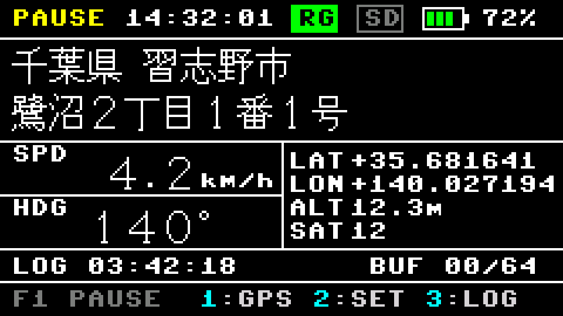

# Geoputer Live Place 画面レイアウト仕様

文書状態: 採用仕様 1.3（実装反映済み）  
画面: 240×135 px、整数座標、アンチエイリアスなし  
フォント: 地名・住所・速度と進行方位の主数値は東雲16×16ドット、ラベル・単位・補助表示はC64 ASCII 8×8ドット  

## 1. 構成



地名・住所を上部2行へ集約し、その下を左右のGPS情報パネルに分ける。左は速度SPDと進行方位HDGを大きく、右は緯度LAT・経度LON・高度ALT・使用衛星数SATを縦に並べる。HDOPはメイン画面に表示しない。上段は記録状態→時刻→RG→SD→電池アイコン・残量率、最下段はF1 PAUSE  1:GPS 2:SET 3:LOGとする。

```text
┌──────────────────────────────┐
│PAUSE 14:32:01 RG SD [電池]72% │
├──────────────────────────────┤
│千葉県 習志野市               │
│鷺沼2丁目1番1号               │
├──────────────┬───────────────┤
│SPD           │LAT +35.681641 │
│    4.2 km/h  │LON +140.027194│
├──────────────┤               │
│HDG           │ALT 12.3m      │
│    140°      │SAT 12         │
├──────────────┴───────────────┤
│LOG 03:42:18        BUF 00/64  │
├──────────────────────────────┤
│F1 PAUSE  1:GPS 2:SET 3:LOG   │
└──────────────────────────────┘
```

上図は領域と項目を示す構成図である。文字サイズとドット配置は以下に従う。表示例の住所は習志野市庁舎の所在地「千葉県習志野市鷺沼2丁目1番1号」とする。時刻・測位情報・電池・件数は配置確認用の入力例とする。

## 2. 配置と文字

240×135 pxで直接描画する。背景は黒、通常文字・区切り線は白、区切り線は1ドットとする。表の座標は左上を原点とし、幅・高さは実ドット数とする。

| 領域 | 配置 | 内容 |
|---|---|---|
| 記録状態 | x=4、y=4 | ASCII 8×8、5文字分。RECは緑、PAUSEは黄、ERRORは赤 |
| 現在時刻 | x=52、y=4 | ASCII 8×8、日本時間HH:MM:SS |
| RG | x=124、y=2、20×12 | 文字はx=126、y=4のASCII 8×8、2文字 |
| SD | x=152、y=2、20×12 | 文字はx=154、y=4のASCII 8×8、2文字 |
| 電池 | x=180、y=3 | 本体18×10、端子2×4ドット |
| 電池残量 | x=204、y=4 | ASCII 8×8。100%の4文字も右端4ドットの余白を確保 |
| ヘッダー区切り | y=16 | 幅240の1ドット線 |
| 地名・住所 | x=4、y=20・40 | 東雲16×16、半角スペース8×16、2行、各232ドット以内 |
| 住所下の区切り | y=60 | 幅240の1ドット線 |
| 速度パネル | x=4〜116、y=61〜82 | SPDとkm/hは8×8、速度の主数値は東雲16×16 |
| 左パネル内の横区切り | x=0、y=83、幅120 | 左端から中央の縦線までSPDとHDGを分ける。右側には横線を引かない |
| 進行方位パネル | x=4〜116、y=84〜105 | HDGは8×8、角度の数値と°は東雲16×16 |
| 左右パネルの区切り | x=120、y=60〜106 | 1ドットの縦線。左右を120ドットずつに等分する |
| GPS詳細ラベル | x=122、y=65・75・85・95 | ASCII 8×8、LAT / LON / ALT / SAT |
| GPS詳細値 | x=148、y=65・75・85・95 | ASCII 8×8。経度の符号付き11文字も右端4ドットを確保 |
| GPS情報下の区切り | y=106 | 幅240の1ドット線 |
| 記録詳細 | x=4・156、y=110 | ASCII 8×8、LOG経過時間・BUF使用数/64 |
| 赤帯 | x=0、y=107、幅240・高さ13 | 記録詳細の行を赤地・白文字へ置換 |
| フッター区切り | y=120 | 幅240の1ドット線 |
| 操作 | x=4、y=124。数字1/2/3はx=84/132/180 | ASCII 8×8、F1 PAUSE  1:GPS 2:SET 3:LOG（27文字・216px）。数字はシアン、:GPS / :SET / :LOGはライトグレー。Fnなしの1/2/3でGPS記録・設定・ログ一覧を直接開く |

速度は最大3桁の数字で表す。単位は画面表示時に変換し、GPS内部のkm/h値と測位レコードの形式は変更しない。

| 速度の範囲 | 表示規則 | 例 |
|---|---|---|
| 1,000m/h未満 | 整数m/h | 420 m/h |
| 1〜10km/h未満 | 小数1桁km/h | 4.2 km/h |
| 10〜100km/h未満 | 小数1桁km/h | 14.2 km/h |
| 100km/h以上 | 整数km/h | 123 km/h |

表示の丸めで1,000m/hになる場合は1.0km/hへ、100.0km/hになる場合は100km/hへ繰り上げる。整数km/hへ丸めて999を超える場合はOVRとする。有効な速度0は0 m/h、未取得は-- km/hとする。

速度の数字は東雲16ドットを維持し、小数点だけ同じ東雲の元字形を使って送り幅を8ドットにする。14.2は数字3桁と小数点で56ドットとなる。値はx=84を右端としてy=66へ配置し、単位はx=84、y=73へ固定する。数字を縮小せず、桁数が変わっても単位を別行へ移さない。進行方位は整数度とし、数値と°をx=36、y=89へ東雲16ドットで横に並べる。

停止中の状態ラベルはSTOP、開始処理・新しいFix待ちはWAITとし、5文字分の枠内へ収める。記録要求のあるRECORDINGはREC、一時停止はPAUSEとする。SD・GPSの問題発生時はERRORを優先するが、Appが持つ記録要求・停止・一時停止の実状態は変更しない。STOPPED / STARTING / PAUSEDでF1は暗灰の無効表示とし、再開はGPS Loggerから行う。

SPDラベルはx=4、y=62、HDGラベルはx=4、y=85に置き、各パネルの左上へ寄せる。住所下端y=60からGPS情報下端y=106の中央はy=83とし、上下も均等に分割する。

## 3. RG：キャッシュ状態

| 実状態 | 表示 |
|---|---|
| Unprepared：未準備・無効・解放済み | 黒地、暗灰の枠・文字 |
| Ready：有効な矩形キャッシュを保持 | 緑地、黒文字。検索していない間も継続 |
| Rebuilding：初回または範囲外の矩形を構築中 | 黄地、黒文字 |

RGはアクセスの点滅ではなく、Storageの実キャッシュ状態を表示する。キャッシュヒットのたびに点滅させず、地名検索の完了時にも消灯しない。再構築に成功すると緑、失敗・画像解放・Reader閉鎖で暗灰へ戻る。緑は有効な矩形を保持している意味であり、すべての新しい座標がその矩形内にあるとは限らない。範囲外の検索を実行すると黄へ移る。

GPS Fix喪失・画面切替・ログの一時停止・ログ保存失敗だけでは、有効なキャッシュを未準備表示にしない。例えばGPS受信断の画像でも、キャッシュを保持していればRGは緑である。SDの取り外し・再マウント・フォーマット等でReaderを閉じた場合は暗灰になる。

RGは最新状態をそのまま表示し、150msの点灯延長を行わない。短い再構築で黄の中間状態がUI更新へ統合された場合は、準備済みの緑を表示してよい。

## 4. SD：カード実アクセス

| 実状態 | 表示 |
|---|---|
| SD実アクセスなし | 黒地、暗灰の枠・文字 |
| SD実アクセス中 | 青地、白文字 |

対象はログの作成・書込み・flush・読出し・一覧・集計、Galuchatの地図・WordBook、データセット確認、SDのファイル管理・媒体操作を含む。RAM上のキャッシュ参照・文字変換・記録受付、NVS設定保存、ファーム内ライセンス表示は対象外とする。SD API・ファイルReaderの実I/O区間を示すもので、SPIバスの電気的な動作そのものを測定するランプではない。

矩形キャッシュがヒットしても、16件の地名キャッシュに未登録の区域コードではWordBookを読むため、RGが緑のままSDが青になることがある。矩形と地名がともにヒットした検索ではSDアクセスを発生させない。再構築中のカード読出しはRG黄・SD青となる。RG未準備でも、データセット確認等でSDだけ青になる場合がある。RGの色は地名キャッシュではなく矩形キャッシュの実状態に従う。

SDは短いアクセスでも最低150ms点灯し、長いI/Oでは終了まで維持する。開始・終了が1回のUI更新へ統合されても、新しいアクセスIDを受ければ短く点灯する。I/O終了・失敗後は最低点灯時間の経過後に待機表示へ戻す。結果バッファをApp・UIが参照しているだけの時間は点灯しない。青は保存成功を意味せず、エラーは赤帯で別に示す。

## 5. 通知と表示の責務

キャッシュとSD I/OはStorageだけが操作・観測する。キャッシュ状態はRgCacheStateChanged、SDアクセスはSdAccessChangedでAppへ投機的に通知する。Appは状態世代とデータセット世代を照合して最新状態を保持し、未取得の同期結果を回収した後、UpdateUiContentでUIへ渡す。UIは自身のループで描画する。

キャッシュ状態・SDアクセスは画面の検索要求IDに依存しない。画面離脱後の地名結果は適用しなくても、実キャッシュの準備・解放とカードI/Oの状態は更新する。通知が詰まった場合は最新状態を保持して再通知し、表示のために実保存・読出しを遅らせない。詳細は[タスク構成設計4.5節](../../06_タスク構成設計.md)に従う。

## 6. 電池と時刻

電池は4段階のバーと残量率を併用する。通常は白枠・緑バー・白い残量率、充電中と確認できた場合はシアン枠とする。11〜20%はバー・残量率を黄、10%以下は赤にする。取得不能時は空の枠と--%で表し、0%や充電中と誤表示しない。残量率は目安であり、残り動作時間の推定は実測と方式を決めてから別途検討する。

表示時計は最初の有効GPS時刻で合わせ、本体の単調増加時刻で進める。日本時間HH:MM:SS、未取得時--:--:--とし、GPS喪失・画面切替・消灯で消去しない。表示時計で記録点のGPS日時を置き換えない。

## 7. GPS詳細と赤帯

GPS:FIXや正常時SD OKを上段へ常設しない。左パネルのSPDはGPSの対地速度、HDGはGPSの進行方位（COG）である。HDGを端末本体の向きや電子コンパスの方位として扱わず、GPSの値を使用する。進行方位は真北を0°とする時計回りの0〜359°で表示し、丸めて360°になる場合は0°へ戻す。速度0だけを理由に方位を作らず、未取得・無効な方位を以前の数値で埋めない。

右パネルのLAT / LONは符号付き十進度・小数点以下6桁、ALTはGGAの海抜高度・メートル・小数点以下1桁、SATは使用衛星数の整数とする。ALTを楕円体高や気圧高度として表示しない。高度0m・速度0・衛星数0は有効フラグがある場合の正当な値として扱い、未取得の代わりに使わない。項目ごとの未取得・無効は--、方位は--°とする。Fix喪失時は速度・方位・座標・高度・衛星数を未取得表示へ戻す。

HDOPはメイン画面から外す。GPSタスクの取得、メッセージの項目、有効フラグ、測位記録ファイル内のHDOPは保持し、表示項目の削除をデータ形式の変更にしない。

- SD WRITE FAILED  BUF64/64：SD保存失敗。GPSが有効なら地名・座標・GPS詳細を維持する。
- SD BUFFER FULL：未保存64件が満杯で新規レコードを受け付けられない。
- GPS WAITING FOR FIX：初期の測位待ち。受信断とは区別する。
- GPS SIGNAL LOST：受信断。旧地名・座標を消去し、地名欄にWAIT GPS FIXを東雲16×16ドットで表示する。

赤帯の文字は8×8ドット、最大29文字とし、地名・座標・GPS詳細・操作欄に重ねない。正常時の記録詳細を置き換えて原因を表示する。Appが対応する問題の解消を確認するまで保持し、別の正常なGPS更新・SDアクセス・画面切替だけでは消さない。受付エラーは同期戻り値、受付後の保存失敗はStorageError通知からAppが把握する。

## 8. 実装状況と画像

採用仕様1.3をUiRenderer、LivePlaceLayout、PlacePresentationへ実装した。Appの表示用住所は2行とし、Storageの地名結果は書式展開済みの2行とし、Appは再結合しない。測位記録ファイルの形式は維持する。画像は実装のUiRendererへ例示入力を渡して生成し、旧画像を置換した。

`python3 tools/render_live_place_layout.py`で10状態の実寸画像と最近傍4倍画像を再生成する。速度の最大桁数、方位の丸め・未取得、電池100%、経度の最大幅、N03の空の2行目なども同じ描画コードで検証する。詳細は[メインレイアウト1.3検証](../../検証/メインレイアウト1.3検証.md)と[画像作成手順](../画像作成手順.md)を参照する。
