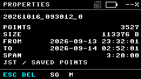
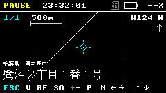
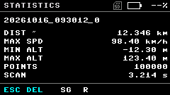

# ReverseGeoputer ログプロパティ・測位点・統計画面

対象: Cardputer ADV、240×135 px。タイトル・補助数値は8×8とし、地名は1行目8×8、2行目16×16で表示する。

[画面・操作機能設計](../02_画面・操作機能設計.md) / [ログ一覧](../logs/README.md)

## 1. 入口と表示方法

ログ一覧のEnterでプロパティ画面を開く。ファイル名（.gps.datを省略）、保存済み件数、ファイルサイズ、先頭・末尾の日時（JST）、その時間差を表示する。ヘッダーと両端の点だけを検証し、全件走査や統計を自動実行しない。プロパティのEnterで最初の測位点の文字表示へ進み、最大10件を読み込む。空のファイルや異常のある概要では点表示を選べない。プロパティには選択項目を並べない。

Mで横並びの「文字・地図・統計」ダイアログを開く。初期選択は統計、左右で選択、Enterで確定、Esc/Delで取消。地図利用不能など、あらかじめ判定できる項目は無効表示にする。

Vで文字/地図を同じ点のまま切り替え、地図ではPで再生/一時停止を切り替える。データセットが利用できない場合は文字表示を維持し、Vによる地図への切替を無効にする。記録点がない正常なファイルは0/0とNO POINTS、ヘッダー等の異常は原因を表示し、待ち状態を終える。点表示のEsc/Delはプロパティへ、プロパティのEsc/Delは一覧の元のページ・選択行へ戻る。

[日本語プレビュー](log-browser-point-preview.png) / [English](log-browser-en-point-preview.png) / [データセットなし](log-browser-point-no-dataset-preview.png)

## 2. 測位点の文字表示

日時（JST）、緯度・経度、速度（km/h）、進行方位（度）、高度（m）、衛星数、HDOPを保存レコードから表示する。未取得値は`--`、欄を超える値は`OVR`とし、現在のGPSや時計の値で補わない。項目名・単位・値欄は固定し、数値は右寄せとする。

地名は選択中のデータセットを使い、その測位点の座標から逆ジオコーディングする。ログ記録時の区域名を復元する仕様ではない。1行目は8×8、2行目は16×16とする。データセットが使えない場合も保存値は表示し、地名欄で理由を示す。

## 3. 地図表示と再生

選択したログ座標を地図の中心として境界線を生成し、シアンのカーソルを重ねる。全移動の軌跡は保持・描画しない。中心から縦横±32表示画素以内の移動では地図を再生成せずカーソルだけを動かし、範囲外や倍率変更で作り直す。区域が変わった場合は、保持している元の区域コード画像から境界の強調を更新する。地名は地図の更新範囲と独立して、データセットのセルが変わるたびに検索する。

既存の地図生成・フレーム転送・地名キャッシュを共用し、ライブGPSの座標と閲覧点を混在させない。ヘッダーはPLAY / PAUSE、保存時刻、1から始まる点番号とし、表示倍率・距離目盛り・北向き表示と地名2行を地図に重ねる。

[再生中](log-browser-log-map-play-preview.png) / [読出し中](log-browser-log-map-loading-preview.png) / [地図エラー](log-browser-log-map-error-preview.png)

地図プレビューの境界は描画検証用の区域パターンであり、実機では選択中のデータセットを使用する。

再生は1点を最低1秒表示して次の点へ進む。ログ・地名・地図の取得中は進行を待ち、準備完了後も表示時間を確保する。記録時刻に比例した等速再生ではない。末尾で停止し、自動的に先頭へ戻らない。読出し・地図エラーでも再生を停止し、手動の点送りや戻る操作を残す。

## 4. 閲覧中のキー

| キー | 動作 |
|---|---|
| 左 / `,`、右 / `/` | 前 / 次の1点 |
| 上 / `;`、下 / `.` | 前 / 次の10点。先頭・末尾で止まる |
| B / E | 先頭 / 末尾へ移動 |
| V | 文字 / 地図を同じ点で切替。再生は一時停止 |
| P | 地図のPLAY / PAUSE |
| ＋（=キーでも可） | 地図を拡大：1/4 → 1/2 → 1/1。端では停止 |
| － | 地図を縮小：1/1 → 1/2 → 1/4。端では停止 |
| M | 文字・地図・統計の表示メニュー。再生は一時停止 |
| Esc / Del | プロパティへ戻る |
| S | 消灯。再生は一時停止 |
| G | GPS・記録操作ダイアログ。再生は一時停止 |

手動の点送りは再生を一時停止する。読込中も移動先を変更でき、完了までは前の表示済み点を保持し、実読出しはSDアイコンで示す。文字表示の最下段は`ESC V BE SG M`と左右・上下、地図ではさらに`+- P`を表示する。数字のトップ画面ショートカットは子画面では受け付けない。プロパティのEnterは文字表示への入口であり、確認項目の選択操作は不要とする。

## 5. 読出し・記録の分離

Appは最大10件・320バイトを保持し、範囲外へ移動した場合にStorageへ読出しを要求する。全レコードをCRC・フラグ・値域・無効項目で検証し、バッチに破損があれば選択点を1件で読み直す。その点自身が破損していれば値を消してエラーにする。点番号を詰めず、正常な前後の点へ移動できる。

現在の記録は閲覧・再生中も継続する。Appから64件RAMリングへの追加と、StorageのSD処理の直列化は維持する。読出し要求の同期戻り値は受付結果のみで、実データは非同期通知する。ログ読出し・地名検索・地図生成はStorageの同時実行を避け、遅延結果は要求トークンと画面世代で照合する。

記録中ファイルでは保存済み範囲のみを読む。ファイルを開いた時点の保存済み件数を上限とし、新しい記録へ自動追従しない。更新した件数を見る場合は一覧へ戻ってファイルを開き直す。セッションID変更・ファイル縮小はエラーとし、未保存RAMや書込み失敗分を表示しない。

ログの地図描画用作業データはログ画面群の資源に含め、通常地図画面の資源と排他にする。UIの境界線画像は既存の前面・転送用バッファを共用する。選択点ごとの別の面キャッシュや軌跡用画像は追加しない。

経路の線表示、ファイル修復は対象外とする。削除は[ログ一覧](../logs/README.md)で行う。

ログ地図の元画像は通常地図と別のMapSessionで所有する。同時に大きな配列を持たず、ログの文字表示へ切り替えた場合や画面離脱・消灯時に解放する。生成完了後も保持するが、地名検索・記録処理は継続できる。

Vで地図表示から文字表示へ切り替えた場合は、同じLogPoint画面内でもUIの表示中・受信中の境界画像を両方解放する。対象点とレコードキャッシュは保持し、遅れて届いた地図行とCommitを拒否する。地図へ戻ると新しい完全な画像を受信するまで解放済みの画像を再表示しない。

## 6. 明示的な統計計算

プロパティまたは点表示のM→統計で、別画面へ進んで集計する。距離は保存点を順に結ぶ大円距離の概算、速度は記録された有効な速度の最大値、高度は有効値の最小・最大とする。対象件数と計算所要時間も表示する。時刻から速度を推定せず、欠落値は除外し、有効値がなければ`--`。時間差は一時停止を含む経過時間であり、移動時間を意味しない。

開始時点の保存済み範囲を固定し、後続の記録を追わない。Storageは8件単位で読出し・CRC/値域検証・加算を進め、約200ms間隔で最新の進捗を通知する。画面にバー・処理件数・経過時間を表示する。終端結果は送信できるまで保持し、途中の進捗通知は集約できる。GPS通知と64件リングへの記録受付は継続し、Storageは各処理区切りで書込み要求とflushを処理する。

1ファイルにつき結果1件を保持する。再表示では再計算せず、Rを押したときだけ最新の保存済み範囲で再計算する。別ファイルを開くかログ画面群を離れると破棄する。Esc/Delは呼出し元のプロパティまたは点表示へ戻り、処理中なら取消を要求する。遅れて届く旧画面の通知を表示に使わない。破損は点番号とエラーを表示し、途中までの値を完成結果として表示しない。

[実装設計](../../13_ログプロパティと統計表示の設計案.md) / [検証結果](../../検証/ログプロパティと統計表示の検証.md)

統計の計算中は進捗表示のため自動消灯を延期し、完了後から設定の消灯時間を数える。Sキーによる明示的な消灯は受け付け、集計は継続する。
