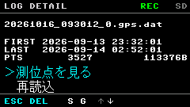

# Geoputer Log Detail / Log Point画面

文書状態: 仕様 1.1（実装済み）
対象画面: 240 × 135 px、横向き  
入力: Cardputer ADV 56キーキーボード

[画面・操作機能設計](../02_画面・操作機能設計.md) / [ファイル一覧](../logs/README.md)

## 1. Log Detail

一覧でEnterを押すと、ファイル名、FIRST / LAST、PTS、バイト数を表示する。長いファイル名は29文字ずつ2行へ折り返して全文を表示する。FIRST / LASTは最初と最後の物理レコードの測位日時をJSTで表示したものであり、セッション終了操作の日時や経過時間ではない。日時不明は`--`とする。PTSはファイルサイズから求めた完全な32バイトスロット数であり、全件のCRC検証済み件数ではない。

ヘッダーと端点のレコードだけを読み、距離・最高速度などの全件集計は行わない。ヘッダー不正・未対応版・端点破損・SD障害を区別して表示する。端点だけが破損していても、有効なヘッダーとスロット数を取得できた場合は測位点画面へ進める。不完全な末尾は`TAIL`で警告し、完全なレコードのみを対象とする。

[日本語・4倍プレビュー](log-browser-detail-preview.png) / [English](log-browser-en-detail-preview.png) / [長いファイル名](log-browser-long-name-preview.png) / [末尾断片](log-browser-partial-tail-preview.png)

| 入力 | 動作 |
|---|---|
| 上 / `;`、下 / `.` | 「測位点を見る」「再読込」を選択 |
| Enter | 選択した処理を実行 |
| Esc / Del | 一覧の元のページ・行へ戻る |

操作項目は日本語設定を日本語表記の東雲16×16、英語設定をM5GFXのAsciiFont8x16とし、タイトル・データ・キーガイドはASCII 8×8とする。英語設定ではVIEW POINTS / RELOAD、日本語設定では測位点を見る / 再読込とする。ライセンス表示の言語・フォント仕様には影響しない。

## 2. Log Point

1画面に1点を表示する。番号は利用者向けに1から表示し、ファイル内の0始まりの番号へ1を足す。保存された日時（JST）、緯度、経度、速度（km/h）、進行方位（度）、高度（m）、衛星数、HDOPを表示する。無効な任意項目は`--`とし、現在のGPS情報や表示時計で埋めない。地名検索は行わない。LAT/LONは同じ行の左右2欄に符号付き小数6桁で表示する。保存レコードの座標精度は変更しない。項目名と単位は固定位置、数値は固定欄の右端へ揃え、桁数や未取得表示で隣の項目を移動させない。欄に収まらない値はOVRとする。

[4倍プレビュー](log-browser-point-preview.png) / [任意項目が不明](log-browser-unknown-preview.png)

| 入力 | 動作 |
|---|---|
| 上 / `;` | 前の測位点 |
| 下 / `.` | 次の測位点 |
| Esc / Del | 詳細へ戻る |

先頭と末尾では移動せず、左右キーは使用しない。読込中も移動先を変更したり戻ったりできる。読込完了までは前の点を保持してREADINGを表示し、要求中の点を現在表示済みの点として扱わない。Appは最大10件・320バイトをキャッシュし、範囲外へ移動した時に次の読出しを要求する。

各レコードをCRC・フラグ・値域・無効項目の格納値で検証する。バッチに破損があれば選択点を1件で読み直し、その点自身が破損している場合は値を消してエラーを表示する。破損点を飛ばして番号を詰めない。前後の正常な点へは移動できる。

[読込中](log-browser-loading-preview.png) / [破損点](log-browser-crc-error-preview.png)

## 3. 記録中の閲覧と保存済み範囲

記録は閲覧中も継続する。同期要求は受付成否だけを返し、StorageTaskがSDの実読出しを非同期に行う。先行して受付済みの未保存点を保存してから閲覧を始め、保存失敗時は読出しも失敗として返す。ディレクトリ走査・最大10件の読出しの区切りで、保存・制御要求を処理する。AppからRAMリングへの追加はSD操作中も空きがあれば受け付ける。

記録中ファイルはLogWriterと同じファイルハンドルから、保存成功が確認できた範囲だけを読む。未保存RAMや失敗した書込みの末尾は含めない。詳細取得時の保存済み件数を上限として固定し、閲覧中に新しい記録が増えても自動的に追従しない。詳細の再読込で上限を更新する。セッションIDの変更やファイル縮小を検出した場合はエラーとし、別の内容を同じ番号の点として表示しない。

固定長の読出し結果は通知に値コピーし、Appが保持する。ログ閲覧には結果バッファプールや解放通知を使用しない。処理と形式は[タスク構成設計](../../06_タスク構成設計.md)および[測位記録ファイル仕様](../../07_測位記録ファイル仕様.md)に従う。

## 4. 未実装の拡張

距離・最高速度の全件集計、軌跡地図、訪問地域一覧、地域遷移・滞在時間、削除・修復は対象外とする。検証範囲は[ログビューア検証](../../検証/ログビューア検証.md)を参照する。

言語別フォントと設定値の配置は[UIフォント・設定配置検証](../../検証/UIフォント・設定配置検証.md)を参照する。

ヘッダーはLIVE・地図・GPSと同じ高さ17 px（区切り線y=16）とし、タイトルとヘッダー内のSD・記録状態・読出し状態・警告の文字上端をy=4に揃える。測位点画面も同じ配置とする。

最下段は`ESC DEL S G ↑↓`のキー一覧とする。Enterによる選択・決定、上下による前後点への移動は説明文を付けず、移動できない方向はグレーにする。下位画面のため画面切替数字は表示しない。
