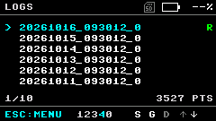

# Geoputer Logs（Log Browser）画面

文書状態: 採用仕様 1.3（拡張子省略・サイズ由来件数・基本情報プロパティ）

対象画面: 240 × 135 px、横向き  
入力: Cardputer ADV 56キーキーボード

[画面・操作機能設計](../02_画面・操作機能設計.md) / [詳細・測位点](../log-detail/README.md)

## 1. 目的と表示

各トップ画面の4、またはEscのMENUから、SDカードの`/logs/`にある測位記録ファイルを開く。ファイル名から末尾の.gps.datだけを省いた名前を一覧に表示する。通常の名前は`YYYYMMDD_HHMMSS_n.gps.dat`であり、日時不明時の名前も[測位記録ファイル仕様](../../07_測位記録ファイル仕様.md)に従う。

タイトルとキーガイドはASCII 8×8とする。

1ページは最大6件。日時付きの名前を降順に並べ、`undated_`で始まる名前をその後に名前の降順で並べる。同じ日時の連番も文字列として比較する。全ファイルの内容を読んで日時順に並べ直す処理は行わない。時刻とセッションIDの正本はファイル内容とする。

一覧の文字は8×8。拡張子を取り除いてから26文字へ収め、長ければ末尾を`...`で省略する。保存名・読出し要求・削除対象と確認ダイアログには元の完全な名前を保持する。開いている記録ファイルには右端に`R`を付ける。ヘッダーのSD表示は実際のSDアクセスに連動する。

[4倍プレビュー](log-browser-list-preview.png)

本文最下段のy=106に、左側へページ番号/総ページ数（例1/10）、右端x=236へ選択中ファイルの記録件数（例3527 PTS）を右寄せで表示する。空一覧は0/0とし、件数は表示しない。総ページ数は対象ファイル数を6で切り上げる。ページの先頭順位を走査結果に含め、前後移動・削除後にもページ番号を整合させる。

件数は`max(0, floor((ファイルサイズ - 512) / 32))`で計算し、末尾の32バイト未満の端数を数えない。512バイト未満は0件とする。ヘッダー・レコード・CRCは読まず、内容の正しさを保証する値ではない。既存の一覧走査で各通常ファイルのstatを取得しているため、サイズから計算した6件分の値を一覧へ添える。行の選択移動だけでは追加I/Oを行わず、一覧取得時点の保存済みスロット数を表示する。記録中の追記はページを読み直すか一覧を開き直すまで自動反映しない。

## 2. 操作

| 入力 | 動作 |
|---|---|
| 上 / `;` | 前の行。先頭では新しい側のページへ移動 |
| 下 / `.` | 次の行。末尾では古い側のページへ移動 |
| Enter | 選択ファイルのプロパティを開く。空一覧・一覧取得エラー時は再読込 |
| D（文字キー） | 選択したファイルの削除確認を開く |
| 1 / 2 / 3 / 0 | メイン / 地図 / GPS・記録 / 設定へ直接移動。読込中も有効 |
| Esc | MENUを開く |
| 4 | 現在の一覧を維持する |
| Del | Live Placeへ戻る |

プロパティから戻った場合は元のページと選択行を保持する。Live Placeから入り直す場合は最新ページを読み直す。左右キーは共通確認ダイアログの選択にだけ使用する。

## 3. 読出しと異常時の扱い

ListLogsの同期結果は要求の受付成否を返し、実際の一覧は非同期のReadCompleted / ReadFailedで受け取る。ディレクトリ走査は最大10項目ずつに区切り、保持する候補は6件までとする。ページ境界はファイル名のカーソルで指定し、全件の一覧をRAMへ保持しない。要求トークンと画面世代で結果を識別し、遷移後の結果で別の画面を上書きしない。

`.gps.dat`で終わる48バイト未満の安全なASCIIファイル名を対象とし、ディレクトリ、長すぎる名前、非ASCII名、パス区切りや`..`を含む名前を除外する。GeoPuterが生成する名前はこの範囲に収まる。内容の検証は測位点を開く時に行うため、名前が適合する破損ファイルも一覧には表示される。

`/logs/`がない場合と対象ファイルがない場合は空一覧とする。SD不在やI/O障害は空一覧と区別してエラーを表示する。通常の閲覧では元ファイルを変更しない。明示的に確認された削除だけを別の操作として実行し、修復・切り詰めは行わない。記録中も一覧を利用でき、実際のSD操作はStorageTaskが直列化する。

[空一覧](log-browser-empty-preview.png) / [SDエラー](log-browser-sd-error-preview.png)

検証範囲は[ログビューア検証](../../検証/ログビューア検証.md)を参照する。

言語別フォントと設定値の配置は[UIフォント・設定配置検証](../../検証/UIフォント・設定配置検証.md)を参照する。

現在のGPS Fixとデータセットは既存ログの一覧・詳細・測位点表示・削除の必要条件にしない。SD読出し可能ならFixなし・データセット異常時も閲覧でき、削除はSD書込み可能かつ対象が保護されていない場合に限る。SD全体が利用不可なら読出しエラーを表示し、戻る操作と設定からの復旧経路を残す。共通の制約は[システム構成設計7節](../../04_システム構成設計.md#7-エラー状態と機能の利用条件)に従う。

## 4. 削除

ログ一覧の最下段は`ESC:MENU 12340 S G D ↑↓`のキー一覧とする。Enterによる選択・再読込は暗黙とし、OPEN / DELETE / RELOADの説明文は表示しない。Dは一覧に対象がない場合、読出し中、選択ログが保護対象の場合にグレーにする。上下矢印も移動可能な行・前後ページがなければ該当方向をグレーにする。Esc / Delの戻る操作は維持する。

Dは[共通確認ダイアログ](../共通確認ダイアログ.md)を一覧の中央に重ねる。背景の一覧を暗く残し、上下の白線の間に質問・対象名・横並びの取消／削除を表示する。対象ファイル名は48バイト未満の全文を8×8で1行27文字・最大2行へ表示し、省略しない。日本語では東雲16×16の「取消」「削除」、英語ではASCII 8×16のCancel / Deleteを表示する。初期選択は取消とし、左右（`,` / `/`）で選んでEnterで確定する。左は取消、右は削除で、上下では変更しない。Esc / Del、または取消を選んだEnterは一覧へ戻り、Storageへ削除要求を送らない。確認中に一覧の版が更新された場合は確認を取り消す。同じ一覧でも対象が記録中に変わった場合は削除を無効化し、選択を取消へ戻す。

記録中・一時停止中・保存待ち・終了処理中など、LogWriterが保持する対象にはRを表示し、確認画面で削除を選べないようにする。Storageも実行直前に現在の保持ファイルと比較して保護する。FAT32の大文字・小文字の別名も保護対象とし、古い一覧でRが欠けていても削除しない。他のログは現在の記録を継続したまま削除できる。

確定した要求はAppが対象行と一覧の版を検証し、DeleteLogでStorageへ同期受付を要求する。受付結果は実際の削除成功を意味せず、SD上の削除と結果通知は非同期に行う。処理中はDELETING...を表示し、二重操作・画面移動・自動消灯を止める。ファイル名の検証と通常ファイルの確認を行い、ディレクトリや指定外のファイルは削除しない。

成功後は旧ページの先頭ファイル名を基準に一覧を再取得し、元の行番号を可能な範囲で維持する。末尾のページが空になった場合は一つ前のページへ戻り、全件がなくなった場合は空一覧とする。失敗時は一覧を残して下部に理由を赤で表示し、対象を削除済みとして扱わない。対象が既にない場合も失敗として区別する。

[削除確認](log-browser-delete-confirm-preview.png) / [削除選択](log-browser-delete-selected-preview.png) / [記録中の保護](log-browser-delete-protected-preview.png) / [削除処理中](log-browser-deleting-preview.png) / [削除失敗](log-browser-delete-error-preview.png)

削除・確認・再取得の検証範囲と書込み結果は[ログ削除実装検証](../../検証/ログ削除実装検証.md)を参照する。

一覧の操作説明行は廃止し、ページ・読込状態はy=106、共通キー一覧はy=124へ配置する。削除実行中は画面切替を受け付けない。

ヘッダーはLIVE・地図・GPSと同じ高さ17 px（区切り線y=16）とし、タイトルとヘッダー内のSD・記録状態・読出し状態・警告の文字上端をy=4に揃える。測位点画面も同じ配置とする。

ファイル選択後は「文字で見る」「地図で見る」「地図で再生」の操作画面に進む。共通の点送り・表示切替・再生キーは[ログ操作・閲覧画面](../log-detail/README.md)に従う。現在のGPS Fixは必要条件にせず、地図の2方式だけが利用可能なデータセットを必要とする。
