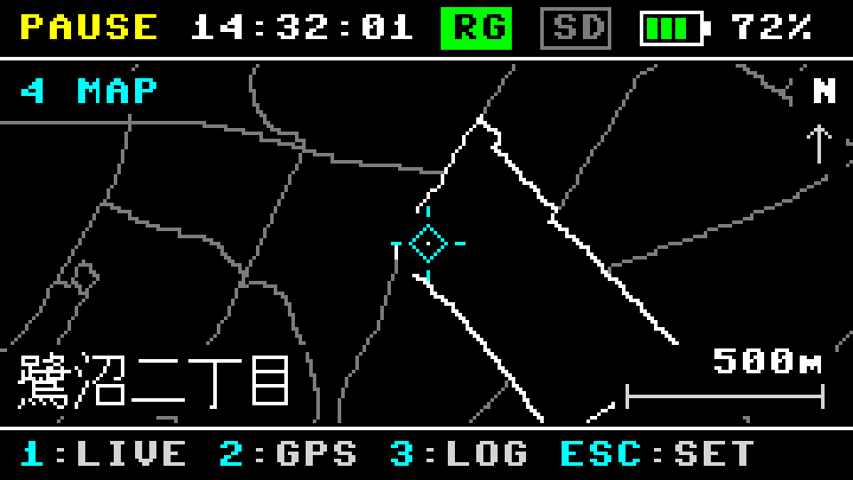

# ReverseGeoputer 地図画面

対象: 240×135 px。4キーで開く北上固定の境界地図。

[画面・操作機能設計](../02_画面・操作機能設計.md) / [モジュール設計](../../12_地図表示モジュール設計.md)

## 表示

上段はLive Placeと共通の記録状態・時刻・RG・SD・電池表示。地図はx=0〜239、y=18〜118の240×101画素に表示する。区域の内部は黒、周辺の境界は灰、現在区域の境界は白。現在地は画面(120,68)のシアンのマーカーと白い中心点で示す。地名・北矢印・距離目盛りを重ねる。ASCIIは8×8、地名は東雲16×16とする。

表示1画素を経度方向の格子1個に対応させ、緯度による距離の縦横差を補正する。初版はズーム・回転・手動移動を行わない。新しいFixがある場合は5秒以上の間隔で地図を更新する。更新中は前の完成画像を保ち、全行の受信後に一括で交換する。時計・電池だけの変更では地図データを再読出ししない。

未測位はWAIT GPS FIX、SD未接続はSD NOT READY、未選択はNO DATASET、読出し失敗はMAP READ ERRORと表示する。前の地図があれば保持し、中心マーカーは灰色として過去の画像であることを示す。区域なしはNO REGIONとし、破損扱いにしない。

RGは既存の128×128キャッシュの状態を示す。地図専用読出しではRGを変えず、実ファイルI/OはSDの青いランプへ反映する。地図専用入力と2bit境界画像は既存128キャッシュから独立させる。

## 操作

| キー | 動作 |
|---|---|
| 1 | Live Place |
| 2 | GPS Logger |
| 3 | Logs |
| 4 | この地図画面 |
| Esc（Fnなしも可） | Settings |
| Del | Live Placeへ戻る |

画面切替は他のトップ画面と同じ扱いとし、設定の下位階層・確認ダイアログ中からは割り込まない。地図への切替でもGPS記録は継続する。消灯時は地図の更新を停止し、復帰後に現在のFixで再取得する。

実装コードから生成したホストプレビュー（実機キャプチャではない）:

原寸画像: [240×135](map-view-ready.png)。生成コマンドは`python3 tools/render_map_view.py <map.glc> <wordbook>`。
