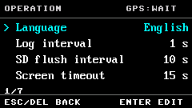

# Geoputer Settings画面

文書状態: Draft 0.15  
対象画面: 240 × 135 px、横向き  
入力: Cardputer ADV 56キーキーボード  

[画面・操作機能設計（共通仕様・画面一覧）](../02_画面・操作機能設計.md)

## 1. 階層とナビゲーション

戻る・編集取消・確認取消にはEscとDelを使用できる。本書のEsc操作はDelでも同じ動作とする。

Settingsは入口と子画面の2階層とする。入口には次の4項目を表示する。

```text
Settings
├ 動作設定
│ ├ 表示言語（日本語 / English）
│ ├ GPSログ間隔
│ ├ SD保存間隔
│ ├ 画面消灯時間
│ ├ 画面輝度
│ ├ データセット
│ └ GPS接続モード
├ ストレージ操作
│ ├ カード情報・総容量・空き容量
│ ├ 再マウント
│ ├ 安全な取り外し
│ └ FAT32でフォーマット
├ 初期化
│ └ 設定を初期値に戻す
└ ライセンス情報
  └ 使用OSS・フォントの情報とライセンス本文
```

```text
┌──────────────────────────────┐
│SETTINGS GPS●         BAT 72% │
│                              │
│ > 動作設定                   │
│   ストレージ操作             │
│   初期化                     │
│   ライセンス情報             │
│                              │
│Esc/Del Back       Enter Open │
└──────────────────────────────┘
```

上下キーで項目を選択し、Enterで子画面を開く。動作設定は1画面4行とし、選択に合わせて全7項目をスクロール表示する。子画面のEscはSettingsの入口へ戻り、入口のEscはLive Placeへ戻る。設定編集と確認ダイアログは子画面内の操作状態として扱い、メニューの階層は増やさない。ライセンス情報では上下キーをスクロールに使用する。

左右キーは動作設定の値編集中だけ使用する。その他の一覧・閲覧・確認状態では使用しない。F1とMENUの2はSettingsでは使用しない。

Fnなしの`;`＝上、`.`＝下、`,`＝左、`/`＝右も同じ方向操作として受け付ける。従来のFn併用も使用できる。上下は選択・スクロール、左右は値編集中の変更に限定し、Fnの有無で操作可能な範囲を変えない。

## 2. 動作設定

### 2.1 設定項目

| 設定 | 候補 | 初期値 |
|---|---|---|
| 表示言語 / Language | 日本語、English | 日本語 |
| GPS Log Interval | 1、5、10秒 | 1秒 |
| SD Flush | 1、5、10、30、60秒 | 10秒 |
| Screen Timeout | 5、15、30、60秒、消灯しない（Never） | 15秒 |
| Brightness | 20、40、60、80、100% | 40% |
| Galuchat dataset | Municipality、Town/Chome、Integrated | Integrated候補 |
| GPS接続モード | Mesh Kit、外付けGPS | Mesh Kit |

ファイル読出し先行版ではデータセット番号01を固定使用し、一覧のDATASET値を`01`と表示する。データセットとGPS接続モードは読取専用とし、上表の候補切替は後続段階で導入する。

データセット検証では、選択したWGSMapSetのチャンク数を確認する。最大1500チャンクまでを利用可能とし、1501以上の場合は地図本文を読み出さず、対象を適用・保存しない。日本語では「使用できません」「チャンク数: 2000 / 上限: 1500」、英語では「Dataset unavailable」「Chunks: 2000 / Max: 1500」のように理由と実数・上限を表示する。警告はEsc / DelまたはEnterで閉じる。チャンク上限の確認・警告は番号01固定使用でも実装する。警告表示中は自動消灯を行わず、閉じた後もメイン画面のエラー帯で利用不可を示す。[日本語表示例](dataset-limit-ja-preview.png)・[英語表示例](dataset-limit-en-preview.png)。データセット選択UIの導入後は、以前の有効なデータセットを維持し、逐次探索へ切り替えない。起動時に使用可能なデータセットがなければ逆ジオコーディングを無効として警告し、GPS受信とログ記録を継続する。

消灯時間は60秒の次に「消灯しない」（英語表示は`Never`）を選択できる。確定・適用後は無操作でも自動消灯せず、NVSへ保存して再起動後も復元する。初期値は15秒を維持する。保存値は従来の候補番号0〜3を維持し、末尾の候補番号4を消灯しない（内部の秒数0）とする。画面の表示・消灯はGPS受信とログ記録を停止しない。

「消灯しない」の日本語5文字を16×16で表示するため、消灯時間の値のみx=156から描画し、右端236 pxまでに収める。[日本語の表示例](settings-ja-timeout-never-preview.png)・[英語の表示例](settings-en-timeout-never-preview.png)。

表示言語は動作設定の先頭に置く。左右キーで候補を選び、Enterで確定後にAppが設定を適用した時点で画面へ反映し、同じ画面・選択位置を維持する。編集中の候補変更だけでは表示言語を変更せず、Esc / Delでは取り消す。NVS保存成功後は再起動しても選択言語を復元する。保存失敗は通知し、保存済みとして扱わない。設定初期化では言語も日本語へ戻す。

動作設定は本体内蔵FlashのNVSへ保存し、起動時に復元する。保存先はGeoputer用名前空間`geoputer`とし、StorageタスクのSettingsStoreがArduinoのPreferencesでアクセスする。SDカードの有無、マウント可否、取り外し、フォーマットに依存せず設定を保持・読込み・保存できる。

GPS接続モードは保存後の再起動時に反映し、選択したモードのGPSだけを使用する。Wi-FiとBLEは初期版では設定項目にせず、常時OFFとする。DISP MODE、AUTO REC、GPS RATEは含めない。電源投入時は必ずGPSログSTOPPEDで開始する。

### 2.2 編集と保存

1. 上下キーで項目を選択する。
2. Enterで編集状態へ入る。
3. 左右キーで候補を変更する。編集中は上下キーによる項目移動を無効にする。
4. EnterでUIが確定した編集値を保持し、内容更新を通知する。Appが同期取得してStorageへSaveSettingsを送り、受付結果をUIへ反映した後に動作設定の一覧へ戻る。
5. 編集中のEscは未確定の変更を破棄し、動作設定の一覧へ戻る。一覧のEscはSettingsの入口へ戻る。

SaveSettingsの同期結果は設定のコピーと保存要求の保持までとする。NVSへの永続化はStorageが非同期に処理し、SettingsWrittenの成功通知後に保存完了を表示する。失敗は未保存・設定保存エラーとして表示し、SDエラーと区別する。候補変更や再描画だけではNVSへ書き込まない。

設定読込みはLoadSettingsを通知で要求し、ReadCompleted / ReadFailedで結果を反映する。設定なし、不正な形式・値、NVS読込障害を区別し、Appが初期値の適用を判断する。NVS全体の自動消去は行わない。

即時反映する項目と、再起動またはデータ再オープンが必要な項目を区別する。Galuchat dataset変更時は、新しいデータ組を検証してから切り替え、失敗時は以前の有効設定へ戻す。保存要求の受付と、設定の実適用・永続化完了を混同しない。

## 3. ストレージ操作

| 項目 | 内容 |
|---|---|
| カード情報 | Enterで情報パネルを開き、SD認識・マウント状態、ファイルシステム、カード容量、総容量、空き容量を16ドットで表示する。EscまたはEnterでストレージ操作の一覧へ戻る |
| 再マウント | SDのファイルを閉じてアンマウントし、カードを再認識する |
| 安全な取り外し | 受付済みの保存を完了し、ファイルを閉じてアンマウントする。完了後に取り外し可能と表示する |
| FAT32でフォーマット | 全データ消去の確認後にSDをFAT32でフォーマットし、再マウントする |

SD操作はAppが判断し、Storageタスクが実行する。UIからSDやNVSを直接操作しない。再マウント・取り外し・フォーマットは、ログセッションが終了して保存が完了し、GIS等のSD読出しと結果バッファの参照が終了しているときに実行する。条件を満たさなければ操作不可の理由を表示し、受付済みデータを無条件に破棄しない。

FAT32フォーマットはログ・GISデータを含むSDカード上の全データを消去する操作とする。確認画面に対象と消去範囲を明記し、初期選択は取消とする。上下キーで選択、Enterで決定、Escで取消とし、一覧でEnterを押しただけでは実行しない。NVSの設定は保持する。マウント失敗時の自動フォーマットは行わない。

## 4. 初期化

「設定を初期値に戻す」を表示する。Geoputerの動作設定とGPS接続モードだけを初期値へ戻し、SDカード上のログ・GISデータと、他ライブラリのNVS領域は変更しない。

確認画面に対象を明記し、初期選択を取消とする。確定後はAppが初期設定のコピーをSaveSettingsでStorageへ渡し、NVSへの保存を要求する。受付時点は初期化処理中とし、SettingsWrittenの成功通知後に設定の復元完了を表示する。GPS接続モードなど再起動が必要な項目は、その旨を表示する。SDカードのフォーマットは、このメニューには置かない。

## 5. ライセンス情報

閲覧専用の子画面に、実際に使用しているOSSとフォントの名称、バージョン、著作権表示、ライセンス名およびライセンス本文を掲載する。依存ライブラリ内の第三者コード・フォントについても、採用した配布物の表示条件を確認して必要な情報を含める。

表示データはファームウェア内に読取専用で保持し、SD未挿入でも閲覧できるようにする。本文はASCIIの8×8ドット・1行29文字・9行表示とし、一つの文書として上下キーでスクロールする。EscでSettingsの入口へ戻る。ライセンスごとの選択メニューを追加して階層を増やさない。

## 6. 日本語・英語の表示

切替対象はSettings画面群のメニュー項目、設定値、確認文、カード情報と短い処理通知とする。翻訳はSettingsTextへ集約する。

| 日本語 | English |
|---|---|
| 動作設定 | Operation |
| 表示言語 | Language |
| 記録間隔 | Log interval |
| SD保存間隔 | SD flush interval |
| 消灯時間 | Screen timeout |
| 明るさ | Brightness |
| データセット | Dataset |
| GPS接続 | GPS source |
| ストレージ操作 | Storage |
| カード情報 | Card information |
| 再マウント | Remount |
| 安全な取り外し | Safely remove |
| FAT32フォーマット | Format as FAT32 |
| 初期化 | Reset |
| 設定を初期値に戻す | Restore defaults |
| ライセンス情報 | Licenses |
| 取消 / 実行 | Cancel / Confirm |

日本語モードの項目・値・確認文・カード情報は東雲16×16ドット、英語モードはM5GFX同梱のAsciiFont8x16を使用する。言語の選択値は常に自称の「日本語 / English」を表示し、日本語名は16×16、Englishは8×16とする。文字高さは16ドットに揃え、8×8字形の2倍拡大は行わない。秒数は日本語で10秒、英語で10 sとする。

画面タイトル（SETTINGS / OPERATION / STORAGE / RESET / LICENSES / CARD INFO）とキーガイドは共通のASCII 8×8とする。GPS状態、項目番号、短い通知も8×8とし、通知の日本語は既存のlgfxJapanGothic_8を使用する。ライセンス画面は本文・折返し・フォント・配置・スクロール方式をそのまま維持し、選択言語で翻訳・再整形しない。

ヘッダー下の罫線はy=22、本文はy=27から20 px間隔の4行、フッター上の罫線はy=118とする。動作設定7項目を選択に合わせてスクロールし、項目名はx=20を左端として左寄せ、値は文字列の実描画幅を測って右端x=236へ右寄せする。日本語16ドット・英語ASCII 8ドットの送り幅と、言語名の混在幅を計算へ反映する。短い値、100%、消灯しない / Never、日本語 / Englishを含む全項目・選択肢で右端を揃える。データセットとGPS接続は読取専用表示とする。タイトルはx=4・y=7、ライセンス本文はx=4・y=27から10 px間隔の9行、29文字幅のASCII 8×8を維持する。

以下の画像は実装のUiRenderer / PixelFontから240×135 pxへ直接描画したもので、入力値は配置確認用の例である。各画像は最近傍4倍のプレビューへリンクする。

| 画面 | 日本語 | English |
|---|---|---|
| 入口 | [](settings-ja-root-preview.png) | [](settings-en-root-preview.png) |
| 動作設定 | [](settings-ja-operation-preview.png) | [](settings-en-operation-preview.png) |
| 消灯しない | [日本語](settings-ja-timeout-never-preview.png) | [English](settings-en-timeout-never-preview.png) |
| ストレージ | [日本語](settings-ja-storage-preview.png) | [English](settings-en-storage-preview.png) |
| カード情報 | [日本語](settings-ja-card-preview.png) | [English](settings-en-card-preview.png) |
| フォーマット確認 | [日本語](settings-ja-format-confirm-preview.png) | [English](settings-en-format-confirm-preview.png) |
| 設定初期化 | [日本語](settings-ja-reset-preview.png) | [English](settings-en-reset-preview.png) |
| 初期化確認 | [日本語](settings-ja-reset-confirm-preview.png) | [English](settings-en-reset-confirm-preview.png) |
| 言語編集中 | [日本語](settings-ja-language-edit-preview.png) | [English](settings-en-language-edit-preview.png) |
| 末尾の項目 | [日本語](settings-ja-operation-bottom-preview.png) | [English](settings-en-operation-bottom-preview.png) |

画像は`python3 tools/render_settings_layout.py`で再生成する。変更前の参考画像は削除し、旧入口`doc/画面・操作/render_screens.py`も現在の生成器へ委譲する。検証結果は[Settings多言語化検証](../../検証/Settings多言語化検証.md)と[消灯しない設定の検証](../../検証/消灯しない設定検証.md)を参照する。

## 7. NVSの形式と旧設定の引継ぎ

保存先は従来と同じ名前空間geoputer、キーconfig、16バイト固定とする。形式バージョン2では、識別子を0〜1、バージョンを2、項目数7を3へ格納する。既存6項目の値はオフセット4〜9を維持し、表示言語を10（日本語0 / English 1）、予約ゼロを11、先頭12バイトのFNV-1a検査値を12〜15へリトルエンディアンで格納する。

形式バージョン1の正しい6項目レコードも受け付け、6項目の値を引き継いで表示言語を日本語とする。読込みだけでは書き換えず、次に設定を確定・保存した時点でバージョン2として書き込む。未対応バージョン、長さ・項目数・予約領域・検査値の不一致、言語を含む値域外を拒否する。


言語別フォントと設定値の配置は[UIフォント・設定配置検証](../../検証/UIフォント・設定配置検証.md)を参照する。
