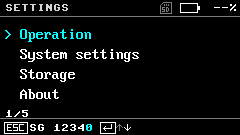
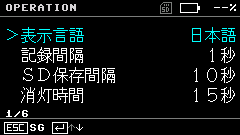

# Geoputer Settings画面

文書状態: Draft 0.20
対象画面: 240 × 135 px、横向き  
入力: Cardputer ADV 56キーキーボード  

[画面・操作機能設計（共通仕様・画面一覧）](../02_画面・操作機能設計.md)

画面選択はLIVEのEscで開くMENUと、1＝メイン、2＝地図、3＝GPS・記録、4＝ログ一覧、0＝設定の数字ショートカットとする。数字はトップ画面でのみ有効とし、子画面の戻る操作は維持する。Sは消灯、GはGPS画面と共通の操作ダイアログを開く。詳細は[画面・操作機能設計](../02_画面・操作機能設計.md)に従う。

## 1. 階層とナビゲーション

戻る・編集取消・確認取消にはEsc（物理バッククォート、Fn不要）とDelを使用できる。本書のEsc操作はDelでも同じ動作とする。

Settingsは入口から動作設定・システム設定などの子画面を開く構成とする。初期化はシステム設定から専用画面を開く。データセット操作は、動作設定からデータセットメニューを開き、選択用の一覧・詳細と索引保守へ分岐する。入口には次の5項目を表示する。

```text
Settings
├ 動作設定
│ ├ 表示言語（日本語 / English）
│ ├ GPSログ間隔
│ ├ SD保存間隔
│ ├ 画面消灯時間
│ ├ 画面輝度
│ └ データセット
│   ├ データセットを選択（未選択、番号一覧→詳細・言語選択）
│   ├ キャッシュ再生成（対象一覧→確認→処理・結果）
│   └ キャッシュ検証（対象一覧→確認→処理・結果）
├ システム設定
│ ├ モード（GPSロガー / USB）
│ ├ GPS接続（Mesh Kit固定、読取専用）
│ ├ 保存して再起動
│ └ 初期化
│   └ 設定を初期値に戻す
├ ストレージ操作
│ ├ カード情報・総容量・空き容量
│ ├ 再マウント
│ ├ 安全な取り外し
│ └ FAT32でフォーマット
├ バージョン情報
│ └ アプリ版・ビルド日時・Git情報
└ ライセンス情報
  └ 使用OSS・フォントの情報とライセンス本文
```

```text
┌──────────────────────────────┐
│SETTINGS GPS●         BAT 72% │
│                              │
│ > 動作設定                   │
│   システム設定               │
│   ストレージ操作             │
│   バージョン情報             │
│                              │
│Esc/Del Back       Enter Open │
└──────────────────────────────┘
```

上下キーで項目を選択し、Enterで子画面を開く。動作設定は1画面4行とし、選択に合わせて全6項目をスクロール表示する。通常の子画面のEscはSettingsの入口へ戻り、入口の1はLive Placeへ戻る（Escは何もしない）。初期化画面のEscはシステム設定の初期化項目へ戻る。データセット詳細のEscは一覧へ、一覧のEscはデータセットメニューへ、そのEscは動作設定へ戻る。設定編集と確認ダイアログは各画面内の操作状態として扱う。ライセンス情報では上下キーをスクロールに使用する。

左右キーは動作設定・システム設定の値編集中、共通確認ダイアログ、ライセンス情報のソフトウェア単位のジャンプで使用する。確認では左が取消、右が実行項目となる。その他の一覧・閲覧では使用しない。P・F1はSettingsでは使用しない。数字1/2/3はSettingsトップでのみLive Place / GPS Logger / Logsへの直接切替に使用する。

Fnなしの`;`＝上、`.`＝下、`,`＝左、`/`＝右も同じ方向操作として受け付ける。従来のFn併用も使用できる。上下は選択・スクロール、左右は値編集中の変更、共通確認ダイアログの選択、ライセンス情報のソフトウェア単位ジャンプに使用し、Fnの有無で操作可能な範囲を変えない。

入口は動作設定・システム設定・ストレージ操作・バージョン情報・ライセンス情報の5項目とする。1画面は4行とし、上下キーでスクロールして全項目を選択できる。システム設定から入口へ戻ると、同じ項目に留まる。入口の表示例: [先頭](settings-ja-root-preview.png) / [最下段までスクロール](settings-ja-root-bottom-preview.png)。

## 2. 動作設定

### 2.1 設定項目

| 設定 | 候補 | 初期値 |
|---|---|---|
| 表示言語 / Language | 日本語、English | 日本語 |
| GPS Log Interval | 1、5、10秒 | 1秒 |
| SD Flush | 1、5、10、30、60秒 | 10秒 |
| Screen Timeout | 5、15、30、60秒、消灯しない（Never） | 15秒 |
| Brightness | 20、40、60、80、100% | 40% |
| Galuchat dataset | 未選択、SD上の番号ディレクトリとメタデータのタイトル | 未選択 |

データセットは選択・索引再生成・索引検証のメニューを開く項目とし、現在の番号を2桁で表示する。GPS接続はシステム設定へ置き、動作設定には含めない。

データセット切替への対応では、`01`〜`99`の番号ディレクトリの`dataset.ini`を[データセットメタデータ仕様](../../08_データセットメタデータ仕様.md)に従って読む。動作設定の「データセット」→「データセットを選択」から番号・タイトルの一覧を開き、上下キーで選択、Enterで詳細を開く。タイトル・説明はUIの表示言語に対応するものを使用し、該当言語がない場合はデータセットの既定言語へ戻す。一覧取得時に全候補のGLCを開かず、詳細では説明、GLCから取得した解像度・範囲・チャンク数、地名用Wordbookの言語を表示する。Wordbookは初回に`default_language`を使用し、詳細で別言語へ変更できる。UIの言語を変えるだけではWordbookを変更しない。メタデータ読取りと切替UIは実装済みとし、実機での操作確認は未実施である。詳細は上下キーでスクロールし、言語の行でEnterを押すと値編集へ入り、左右キーで言語を変更、Enterで候補を確定し、Esc / Delでは編集前の候補へ戻す。いずれもこの時点ではNVSへ保存しない。候補の適用は最終行の「適用する」で行う。

適用前にGPSログの停止が完了していることを必須とする。PAUSEDは不可とし、STOPPEDでも未保存データや未完了のセッション閉鎖が残っている間は適用しない。GPS Loggerで停止するよう表示し、自動で記録を停止しない。「適用する」で対象と索引を検証し、番号と言語の組をNVSへ保存する。成功後に旧Reader・矩形キャッシュ・地名キャッシュを解放し、新しい組を再確認して起動中に切り替える。再起動は不要とする。検証・保存失敗時は旧選択を維持する。Esc / Delによる取消や候補選択だけでは保存しない。

適用の受付後から検証・保存・Reader切替が完了するまで、ログの開始・再開を受け付けない。検証・保存失敗で適用を取り消した場合は通常操作へ戻す。

データセット候補の検証では最大1500チャンクまでを許可し、1501以上なら対象を適用・保存しない。構成・形式・文字コード・メモリ不足などの失敗も、Settings内の詳細・結果欄へ理由を表示し、以前の選択とNVS保存値を保持する。チャンク実数と上限はこの画面で確認する。候補の失敗で使用中の有効な地名表示を置き換えず、逐次探索へ切り替えない。使用中のデータセットが起動時・検索時に異常となった場合は[データセット異常時の共通仕様](../../08_データセットメタデータ仕様.md#83-起動時の復元とエラー)に従い、原因通知・未選択への保存・検索停止として起動を継続する。

消灯時間は60秒の次に「消灯しない」（英語表示は`Never`）を選択できる。確定・適用後は無操作でも自動消灯せず、NVSへ保存して再起動後も復元する。初期値は15秒を維持する。保存値は従来の候補番号0〜3を維持し、末尾の候補番号4を消灯しない（内部の秒数0）とする。画面の表示・消灯はGPS受信とログ記録を停止しない。

「消灯しない」の日本語5文字を16×16で表示するため、消灯時間の値のみx=156から描画し、右端236 pxまでに収める。[日本語の表示例](settings-ja-timeout-never-preview.png)・[英語の表示例](settings-en-timeout-never-preview.png)。

表示言語は動作設定の先頭に置く。左右キーで候補を選び、Enterで確定後にAppが設定を適用した時点で画面へ反映し、同じ画面・選択位置を維持する。編集中の候補変更だけでは表示言語を変更せず、Esc / Delでは取り消す。NVS保存成功後は再起動しても選択言語を復元する。保存失敗は通知し、保存済みとして扱わない。設定初期化では言語も日本語へ戻す。

動作設定は本体内蔵FlashのNVSへ保存し、起動時に復元する。保存先はGeoputer用名前空間`geoputer`とし、StorageタスクのSettingsStoreがArduinoのPreferencesでアクセスする。SDカードの有無、マウント可否、取り外し、フォーマットに依存せず設定を保持・読込み・保存できる。

GPS接続は再初期化を伴う設定としてシステム設定に分類する。現行はMesh Kit固定で、外付けGPSは未実装とする。Wi-FiとBLEは初期版では設定項目にせず、常時OFFとする。DISP MODE、AUTO REC、GPS RATEは含めない。電源投入時は必ずGPSログSTOPPEDで開始する。

### 2.2 編集と保存

1. 上下キーで項目を選択する。
2. Enterで編集状態へ入る。
3. 左右キーで候補を変更する。編集中は上下キーによる項目移動を無効にする。
4. EnterでUIが確定した編集値を保持し、内容更新を通知する。Appが同期取得してStorageへSaveSettingsを送り、受付結果をUIへ反映した後に動作設定の一覧へ戻る。
5. 編集中のEscは未確定の変更を破棄し、動作設定の一覧へ戻る。一覧のEscはSettingsの入口へ戻る。

SaveSettingsの同期結果は設定のコピーと保存要求の保持までとする。NVSへの永続化はStorageが非同期に処理し、SettingsWrittenの成功通知後に保存完了を表示する。失敗は未保存・設定保存エラーとして表示し、SDエラーと区別する。候補変更や再描画だけではNVSへ書き込まない。

設定読込みはLoadSettingsを通知で要求し、ReadCompleted / ReadFailedで結果を反映する。設定なし、不正な形式・値、NVS読込障害を区別し、Appが初期値の適用を判断する。NVS全体の自動消去は行わない。

即時反映する項目と、再起動が必要な項目を区別する。データセット番号・地名用Wordbookの言語は、ログ停止完了後に新しい組を検証・保存し、Readerとキャッシュを再構成して即時反映する。システム設定のモード変更だけは保存後に再起動する。失敗時は以前の有効設定を維持する。保存要求の受付と、設定の実適用・永続化完了を混同しない。

### 2.3 障害時の利用条件

有効GPS Fixなし・SD利用不可・データセット異常を理由にSettingsを利用不可にしない。通常設定の保存先はNVSであり、SDがなくてもNVSが利用可能なら保存できる。SD復旧操作、版・ライセンス表示はそれぞれの必要条件で判定し、データセット切替は候補の検証・NVS実保存・ログ停止完了を別途確認する。

保存設定が未保存の場合はDEFAULTとして初期値で動作し、設定が不正・復元失敗の場合はエラーを表示して初期値で起動する。NVS自体が利用不可なら設定保存を成功扱いにせず、初期値または現在の有効なRAM設定で独立した機能を継続する。動作モード・データセット選択はNVS実保存に成功するまで切替・再起動を確定しない。GPS・SD・NVS障害の組合せは[システム構成設計7節](../../04_システム構成設計.md#7-エラー状態と機能の利用条件)に従う。

## 3. ストレージ操作

| 項目 | 内容 |
|---|---|
| カード情報 | Enterで情報パネルを開き、SD認識・マウント状態、ファイルシステム、カード容量、総容量、空き容量を16ドットで表示する。EscまたはEnterでストレージ操作の一覧へ戻る |
| 再マウント | SDのファイルを閉じてアンマウントし、カードを再認識する |
| 安全な取り外し | 受付済みの保存を完了し、ファイルを閉じてアンマウントする。完了後に取り外し可能と表示する |
| FAT32でフォーマット | 全データ消去の確認後にSDをFAT32でフォーマットし、再マウントする |

SD操作はAppが判断し、Storageタスクが実行する。UIからSDやNVSを直接操作しない。再マウント・取り外し・フォーマットは、ログセッションが終了して保存が完了し、GIS等のSD読出しと結果バッファの参照が終了しているときに実行する。条件を満たさなければ操作不可の理由を表示し、受付済みデータを無条件に破棄しない。

フォーマットと設定初期化の選択確認は[共通確認ダイアログ](../共通確認ダイアログ.md)を使用する。背景の設定一覧を暗く残し、中央の上下白線付きウインドウへ質問・対象範囲・横並びの取消／実行を表示する。

FAT32フォーマットはログ・GISデータを含むSDカード上の全データを消去する操作とする。確認画面に対象と消去範囲を明記し、初期選択は取消とする。左右キーで取消／実行を選択、Enterで決定、Esc / Delで取消とし、一覧でEnterを押しただけでは実行しない。NVSの設定は保持する。マウント失敗時の自動フォーマットは行わない。

## 4. 初期化

設定→システム設定→初期化から専用画面を開く。Enterを押しただけでは実行せず、従来どおり「設定を初期値に戻す」から共通確認を開く。確認の取消では初期化画面に留まり、初期化画面のEsc / Delはシステム設定の初期化項目へ戻る。

「設定を初期値に戻す」を表示する。Geoputerの動作設定とGPS接続モードだけを初期値へ戻し、SDカード上のログ・GISデータと、他ライブラリのNVS領域は変更しない。

確認画面に対象を明記し、初期選択を取消とする。未選択時の確定後はAppが初期設定のコピーをSaveSettingsでStorageへ渡し、NVSへの保存を要求する。データセットが選択済みの場合はDatasetOperationのClear（設定初期化指定）を使用し、ログ停止完了を確認してから全設定を初期値・未選択へ戻す。SD上のデータセット検証や索引生成は行わない。受付時点は初期化処理中とし、SettingsWrittenの成功通知後に設定の復元完了を表示する。GPS接続モードなど再起動が必要な項目は、その旨を表示する。SDカードのフォーマットは、このメニューには置かない。

## 5. ライセンス情報

閲覧専用の子画面に、実際に使用しているOSSとフォントの名称、バージョン、著作権表示、ライセンス名およびライセンス本文を掲載する。依存ライブラリ内の第三者コード・フォントについても、採用した配布物の表示条件を確認して必要な情報を含める。

表示データはファームウェア内に読取専用で保持し、SD未挿入でも閲覧できるようにする。本文はASCIIの8×8ドット・1行29文字・9行表示とし、一つの文書として上下キーで1行ずつスクロールする。右キーで次、左キーで前のソフトウェアの名称行へジャンプし、その名称を表示領域の先頭へ置く。本文の途中から左を押しても前のソフトウェアへ移る。冒頭案内から右を押すと最初のソフトウェアへ進む。最初のソフトウェアで左を押すとその先頭に留まり、最後で右を押しても折り返さない。通常の左右キーと`,` / `/`のほか、ライセンス閲覧中だけ`Shift + ,`（`<`）と`Shift + .`（`>`）を同じ操作として受け付ける。修飾なしの`.`は下スクロールを維持する。Esc / DelでSettingsの入口へ戻る。ライセンスごとの選択メニューを追加して階層を増やさない。

## 6. 日本語・英語の表示

切替対象はSettings画面群のメニュー項目、設定値、確認文、カード情報と短い処理通知とする。翻訳はSettingsTextへ集約する。

| 日本語 | English |
|---|---|
| 動作設定 | Operation |
| 表示言語 | Language |
| 記録間隔 | Log interval |
| SD保存間隔 | SD flush interval |
| 消灯時間 | Screen timeout |
| 明るさ | Brightness |
| データセット | Dataset |
| GPS接続 | GPS source |
| ストレージ操作 | Storage |
| カード情報 | Card information |
| 再マウント | Remount |
| 安全な取り外し | Safely remove |
| FAT32フォーマット | Format as FAT32 |
| 初期化 | Reset |
| 設定を初期値に戻す | Restore defaults |
| ライセンス情報 | Licenses |
| 取消 / 実行 | Cancel / Confirm |

日本語モードの項目・値・確認文・カード情報は東雲16×16ドット、英語モードはM5GFX同梱のAsciiFont8x16を使用する。言語の選択値は常に自称の「日本語 / English」を表示し、日本語名は16×16、Englishは8×16とする。文字高さは16ドットに揃え、8×8字形の2倍拡大は行わない。秒数は日本語で10秒、英語で10 sとする。

画面タイトル（SETTINGS / OPERATION / STORAGE / RESET / ABOUT / LICENSES / CARD INFO）とキーガイドは共通のASCII 8×8とする。GPS状態、項目番号、短い通知も8×8とし、通知の日本語は既存のlgfxJapanGothic_8を使用する。ライセンス画面は本文・折返し・フォント・配置・上下スクロールとソフトウェア単位のジャンプを共通とし、選択言語で翻訳・再整形しない。

ヘッダー下の罫線は他の主要画面と同じy=16（ヘッダー高17 px）、本文はy=27から20 px間隔の4行、フッター上の罫線はy=118とする。動作設定6項目を選択に合わせてスクロールし、項目名はx=20を左端として左寄せ、値は文字列の実描画幅を測って右端x=236へ右寄せする。日本語16ドット・英語ASCII 8ドットの送り幅と、言語名の混在幅を計算へ反映する。短い値、100%、消灯しない / Never、日本語 / Englishを含む全項目・選択肢で右端を揃える。データセットは番号表示とデータセットメニューへの入口とする。システム設定は4行を表示し、同じ項目左寄せ・値右寄せとフォントを使用する。GPS接続の未対応理由と保存禁止理由は本文下部のy=108へ8×8で表示し、4行目の初期化や最下段のキー一覧と重ねない。タイトルはx=4・y=4、ライセンス本文はx=4・y=27から10 px間隔の9行、29文字幅のASCII 8×8を維持する。

最下段（y=124）は操作可能なキーの一覧とする。設定の入口は`⎋SG 12340`と上下矢印、下位ページは`⎋SG`に必要な矢印を加える。一覧は上下、値の編集中は左右、ライセンスは上下スクロールと左右のソフトウェア単位ジャンプを表示する。Enterは暗黙の決定キーとし、説明文は表示しない。端や処理中などで反応しない矢印・戻るキーはグレー表示とする。メンテナンスでは画面ショートカットとS/Gを表示しない。ライセンスの行番号・総行数はヘッダー右端へ表示する。

以下の画像は実装のUiRenderer / PixelFontから240×135 pxへ直接描画したもので、入力値は配置確認用の例である。各画像は最近傍4倍のプレビューへリンクする。

| 画面 | 日本語 | English |
|---|---|---|
| 入口 | [](settings-ja-root-preview.png) | [](settings-en-root-preview.png) |
| 動作設定 | [](settings-ja-operation-preview.png) | [](settings-en-operation-preview.png) |
| 消灯しない | [日本語](settings-ja-timeout-never-preview.png) | [English](settings-en-timeout-never-preview.png) |
| ストレージ | [日本語](settings-ja-storage-preview.png) | [English](settings-en-storage-preview.png) |
| カード情報 | [日本語](settings-ja-card-preview.png) | [English](settings-en-card-preview.png) |
| フォーマット確認 | [日本語](settings-ja-format-confirm-preview.png) | [English](settings-en-format-confirm-preview.png) |
| 設定初期化 | [日本語](settings-ja-reset-preview.png) | [English](settings-en-reset-preview.png) |
| 初期化確認 | [日本語](settings-ja-reset-confirm-preview.png) | [English](settings-en-reset-confirm-preview.png) |
| 言語編集中 | [日本語](settings-ja-language-edit-preview.png) | [English](settings-en-language-edit-preview.png) |
| 末尾の項目 | [日本語](settings-ja-operation-bottom-preview.png) | [English](settings-en-operation-bottom-preview.png) |

画像は`python3 tools/render_settings_layout.py`で再生成する。変更前の参考画像は削除し、旧入口`doc/画面・操作/render_screens.py`も現在の生成器へ委譲する。検証結果は[Settings多言語化検証](../../検証/Settings多言語化検証.md)と[消灯しない設定の検証](../../検証/消灯しない設定検証.md)を参照する。

## 7. NVSの形式と旧設定の引継ぎ

保存先は従来と同じ名前空間geoputer、キーconfigとし、形式バージョン3は48バイト固定とする。識別子GPを0〜1、バージョン3を2、項目数7を3へ格納する。既存6項目は4〜9、表示言語は10（日本語0 / English 1）、予約ゼロは11とする。オフセット8のデータセット値は0を未選択、1〜99を01〜99の番号ディレクトリとする。未選択の場合はWordbook言語の32バイトをすべてゼロで保存する。Wordbookの言語識別子を12〜43の32バイトへ終端NUL付きで格納し、先頭44バイトのFNV-1a検査値を44〜47へリトルエンディアンで保存する。番号と言語は同じレコードで保存する。

16バイトの形式バージョン1・2の正しいレコードも受け付ける。従来のデータセット値0〜2は未使用のモード候補番号なので、フォルダ番号として流用せず01とINIの既定言語へ移行する。他の項目は引き継ぎ、バージョン1の表示言語は日本語、バージョン2は保存値を使う。読込みだけではNVSを書き換えず、次回の確定・保存でバージョン3として書き込む。未対応バージョン、長さ・項目数・予約領域・検査値の不一致、言語を含む値域外を拒否する。


言語別フォントと設定値の配置は[UIフォント・設定配置検証](../../検証/UIフォント・設定配置検証.md)を参照する。

## 8. データセット画面の表示例

描画は240×135の実寸、整数座標、既存の東雲16×16・ASCII 8×16・補助ASCII 8×8を使用する。

- 一覧: [日本語](dataset-ja-list-preview.png) / [English](dataset-en-list-preview.png)
- 詳細: [日本語](dataset-ja-detail-preview.png) / [English](dataset-en-detail-preview.png)
- 範囲・チャンク: [日本語](dataset-ja-extent-preview.png) / [English](dataset-en-extent-preview.png)
- 適用: [日本語](dataset-ja-apply-preview.png) / [English](dataset-en-apply-preview.png)
- 停止要求: [日本語](dataset-ja-blocked-preview.png) / [English](dataset-en-blocked-preview.png)

## システム設定

設定のトップ階層で動作設定の次に「システム設定 / System settings」を置く。再起動時の初期化が必要な項目と、端末設定の初期化をまとめる。表示言語・記録間隔・SD保存間隔・消灯時間・明るさ・データセットは起動中に反映できるため、動作設定に残す。

| 項目 | 値と操作 |
|---|---|
| モード / Mode | GPSロガー / USB。Enterで編集し、左右で候補を切り替え、Enterで候補を確定する |
| GPS接続 / GPS source | 現行はMESH固定。読取専用とし、選択時に外付けGPS未対応と表示する |
| 保存して再起動 / Save and restart | モード変更がある場合に共通確認を開き、取消／再起動から選択する |
| 初期化 / Reset | 設定を初期値に戻す専用画面を開く。SDフォーマットは含めない |

モードの候補はUI内に保持し、編集の確定だけでは保存・再起動しない。編集中のEsc / Delで編集前へ戻る。確認取消では候補を保持し、システム設定から設定トップへ戻ると未保存候補を破棄する。変更なし・記録中・一時停止中・開始待ち・保留測位点あり・未保存データあり・セッション保持／閉鎖中・Storage使用中・NVS利用不可の場合は保存項目をグレーアウトし、理由を表示する。確認中の状態変化も再検証する。

確認は取消を初期選択とし、左で取消、右で再起動を選んでEnterで確定する。AppはStorageに起動フラグの保存を依頼し、実保存成功の完了通知後に再起動する。失敗時は同じ画面で再試行できる。モードはNVSの独立した`boot_mode`キーを使用し、通常設定の7フィールド・48バイトレコードを変更しない。USBモードからは専用の終了ダイアログでGPSロガーへ戻る。

[起動モード仕様](../../09_起動モード・USBストレージ仕様.md) / [システム設定](settings-ja-mode-preview.png) / [保存確認](settings-ja-mode-confirm-preview.png) / [記録中の禁止](settings-ja-mode-blocked-preview.png)。

ジャンプ先は`third_party/licenses/manifest.json`の各掲載項目と一致させ、`tools/prepare_licenses.py`が本文と先頭位置を同時に生成する。本文中の罫線や見出しを実行時に探索しない。位置情報はファームウェアの読取専用領域へ保持し、ジャンプのためにSDやAppへの要求を追加しない。

ソフトウェアの先頭へのジャンプ表示例: [最初の項目](settings-ja-license-first-preview.png) / [最後の項目](settings-ja-license-last-preview.png)。画面上段に`< > SOFTWARE`を表示する。

## バージョン情報（About）

設定トップの「初期化」と「ライセンス情報」の間に「バージョン情報 / About」を置く。ソフトウェアの識別に必要な、製品名ReverseGeoputer、アプリのバージョン、JSTのビルド年月日・時刻、Gitの短縮ハッシュと未コミット変更の有無を表示する。OSSの名称・ライセンス本文とは独立した閲覧専用画面とし、SDの読込みや設定保存を行わない。

画面タイトルはASCII 8×8の`ABOUT`とする。製品名・`VERSION`・`GIT`はASCII 8×16、日時はASCII 8×8で2行に配置する。日本語／英語で製品名やビルド情報を翻訳しない。位置は製品名y=27、版y=47、日付y=69、時刻y=79、Git情報y=97とし、240×135の画面へ収める。上段にGPS状態は表示しない。EnterまたはEsc / Delでトップの「バージョン情報」へ戻り、上下左右では項目変更や別タスクへの操作を起動しない。GPS・Storageの状態更新でこの画面や表示内容を切り替えない。共通の無操作消灯と復帰は維持する。

製品名とアプリ版は`application/Version.h`で管理し、初版は`0.1.0-dev`とする。`tools/platformio_build_info.py`がPlatformIOのビルド開始時に`tools/build_metadata.py`を使い、ビルドディレクトリ内の`generated/BuildMetadata.h`へ日時とGit情報を生成する。起動時や描画時の現在時刻ではなく、そのファームウェアをビルドした日時を表示する。実機の時計設定には依存しない。

Gitは短縮8桁を基本とし、未コミットの追跡済みファイル変更と未追跡ファイルを含めて判定する。変更ありは`+dirty`、取得できない状態は`unknown`として区別し、不明な状態を変更なしと表示しない。`.pio`などのGit無視対象の生成物だけでは変更ありとしない。ソース配布物などGitがない環境でもビルドを継続できる。

画面例: [日本語](settings-ja-about-preview.png) / [English](settings-en-about-preview.png)。

Aboutの実装・検証結果は[バージョン情報メニュー検証](../../検証/バージョン情報メニュー検証.md)を参照する。

## メンテナンスからの利用

Bootの確認中・完了後、または記録停止済みのLive Placeの地名欄異常・赤帯からEscで入った場合、入口タイトルを`MAINTENANCE`、戻る案内を`ESC RESTART`とする。項目と子画面は共通だが、自動位置検索・記録開始・自動消灯を行わない。入口でEsc / Delを押すと取消／再起動の共通確認を開く。Storage処理中の再起動は拒否し、USBモードへの切替は従来の確認と保存後再起動を使用する。動作設定の「データセット」から再生成・検証を実行できる。

使用中データセットが利用不能になった場合は、原因を通知してNVSとRAM上の選択を未選択へ移す。設定メニューにはその起動中の最終解除番号・原因を表示し、保存失敗も表示する。元データを復旧してキャッシュを再生成した後も、通常利用には利用者による再選択を必要とする。新しい候補の検証失敗では現在の有効な選択を維持する。

## 事前索引の扱い

[事前索引ファイル仕様](../../11_データセット事前索引ファイル仕様.md)の `_mapindex.dat` は、データセット・地名用言語の適用または明示再生成時に作成する。通常起動・再マウントでは既存索引を検証するだけで、欠落・不正・不一致は地名欄のデータセットエラーとして起動を継続する。Escメンテナンスからの設定操作・通常のEscによる設定操作は維持する。

同じ選択の再適用でも生成できるようにし、生成には記録停止・未保存データの保存・セッション閉鎖完了を必要とする。生成・検証が成功するまで使用可能へ戻さず、切替のNVS保存・Reader切替も確定しない。適用・同じ選択の再適用による生成を実装している。生成中は適用中の表示を維持し、生成失敗・設定保存失敗・索引復元失敗を表示する。復元失敗では退避ファイルを残し、再適用で元データから生成し直す。通常起動では索引を必須とし、欠落・不正・元GLC不一致は既存のDATA ERRと地名欄の読込失敗表示へ接続する。Escメンテナンスまたは通常設定で同じ選択を再適用して生成できる。チャンク配列はRAMへ保持せず、画像ミス時に保存索引をSeek＆Readする。ブロック群からの復号再開はアプリ内Galuchatの追加APIで実装済みである。Wordbook索引も利用し、選択言語領域の欠落・元Wordbook不一致はDATA ERRとして扱う。再生成・検証の操作は以下の索引保守を使用する。

## データセットメニューとキャッシュ保守

動作設定の「データセット / Dataset」から、次の3項目を持つメニューを開く。メニューの表示自体ではデータファイルを読まない。表示名のキャッシュは、SD上の事前索引ファイル`_mapindex.dat`を指す。

```text
設定 → 動作設定 → データセット
├ データセットを選択
│ └ 一覧
│   ├ 未選択 → 共通確認 → NVS保存して解除
│   └ 番号・タイトル → 詳細・言語選択 → 適用する
├ キャッシュ再生成
│ └ 対象の番号・タイトル一覧 → 共通確認 → 進捗・結果
└ キャッシュ検証
  └ 対象の番号・タイトル一覧 → 共通確認 → 進捗・結果
```

通常の一覧の先頭には仮想行「未選択 / None」を置く。`/dataset/00`を実在ディレクトリとして探索しない。SD利用不可でもこの行だけを表示し、NVSへの保存に成功した時点でReaderと地名・矩形キャッシュを解放する。解除は再起動せず反映し、SDのファイルを削除しない。すでに未選択の場合はこの行を無効にする。独立した「選択を解除」メニューは置かない。

キャッシュ再生成・検証の一覧には、実在する01〜99の番号ディレクトリだけを表示する。使用中のデータセットが未選択でも一覧から対象を選べる。一覧ではINIのタイトルと構成上のエラーだけを取得し、GLC・Wordbook・索引を開かない。Enterで対象番号を示す共通確認を開き、取消を初期選択とする。詳細画面を開くことや、対象を通常利用に適用することは要求しない。

確認後に地図とINIで宣言された全言語のWordbookを一括処理する。「全体／地図／辞書」を選ぶ追加画面は置かない。再生成は一時ファイルへの生成・構造CRC検査・元データ突合・正式ファイルへの置換を行う。検証は元データから再計算した索引と既存ファイルを照合し、ファイルを書き換えない。処理中は段階、言語、段階内の進捗バー・百分率と経過秒数を表示し、画面離脱と消灯を抑止する。

結果画面では成否・原因と所要時間を示す。EnterまたはEsc / Delで同じ操作の対象一覧へ戻り、一覧からは対応するデータセットメニュー項目へ戻る。番号・言語のNVS保存や自動再起動は行わない。操作対象が使用中の番号と一致する場合だけReader・キャッシュを解放し、成功後に明示再確認、失敗時に原因を通知して未選択へ移す。別番号の処理結果で使用中の地名機能を無効化しない。

### 実行条件とグレーアウト

事前に分かる実行不能条件は項目をグレーアウトし、フォーカスした行の理由を画面下に表示する。無効な行のEnterでは要求・確認ダイアログを発行しない。SD利用不可、Storage処理中、記録中・一時停止中、未保存・セッション閉鎖待ちは、該当する変更・キャッシュ操作を無効にする。通常の番号・詳細閲覧は記録中も可能とし、適用行を無効にする。NVS利用不可が判明している場合は、設定保存を必要とする適用・解除を無効にし、NVS保存を行わないキャッシュ保守にはこの制約を適用しない。

INI読取り時点で判明した構成不正は一覧行を無効にして理由を示す。GLC・Wordbookの異常、実際のI/O失敗、キャッシュ不一致・生成失敗・NVS保存失敗など、試行が必要な問題は処理後のエラーとする。確認中に状態が変化した場合も、UI・App・Storageで実行条件を再確認する。

タイトル・操作ガイドはASCII 8×8、日本語項目は東雲16×16、英語項目はASCII 8×16とする。データセットメニューは`DATASET`、対象一覧・進捗画面は`REBUILD CACHE` / `VERIFY CACHE`を使用し、通常選択の一覧は`DATASETS`とする。未選択の現在値は「未選択 / None」および`CURRENT NONE`と表示する。詳細は[メタデータ仕様8.7節](../../08_データセットメタデータ仕様.md#87-データセット未選択)と[索引仕様11節](../../11_データセット事前索引ファイル仕様.md#11-索引保守と全言語の利用)に従う。

キーの分類・並び順・ESC・Enterマークと暗黙のDelは[共通キー操作](../共通キー操作.md)に従う。
